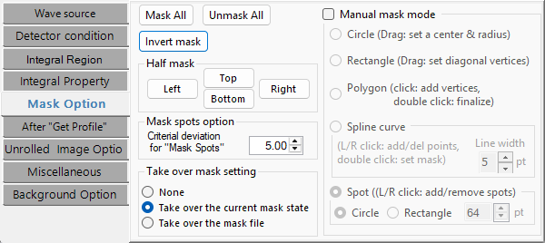
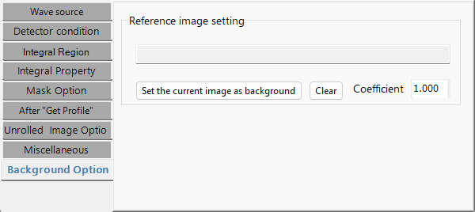

<!-- 261124Cl: Retranslated from en/2-property-windows.md (UI labels follow the localized GUI). -->

# Eigenschaftsfenster

Im Eigenschaftsfenster stellen Sie die Strahlungsquelle, die Detektorbedingungen und die verschiedenen Bedingungen der Eindimensionalisierung ein. Jede Registerkarte lässt sich auch direkt über das Menü **Eigenschaften (Property)** im Hauptfenster öffnen.

Die Beschriftungen unten sind die Anzeigenamen der deutschen Oberfläche; in Klammern steht jeweils der englische Name. Die Überschriften verwenden die tatsächlichen Namen der Registerkarten und Steuerelemente.

## Wellenquelle (Wave source)

Legt die Art des einfallenden Strahls und die Wellenlänge fest. Als Quelle stehen Röntgen-, Elektronen- und Neutronenstrahlung zur Wahl. Bei Röntgenstrahlung wird die Wellenlänge durch Auswahl eines Elements und eines Übergangs (K-Linie, L-Linie usw.) automatisch eingetragen; bei Synchrotronstrahlung geben Sie die Wellenlänge direkt ein. Bei Elektronen- und Neutronenstrahlen geben Sie die Energie oder die Wellenlänge ein (die Elektronenwellenlänge wird relativistisch korrigiert).

- **Lineare Polarisation korrigieren (Correct linear polarization)**: korrigiert eine linear polarisierte Intensität auf das unpolarisierte Äquivalent (für Synchrotrondaten). Die unten stehende Korrekturformel hängt vom Azimut χ und vom Streuwinkel 2θ ab. Ist die χ-Bezugsrichtung (auf der Registerkarte Sonstiges (Miscellaneous) eingestellt) Links/Rechts, wird der Strahl als horizontal polarisiert behandelt; ist sie Oben/Unten, als vertikal polarisiert.

$$
I_\text{corr}(2\theta,\chi) = \frac{I(2\theta,\chi)}{\sin^2\chi + \cos^2\chi\,\cos^2 2\theta} \times \frac{1}{2}\left(1 + \cos^2 2\theta\right)
$$

## Detektorbedingung (Detector condition)

Legt die geometrischen Bedingungen des Detektors fest. Dies entspricht der früheren „IP Condition“, ergänzt um die Auswahl des Koordinatensystems und der Detektorform.

- **Koordinaten (Coordinates)**: **Direktstrahl (Direct spot)** (Bezug auf den Direktstrahl) / **Fuß (Foot)** (Bezug auf den Lotfußpunkt).
- **Detektortyp (Detector type)**: **Flachdetektor (Flat panel)** / **Gandolfi**.
- **Direktstrahlposition (Direct spot position)** und **Kameralänge 1 (Camera Length 1)**: die Position des Direktstrahls (X, Y pix) und der Abstand von der Probe zum Direktstrahl (mm).
- **Fußposition (Foot position)** und **Kameralänge 2 (Camera Length 2)**: im Fuß-Modus die Position des Lotfußpunkts und der Abstand von der Probe zum Lotfußpunkt.
- **Pixelform (Pixel Shape)**: Pixelgröße X, Y (mm) und ξ (Ksi, der Scherwinkel des Parallelogramms).
- **Gandolfi-Radius (Gandolfi Radius)**: der Radius, wenn die Gandolfi-Form gewählt ist.
- **Sphärische Korrektur (Spherical correction)**: Geben Sie für einen gekrümmten Detektor den Kehrwert des Krümmungsradius 1/R (mm⁻¹) ein. Für einen Flachdetektor verwenden Sie 0.
- **Neigung (Tilt)**: die IP-Verkippung φ (Phi) und τ (Tau).

Die Definitionen der Verkippung φ, τ und des Pixelparameters ξ finden Sie im [Überblick](0-overview.md).

## Integralbereich (Integral Region)

Legt den Bildbereich fest, der eindimensionalisiert wird.

- **Rechteck (Rectangle)**: Wählen Sie die **Richtung (Direction)** (Voll / Oben / Unten / Links / Rechts (Full / Top / Bottom / Left / Right) sowie Vertical / Horizontal / Free) und stellen Sie die **Bandbreite (Band Width)**, den **Winkel (Angle)** (im Modus Free) und **Beide Seiten (Both Side)** ein.
- **Sektor (Sector)**: Geben Sie den Winkelbereich mit **Startwinkel (Start Angle)** / **Endwinkel (End Angle)** an.
- **Ausnahmepixel (Exceptional pixels)**: schließt **Maskierte Spots (Masked Spots)**, Pixel **Unter Intensität von (Under intensity of)** / **Über Intensität von (Over intensity of)** den angegebenen Schwellen sowie eine Anzahl **Pixel von den Rändern (pixels from edges)** aus.

## Integraleigenschaft (Integral Property)

Legt Integrationsmethode und Schrittweite fest.

- **Konzentrische Integration (streuwinkeldispersiv) (Concentric integration (scattering-angle dispersive))**: Wählen Sie die Einheit der horizontalen Achse aus **Winkel (Angle)** (2θ, °) / **d-Wert (d-spacing)** (Å) und stellen Sie **Start / Ende / Schritt (Start / End / Step)** ein. Die Auswahl **Ausgabemuster (Output pattern)** (Bragg-Brentano / Debye-Scherrer) wirkt sich in der aktuellen Version nicht auf das Ergebnis aus.
- **Radiale Integration (Cake-Muster) (Radial integration (cake pattern))**: summiert die Intensität eines ringförmigen Bereichs für jeden Azimut. Geben Sie die Ringmitte (**Donut-Radius (Donut radius)**) und die Halbbreite (**Donut-Breite (Donut width)**) als Streuwinkel 2θ (**Winkel (Angle)**) oder d-Wert (**d-Wert (d-spacing)**) an und stellen Sie den **Sektorwinkel-Schritt (Sector angle step)** (azimutale Schrittweite) ein. Die horizontale Achse des erhaltenen Profils ist der Azimut χ (°).

## Maskenoptionen (Mask Option)

Legt die Bedingungen für das Maskieren und die Spot-Erkennung fest (eine Erweiterung des früheren „Find Center & Spots“). Die Einstellungen für die Zentrumserkennung befinden sich auf der Registerkarte Sonstiges (Miscellaneous).

- **Halbmaske (Half mask)**: Schaltflächen, mit denen die obere, untere, linke oder rechte Bildhälfte schnell maskiert wird.
- **Manueller Maskenmodus (Manual mask mode)**: aktiviert das interaktive Maskieren im Hauptbild. Die Formen sind **Kreis (Circle)** (Ziehen setzt Zentrum und Radius), **Polygon** (Klicken fügt Ecken hinzu), **Rechteck (Rectangle)** (Ziehen der Diagonalecken), **Spline-Kurve (Spline curve)** und **Spot** (Links-/Rechtsklick fügt Spots hinzu/entfernt sie).
- **Takeover**: wie die Maske beim Laden eines neuen Bildes behandelt wird (**Keine (None)** / **Aktuellen Maskenzustand übernehmen (Take over the current mask state)** / **Maskendatei übernehmen (Take over the mask file)**).
- **Find Spots** → **Deviation**: die statistische Schwelle für die Spot-Erkennung.

## Nach "Profil abrufen" (After "Get Profile")

Legt das Speichern und Senden nach der Eindimensionalisierung fest.

- **Save File**: Wählen Sie das Ziel („Im selben Verzeichnis wie das Bild“ oder „Jedes Mal im gewählten Verzeichnis“) und das Format aus **PDI** / **CSV** / **TSV** / **GSAS**. Die GSAS-Ausgabe ist nur bei konzentrischer Integration mit 2θ als horizontaler Achse möglich. Sollen mehrere Profile in einer Datei gespeichert werden, wird GSAS nicht geschrieben; speichern Sie sie stattdessen in getrennten Dateien.
- **Send PDIndexer**: sendet das Profil über die Zwischenablage an eine laufende PDIndexer-Instanz.

## Abgewickeltes Bild – Optionen (Unrolled Image Option)

Legt die Parameter für das abgewickelte (Unroll-)Bild fest.

- **Horizontal**: **Start / Ende / Schritt (Start / End / Step)** im Streuwinkel 2θ (°) (Einheitenoptionen werden angezeigt, die aktuelle Version behandelt die Werte jedoch immer als 2θ). Die Breite des Ausgabebildes ≈ (Ende − Start) / Schritt.
- **Vertikal (Vertical)**: die **Anzahl der Unterteilungen (number of divisions)** N im Azimut. Das Ausgabebild ist N Pixel hoch, und jede Zeile deckt 360°/N ab (0,5° beim Standardwert 720).

Beim Abwickeln wird das polare Beugungsbild mit dem Direktstrahl als Zentrum in ein kartesisches Bild (Winkel gegen Abstand) abgebildet.

## Sonstiges (Miscellaneous)

Eine Registerkarte, die feinere Anzeige- und Koordinateneinstellungen zusammenfasst.

- **Image name display**: nur Dateiname / übergeordneter Ordner + Dateiname / vollständiger Pfad.
- **Anzeigebereich beibehalten (Maintain display range)**: ob Zoom und Anzeigeposition (Anzeigebereich) beim Laden eines neuen Bildes übernommen werden.
- **Azimuth χ (Chi) orientation**: die Bezugsposition (Oben / Unten / Links / Rechts (Top / Bottom / Left / Right)) und der Drehsinn (Im Uhrzeigersinn / Gegen den Uhrzeigersinn (Clockwise / Counterclockwise)). χ wird von der Polarisationskorrektur und der radialen Integration verwendet.
- **Maßstabslinie (Scale line)**: Farbe, Breite, Anzahl der Unterteilungen und Anzeige der Beschriftungen.
- **Zentrum finden (Find Center)**: Suchbereich, Peak-Anpassungsbereich, Zentrum fixieren und Ausschluss maskierter Pixel.

## Hintergrundoptionen (Background Option)

Legt die Korrektur mit einem Hintergrundbild fest.

- **Background image**: Legen Sie das aktuell angezeigte Bild als Hintergrund fest (**Aktuelles Bild als Hintergrund festlegen (Set the current image as background)**) oder löschen Sie es (**Leeren (Clear)**).
- **Koeffizient (Coefficient)**: der Faktor, mit dem das Hintergrundbild multipliziert wird.

Dient zum Abzug eines additiven Untergrunds wie der Luftstreuung. Für jedes Pixel wird \(I_\mathrm{out} = I - cB\) berechnet (\(B\): Hintergrundbild, \(c\): Koeffizient). Um Pixel nahe den Bildrändern auszuschließen, verwenden Sie **Pixel von den Rändern (pixels from edges)** auf der Registerkarte Integralbereich (Integral Region).

