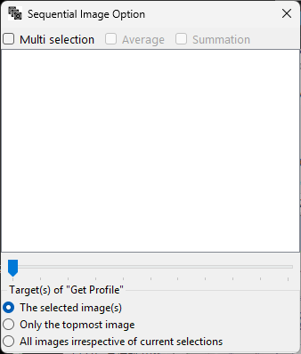

<!-- 261124Cl: Retranslated from en/3-tools.md (UI labels follow the localized GUI). -->

# Werkzeuge

Diese Seite beschreibt die Hilfswerkzeuge, die über die vertikale Symbolleiste rechts im Hauptfenster oder über die Menüs gestartet werden. Konkrete Abläufe mit Parameterkalibrierung und Makros finden Sie unter [Arbeitsabläufe](4-procedures.md).

## R-AXIS-Bild kalibrieren (Calibrate Raxis Image)

Öffnen Sie das Werkzeug mit **Werkzeuge → R-AXIS-Bild kalibrieren (Tool → Calibrate Raxis Image)**. Geben Sie zwei gleich große R-AXIS-IV-Bilder (`.stl`) an; das Werkzeug optimiert eine Intensitätsumrechnungstabelle so, dass die beiden Intensitäten übereinstimmen. Die Tabelle wird durch Stützpunkte dargestellt, und die Summe ihrer Elemente bleibt während der Optimierung konstant. Das Ergebnis wird als Diagramm angezeigt. Es dient beispielsweise zur Kalibrierung des Intensitätsverhaltens eines Detektors.

Der Schaltfläche **Intensitätstabelle (Intensity table)** in der Symbolleiste ist in der aktuellen Version keine Funktion zugewiesen.

## Automatische Prozedur (Auto procedure)

Ein Werkzeug, das einen Ordner überwacht, neue Bilder automatisch lädt und nach dem Laden eine Abfolge von Operationen ausführt.

- **Überwachen und automatisch laden**: überwacht den angegebenen Ordner (einschließlich Unterordnern) und liest eine Datei ein, sobald ihr Schreibvorgang abgeschlossen ist. Dateien lassen sich nach Namen filtern (Nummernabgleich, Stichwort).
- **Automatische Ausführung**: führt die angehakten Schritte aus Auto Contrast → Find Center → Mask Spots → Get Profile → Execute Macro der Reihe nach aus.

So lässt sich beispielsweise während eines Experiments ein Ausgabeordner überwachen und jedes eintreffende Bild automatisch integrieren. Einzelheiten finden Sie unter [Arbeitsabläufe](4-procedures.md).

## Ring zeichnen (Draw Ring)

Zeichnet unter Berücksichtigung der IP-Verkippung und der Pixelverzerrung einen Ring in einem angegebenen Abstand, Winkel oder d-Wert in das Bild. Klicken Sie auf **R (mm)** / **2θ (°)** / **d (Å)**, um den zu bearbeitenden Wert zu wählen; die übrigen Werte werden aus Wellenlänge und Kameralänge automatisch berechnet.

## Abwickeln (Unroll)

Wickelt das Beugungsbild von Polarkoordinaten um den Direktstrahl in kartesische Koordinaten ab (horizontale Achse = Streuwinkel 2θ; vertikale Achse = Azimut). Eingestellt wird dies heute nicht in einem eigenen Fenster, sondern über die Symbolleisten-Schaltfläche **Bild abrollen (Unroll image)** und die Registerkarte **Abgewickeltes Bild – Optionen (Unrolled Image Option)** der Eigenschaften. Das Abwickeln verwendet denselben subpixelgenauen Intensitätsverteilungs-Algorithmus wie die Eindimensionalisierung.

## Umfangsunschärfe (Circumferential Blur)

Ein Werkzeug, das das Ringmuster in Umfangsrichtung (azimutal) weichzeichnet. Geben Sie einen einzelnen Unschärfewinkel an und wenden Sie ihn an.

## Bildsequenz (Sequential Image)

Ein Werkzeug für Multiframe-Bilder (NeXus (`.nxs`), mehrseitige TIFF-Dateien und Ähnliches; Zeitreihen, Temperaturreihen, Energiescans am Synchrotron).

- Wählen Sie in der Frame-Liste einen einzelnen Frame aus, um ihn anzuzeigen, oder blättern Sie mit dem Schieberegler durch die Frames.
- Mit **Mehrfachauswahl (Multi selection)** wählen Sie mehrere Frames aus und berechnen deren **Mittelwert (Average)** oder **Summierung (Summation)**.
- Das Ziel der Eindimensionalisierung lässt sich aus „Alle Bilder unabhängig von der aktuellen Auswahl / Die ausgewählten Bilder / Nur das oberste Bild“ wählen.
- Enthält ein Frame Energieinformationen, wird die Wellenlänge aktualisiert, sobald dieser einzelne Frame ausgewählt wird.

## Bild speichern (Save Image) im IPA-Format

Korrigiert die IP-Verkippung φ, τ und die Pixelverzerrung ξ und speichert das Bild mit quadratischen Pixeln in einer angegebenen Auflösung. Metadaten wie Kameralänge, Wellenlänge und Zentrumsposition werden ebenfalls geschrieben, sodass das Bild unter Erhalt der geometrischen Informationen an andere Bildverarbeitungen übergeben werden kann.

## Parameter finden (geometrisch)

**Parameter finden (geometrisch) (Find parameter (geometrically))** ist ein Werkzeug, das Wellenlänge, Kameralänge, Pixelgröße, Pixelverzerrung und Verkippung (φ, τ) anhand der Beugungsringe eines Standardmaterials optimiert. Es verwendet ein Bild einer Standardprobe (Primär, Primary) oder zwei bei unterschiedlichen Kameralängen aufgenommene Bilder (Primär und Sekundär, Primary und Secondary); Sie wählen Peaks aus und optimieren mit **Verfeinern! (Refine!)**. Die Konvergenz (Ellipsenzentrum, Residuen) lässt sich in den Diagrammen prüfen. Die konkreten Schritte finden Sie unter [Arbeitsabläufe](4-procedures.md).

## Parameter finden (Brute Force)

**Parameter finden (Brute Force) (Find parameter (brute force))** ist ein Werkzeug, das Kameralänge, Zentrumsposition, Verkippung (φ, τ) und optional die Wellenlänge (standardmäßig aus) nicht mit einem Gradientenverfahren, sondern durch eine erschöpfende Rastersuche bestimmt. Es verwendet das im Hauptfenster geladene einzelne Bild einer Standardprobe. Es ist wirksam, wenn die geometrische Optimierung schlecht konvergiert, etwa bei unvollständigen Ringen oder verrauschten Daten. Wählen Sie den Standard aus Au / CeO₂ / LaB₆ / Al₂O₃ oder wählen Sie **Andere (Other)** und geben Sie den Kristall ein. Ausführliche Schritte finden Sie unter [Parameter finden (Brute Force)](6-find-parameter.md), den Ablauf unter [Arbeitsabläufe](4-procedures.md).

## Makro

Eine Funktion, die Operationen mit Python-ähnlichen Skripten automatisiert. Öffnen Sie den Makro-Editor im Hauptfenster über das Menü **Makro → Editor (Macro → Editor)**.

- `for` / `if` / `while` / `def` / `class`, Arithmetik und das Modul `math` stehen zur Verfügung.
- Über APIs wie `IPA.File` / `IPA.Wave` / `IPA.Detector` / `IPA.Profile` / `IPA.Sequential` / `IPA.Image` / `IPA.Mask` / `IPA.PDI` / `IPA.IntegralProperty` lassen sich die einzelnen Operationen aufrufen.
- Schalten Sie **Beispiele anzeigen (Show samples)** ein, um die schreibgeschützten Beispielmakros anzuzeigen (einfache Schleifen, Geometrieeinstellung, Stapelverarbeitung, azimutale Unterteilung, Maskieren, Senden an PDIndexer usw.). Mit der schrittweisen Ausführung lassen sich Variablen untersuchen.

Die vollständige Funktionsreferenz und Beispiele finden Sie unter [Makro](5-macro/index.md), makrobasierte Abläufe unter [Arbeitsabläufe](4-procedures.md).

