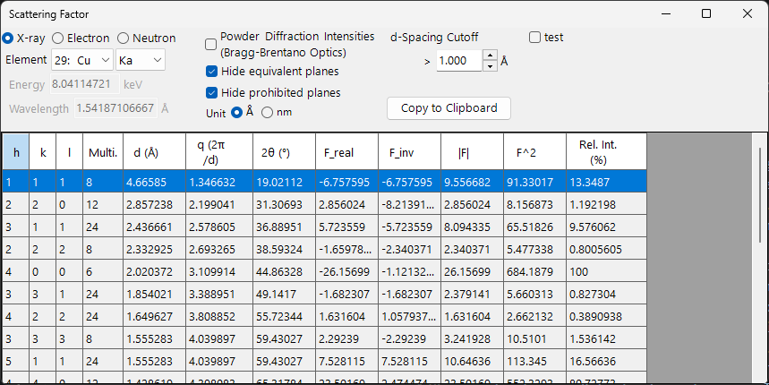

<!-- 261124Cl: Retranslated from en/appendix/a5-scattering-factor.md (UI labels follow the localized GUI). -->

# Anhang A5. Streufaktor

**Scattering Factor** listet die erlaubten Kristallebenen (Reflexe) des ausgewählten Kristalls und berechnet für jede den **Strukturfaktor** und die Beugungsintensität. Die Strahlungsart (Röntgen, Elektronen oder Neutronen) lässt sich umschalten, sodass die Strukturfaktoren desselben Kristalls zwischen verschiedenen Beugungsverfahren verglichen werden können.

In der aktuellen Version befindet sich diese Liste auf der Registerkarte **Reflexe (Reflections)** von **Strahlwechselwirkung (Beam interaction)** im Kristallfenster (die Atomformfaktoren selbst stehen auf der Registerkarte **Streufaktoren (Scattering factors)** desselben Fensters). Die unten beschriebenen Bildschirme und Einträge beruhen auf dem früheren Fenster Scattering Factor.

In IPAnalyzer wird dieses Unterfenster aus dem **Kristallfenster** geöffnet (dem CrystalControl, das in [4. Arbeitsabläufe](../4-procedures.md) für die geometrische Kalibrierung und in [6. Parameter finden (Brute Force)](../6-find-parameter.md) verwendet wird).

Die Berechnungsbedingungen befinden sich oben im Fenster, die Reflexliste unten. Die Liste wird sofort neu berechnet, sobald sich eine Bedingung ändert.

---

## Tastatur- und Maus-Kurzbefehle

Dieses Fenster hat keine besonderen Tasten- oder Mauskombinationen. <kbd>F1</kbd> öffnet diese Handbuchseite, und **Copy to clipboard** exportiert die gesamte Reflextabelle als Text, der sich in eine Tabellenkalkulation einfügen lässt.

---

## Wave Length Control

- **X-ray / Electron / Neutron**: Die Atomformfaktoren unterscheiden sich je nach Art des einfallenden Strahls und werden daher hier umgeschaltet.
- Bei **X-ray** wird durch Auswahl des **Element** (Anodenmaterial) und der charakteristischen Linie (Kα usw.) die Wellenlänge dieser charakteristischen Röntgenstrahlung automatisch eingestellt.

- **Energy (keV)** und **Wavelength (Å)** sind miteinander gekoppelt.
- Diese Energie bzw. Wellenlänge wird zur Berechnung von 2θ (Beugungswinkel) verwendet. Bei Röntgenstrahlung lässt sie sich auch über die Auswahl von Element und Linienart einstellen.

---

## Anzeige- und Berechnungsoptionen

- **Pulverbeugungsintensitäten (Bragg-Brentano-Optik) (Powder Diffraction Intensities (Bragg-Brentano Optics))**: berechnet die relative Intensität als Pulverbeugungsintensität (Bragg–Brentano) einschließlich Zähligkeit und Lorentz-Polarisationsfaktor. Ist die Option aus, wird die Strukturfaktorintensität angezeigt.
- **Äquivalente Ebenen ausblenden (Hide equivalent planes)**: fasst kristallographisch äquivalente Ebenen zu einem einzigen Eintrag zusammen.
- **Verbotene Ebenen ausblenden (Hide prohibited planes)**: schließt Ebenen aus, deren Intensität nach den Auslöschungsregeln null ist.
- **Unit (Å / nm)**: schaltet die Längeneinheit für d-Werte usw. um.
- **d-Spacing Cutoff**: schließt Reflexe mit einem d-Wert kleiner als dieser Wert aus.

---

## Reflexliste

Jede Zeile entspricht einem Reflex (bzw. einer Gruppe symmetrieäquivalenter Ebenen).

| Spalte | Bedeutung |
|------|------|
| **h, k, l** | Millersche Indizes |
| **Multi.** | Zähligkeit (Anzahl symmetrieäquivalenter Ebenen) |
| **d (Å)** | Netzebenenabstand |
| **q (2π/d)** | Betrag des Streuvektors |
| **2θ (°)** | Beugungswinkel für die gewählte Wellenlänge |
| **F_real** | Realteil des Strukturfaktors |
| **F_inv** | Imaginärteil des Strukturfaktors |
| **\|F\|** | Strukturfaktor-Amplitude ($= \sqrt{F_\text{real}^2 + F_\text{inv}^2}$) |
| **F^2** | Strukturfaktor-Intensität ($\lvert F\rvert^2$) |
| **Rel. Int. (%)** | relative Intensität, wobei der stärkste Reflex auf 100 gesetzt ist |

---

## Copy to Clipboard

**Copy to Clipboard** kopiert die Liste als Text in die Zwischenablage, der sich in eine Tabellenkalkulation wie Excel einfügen lässt.

---

## Siehe auch

- [Startseite des Anhangs](index.md)
- [4. Arbeitsabläufe](../4-procedures.md) — Definition des Standardkristalls, dessen Strukturfaktoren berechnet werden.
- [6. Parameter finden (Brute Force)](../6-find-parameter.md)
