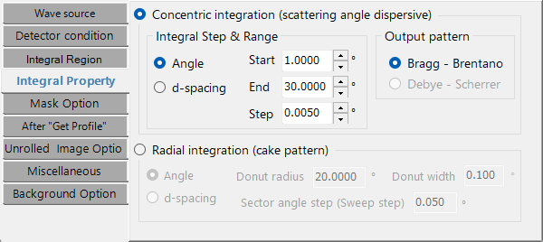

<!-- 260601Cl: Reflected from ja/2-property-windows.md (lead language: Japanese). 260601Cl: per-tab auto-capture images embedded. -->
<!-- 261124Cl: Corrected the spherical-correction unit, axis choices, Output pattern, radial/unroll inputs, GSAS conditions and background subtraction to match the implementation. Renamed the control labels to the actual English GUI (Save Profiles, Take over mask setting, Image name options, Chi (χ) axis options, Scale line options, Find center options, Reference image setting, the unroll group boxes, etc.), set the spherical-correction unit to the on-screen m⁻¹, and replaced "one-dimensionalization" with "integration". -->

# Property Windows

The property window is where you configure the source, the detector conditions, and the various conditions for integrating the image into a 1D profile. Each tab can also be opened directly from the **Property** menu in the main window.

The labels below are those shown in the English interface. The headings use the actual tab and control names.

## Wave source

Sets the type of incident beam and the wavelength. The source can be X-ray, electron, or neutron. For X-rays, selecting an element and a transition (K line, L line, etc.) fills in the wavelength automatically; for synchrotron radiation, enter the wavelength directly. For electron and neutron beams, enter the energy or the wavelength (the electron wavelength is relativistically corrected).

- **Correct linear polarization (i.e., linear polarized → unpolarized)**: corrects a linearly-polarized intensity to the unpolarized equivalent (for synchrotron data). The correction formula below depends on the azimuth χ and the scattering angle 2θ. If the χ reference direction (set on the Miscellaneous tab) is Left/Right the beam is treated as horizontally polarized; if it is Top/Bottom, as vertically polarized.

$$
I_\text{corr}(2\theta,\chi) = \frac{I(2\theta,\chi)}{\sin^2\chi + \cos^2\chi\,\cos^2 2\theta} \times \frac{1}{2}\left(1 + \cos^2 2\theta\right)
$$

## Detector condition

Sets the geometric conditions of the detector. This corresponds to the legacy "IP Condition", with the addition of coordinate-system and detector-shape selectors.

- **Coordinates**: **Direct spot** (direct-spot reference) / **Foot** (foot-of-perpendicular reference).
- **Detector type**: **Flat panel** / **Gandolfi**.
- **Direct spot position** and **Camera Length 1**: the direct-spot position (X, Y pix) and the distance from the sample to the direct spot (mm).
- **Foot position** and **Camera Length 2**: in Foot mode, the position of the foot of the perpendicular and the distance from the sample to the foot.
- **Pixel Shape**: pixel size X, Y (mm) and ξ (Ksi, the parallelogram skew angle).
- **Gandolfi Radius**: the radius, when the Gandolfi shape is selected.
- **Spherical correction**: for a curved detector, enter the inverse of the radius of curvature, 1/R, in m⁻¹ (the unit shown on screen is /m). Use 0 for a flat detector.
- **Tilt**: the IP tilt φ (Phi) and τ (Tau).

See [Overview](0-overview.md) for the definitions of the tilt φ, τ and the pixel ξ.

## Integral Region

Specifies the image region to be integrated.

- **Rectangle**: choose the **Direction** (Full / Top / Bottom / Left / Right / Vertical / Horizontal / Free), and set the **Band Width**, the **Angle** (in Free mode), and **Both Side**.
- **Sector**: specify the angular range with **Start Angle** / **End Angle**.
- **Exceptional pixels**: exclude **Masked Spots**, pixels **Under intensity of** / **Over intensity of** the given thresholds, and a number of **pixels from edges**. The threshold masks are recalculated from the corrected intensities whenever the intensities change: when another frame of a sequential image is selected, after flip/rotate, and when the background subtraction or the polarization correction is changed.

## Integral Property

Sets the integration method and step.

- **Concentric integration (scattering angle dispersive)**: choose the horizontal-axis unit from **Angle** (2θ, °) / **d-spacing** (Å), and set **Start / End / Step**. The **Output pattern** choice (Bragg - Brentano / Debye - Scherrer) has no effect on the result in the current version.
- **Radial integration (cake pattern)**: sums the intensity of a ring-shaped region for each azimuth. Specify the ring center (**Donut radius**) and half-width (**Donut width**) as scattering angle 2θ (**Angle**) or d-spacing (**d-spacing**), and set the **Sector angle step (Sweep step)** (azimuthal step). The horizontal axis of the resulting profile is the azimuth χ (°).

## Mask Option

Sets the conditions for masking and spot detection (an expansion of the legacy "Find Center & Spots"). The center-detection settings are on the Miscellaneous tab.

- **Half mask**: buttons that quickly mask the top, bottom, left, or right half of the image.
- **Manual mask mode**: enables interactive masking on the main image. The shapes are **Circle** (drag to set center and radius), **Polygon** (click to add vertices), **Rectangle** (drag diagonal vertices), **Spline curve**, and **Spot** (left/right click to add/remove spots).
- **Take over mask setting**: how the mask is treated when a new image is loaded (**None** / **Take over the current mask state** / **Take over the mask file**).
- **Mask spots option** → **Criterial deviation for "Mask Spots"**: the statistical threshold for spot detection (how many standard deviations above the mean a pixel must be to count as a spot).

## After "Get Profile"

Sets saving and sending after integration.

- **Save Profiles**: choose the destination under **Directory to be saved** (**At the same directory of the image** / **At the chosen directory each time**) and the format under **File format** (**PDI** / **CSV** / **TSV** / **GSAS**). GSAS output is possible only for concentric integration with a 2θ horizontal axis. Under **Saving option** (for sequential images or azimuthal division), **In one file (Excluding GSAS)** does not write GSAS; choose **In separate files** instead.
- **Send profile data to PDIndexer through Clipboard**: sends the profile, via the clipboard, to a running instance of PDIndexer.

## Unrolled Image Option

Sets the parameters for the unrolled (Unroll) image.

- **Horizontal (distance from direct spot) unit and range**: **Start / End / Step** in scattering angle 2θ (°) (unit options are displayed, but the current version always treats the values as 2θ). The output image width ≈ (End − Start) / Step.
- **Vertical (sector angle) step**: the number of divisions N in azimuth. The output image is N pixels high, and each row covers 360°/N (0.5° for the default 720).

Unrolling maps the polar diffraction image centered on the direct spot into a Cartesian (angle vs. distance) image.

## Miscellaneous

A tab that collects the finer display and coordinate settings.

- **Image name options**: **File name** / **Last folder + file name** / **Full path**.
- **Image loading options** → **Maintain display range**: whether the zoom and display position (display range) carry over when a new image is loaded.
- **Chi (χ) axis options**: the reference position (Top / Bottom / Left / Right) and the rotation sense (Clockwise / Counterclockwise). χ is referenced by the polarization correction and the radial integration.
- **Scale line options**: colors (**2θ scale line** / **Azimuth scale line**), **Line Width**, **Division**, and **Show labels**.
- **Find center options**: **Search area ±**, **Peak fitting range (2θ)**, **Fix Center**, and **Exclude masked pixels**.

## Background Option

Sets correction by a background image.

- **Reference image setting**: set the currently displayed image as the background (**Set the current image as background**), or clear it (**Clear**).
- **Coefficient**: the factor applied to the background image.

Used to subtract an additive background such as air scattering. For each pixel, \(I_\mathrm{out} = I - cB\) is computed (\(B\): background image, \(c\): coefficient). To exclude pixels near the image edges, use **pixels from edges** on the Integral Region tab.

