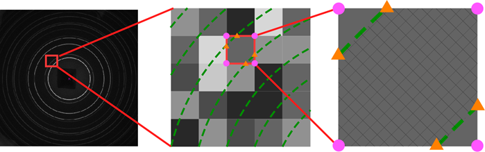

<!-- 260602Cl: Reflected from ja/appendix/a3-image-integration.md (lead language: Japanese). -->
<!-- 261124Cl: Split the table into the horizontal axis of the output and the pixels combined into one point, and added the normalization after integration (checked against Ring.GetConcenrticProfile / GetProfileThreadWithTiltCorrectionNew / GetUnrolledImageArray / GetRadialProfile). -->

# Appendix A3. Image integration

When converting a 2D image into a 1D profile, the biggest problem is **how to distribute the intensity of a pixel that straddles several steps when the angular step size of the integration is smaller than the pixel spacing (pixel size)**. IPAnalyzer handles this distribution with an **area-based distribution method**.

---

## Area-based distribution method

In this software, the program computes the intersections between the lines that delimit each step (the boundaries of equal diffraction angle) and the pixels, obtains the **area** of each pixel that falls within a given step, and distributes the intensity in proportion to that area.

{width=680px}

This method has the following characteristics.

- Inside each pixel, the arc of the step boundary is **approximated as a straight line**. This is done for computational speed and is almost never a problem in practice.
- When the tilt correction and pixel-shape correction in [A1. Detector geometry](a1-geometry.md) are required, the pixel shape is not strictly square. The software therefore **computes the coordinates of the four corners of the pixel sequentially** and obtains the area as a quadrilateral (in general, a parallelogram).

With this scheme, in principle, no matter how fine the angular step is made, the pixel intensity is distributed smoothly across the steps.

---

## Scope of application

The same area-based distribution algorithm is used for all three of the following types of integration. They differ in which coordinate remains on the horizontal axis of the output, and in which pixels are combined into one output point.

| Function | Horizontal axis of the output | Pixels combined into one output point | Use |
|------|------|------|------|
| **Concentric integration** | Diffraction angle $2\theta$ (or d-spacing) | Those within one step of $2\theta$ (or d), over all azimuths inside the integration region | Creating an ordinary $2\theta$-intensity profile. |
| **Radial integration** | Azimuth $\chi$ | Those within one azimuthal step (**Sector angle step (Sweep step)**), inside the ring given by **Donut radius** ± **Donut width** | Evaluating the azimuthal dependence of a ring (orientation, distortion). |
| **Unrolled image** | $2\theta$ (horizontal) × azimuth $\chi$ (vertical) | Those within one $2\theta$ step and one azimuthal sector ($360^\circ/N$) | Creating a 2D unrolled image with the ring cut open. |

In every case only valid pixels are used: masked pixels and pixels excluded on the **Integral Region** tab do not contribute.

---

## Normalization after integration

The distributed intensities are normalized differently depending on the function.

- **Concentric integration** (flat-panel detector, $2\theta$ or d-spacing axis) and the **unrolled image**: for each step (each pixel of the unrolled image), the distributed intensities are summed, and the sum is divided by the amount that contributed to that step. The contribution of each part of a pixel is measured by its area projected onto the plane perpendicular to the scattered ray at the camera-length distance, that is, by the solid angle it subtends, counted in units of one pixel seen face-on at the camera length. The result is therefore an average intensity per unit solid angle: it does not depend on the step width or on how many pixels fall into a step, and the decrease of the solid angle per pixel toward high angles on a flat detector is compensated. A step that receives no pixel is 0.
- **Radial integration**: the distributed intensities are simply summed for each azimuthal step and are not divided. The values therefore grow with the ring width (**Donut width**) and the azimuthal step.

For how to operate each function, see [3. Tools](../3-tools.md).
