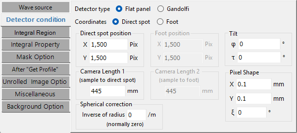

<!-- 261124Cl: Retranslated from en/2-property-windows.md (UI labels follow the localized GUI). (2nd update: synced with en changes) -->

# Ventanas de propiedades

La ventana de propiedades es donde se configuran la fuente, las condiciones del detector y las distintas condiciones para integrar la imagen en un perfil 1D. Cada pestaña también se puede abrir directamente desde el menú **Propiedad (Property)** de la ventana principal.

Las etiquetas siguientes son las que muestra la interfaz en español; entre paréntesis se indica el nombre en inglés. Los títulos usan los nombres reales de las pestañas y los controles.

## Fuente de ondas (Wave source)

Define el tipo de haz incidente y la longitud de onda. La fuente puede ser de rayos X, electrones o neutrones. Para rayos X, al seleccionar un elemento y una transición (línea K, línea L, etc.) la longitud de onda se rellena automáticamente; para radiación sincrotrón, introduce directamente la longitud de onda. Para haces de electrones y de neutrones, introduce la energía o la longitud de onda (la longitud de onda de los electrones incluye la corrección relativista).

- **Corregir polarización lineal (es decir, polarizado lineal → no polarizado) (Correct linear polarization (i.e., linear polarized → unpolarized))**: corrige una intensidad con polarización lineal a su equivalente no polarizado (para datos de sincrotrón). La fórmula de corrección siguiente depende del azimut χ y del ángulo de dispersión 2θ. Si la dirección de referencia de χ (definida en la pestaña Varios (Miscellaneous)) es Izquierda/Derecha (Left/Right), el haz se trata como polarizado horizontalmente; si es Superior/Inferior (Top/Bottom), como polarizado verticalmente.

$$
I_\text{corr}(2\theta,\chi) = \frac{I(2\theta,\chi)}{\sin^2\chi + \cos^2\chi\,\cos^2 2\theta} \times \frac{1}{2}\left(1 + \cos^2 2\theta\right)
$$

## Condición del detector (Detector condition)

Define las condiciones geométricas del detector. Corresponde a la antigua "IP Condition", con el añadido de selectores del sistema de coordenadas y de la forma del detector.

- **Coordenadas (Coordinates)**: **Punto directo (Direct spot)** (referencia en el punto directo) / **Pie (Foot)** (referencia en el pie de la perpendicular).
- **Tipo de detector (Detector type)**: **Panel plano (Flat panel)** / **Gandolfi**.
- **Posición del punto directo (Direct spot position)** y **Longitud de cámara 1 (Camera Length 1)**: la posición del punto directo (X, Y pix) y la distancia de la muestra al punto directo (mm).
- **Posición del pie (Foot position)** y **Longitud de cámara 2 (Camera Length 2)**: en el modo Pie (Foot), la posición del pie de la perpendicular y la distancia de la muestra al pie.
- **Forma del píxel (Pixel Shape)**: tamaño de píxel X, Y (mm) y ξ (Ksi, el ángulo de sesgo del paralelogramo).
- **Radio de Gandolfi (Gandolfi Radius)**: el radio, cuando se selecciona la forma Gandolfi.
- **Corrección esférica (Spherical correction)**: para un detector curvo, introduce el inverso del radio de curvatura, 1/R, en m⁻¹ (la unidad que se muestra en pantalla es /m). Usa 0 para un detector plano.
- **Inclinación (Tilt)**: la inclinación de la IP φ (Phi) y τ (Tau).

Véase [Visión general](0-overview.md) para las definiciones de la inclinación φ, τ y del ξ del píxel.

## Región de integración (Integral Region)

Especifica la región de la imagen que se integra.

- **Rectángulo (Rectangle)**: elige la **Dirección (Direction)** (Completo / Superior / Inferior / Izquierda / Derecha / Vertical / Horizontal / Free; en inglés Full / Top / Bottom / Left / Right / Vertical / Horizontal / Free) y define el **Ancho de banda (Band Width)**, el **Ángulo (Angle)** (en el modo Free) y **Ambos lados (Both Side)**.
- **Sector**: especifica el intervalo angular con **Ángulo inicial (Start Angle)** / **Ángulo final (End Angle)**.
- **Píxeles excepcionales (Exceptional pixels)**: excluye los **Puntos enmascarados (Masked Spots)**, los píxeles **Por debajo de la intensidad de (Under intensity of)** / **Por encima de la intensidad de (Over intensity of)** los umbrales indicados y un número de **píxeles desde los bordes (pixels from edges)**. Las máscaras por umbral se recalculan a partir de las intensidades corregidas cada vez que las intensidades cambian: al seleccionar otro fotograma de una imagen secuencial, tras voltear/rotar y al cambiar la resta del fondo o la corrección de polarización.

## Propiedad de integración (Integral Property)

Define el método y el paso de integración.

- **Integración concéntrica (dispersiva en ángulo de dispersión) (Concentric integration (scattering angle dispersive))**: elige la unidad del eje horizontal entre **Ángulo (Angle)** (2θ, °) / **d-espaciado (d-spacing)** (Å) y define **Inicio / Fin / Paso (Start / End / Step)**. La opción **Patrón de salida (Output pattern)** (Bragg - Brentano / Debye - Scherrer) no influye en el resultado en la versión actual.
- **Integración radial (patrón de pastel) (Radial integration (cake pattern))**: suma la intensidad de una región en forma de anillo para cada azimut. Especifica el centro del anillo (**Radio del anillo (Donut radius)**) y su semianchura (**Anchura del anillo (Donut width)**) como ángulo de dispersión 2θ (**Ángulo (Angle)**) o espaciado d (**d-espaciado (d-spacing)**), y define el **Paso del ángulo de sector (paso de barrido) (Sector angle step (Sweep step))** (paso azimutal). El eje horizontal del perfil resultante es el azimut χ (°).

## Opciones de máscara (Mask Option)

Define las condiciones de enmascaramiento y de detección de puntos (una ampliación de la antigua "Find Center & Spots"). La configuración de la detección del centro está en la pestaña Varios (Miscellaneous).

- **Media máscara (Half mask)**: botones que enmascaran rápidamente la mitad superior, inferior, izquierda o derecha de la imagen.
- **Modo de máscara manual (Manual mask mode)**: habilita el enmascaramiento interactivo sobre la imagen principal. Las formas son **Círculo (Circle)** (arrastrar para definir el centro y el radio), **Polígono (Polygon)** (clic para añadir vértices), **Rectángulo (Rectangle)** (arrastrar los vértices diagonales), **Curva spline (Spline curve)** y **Punto (Spot)** (clic izquierdo/derecho para añadir/quitar puntos).
- **Heredar configuración de máscara (Take over mask setting)**: cómo se trata la máscara cuando se carga una imagen nueva (**Ninguno (None)** / **Heredar el estado de máscara actual (Take over the current mask state)** / **Heredar el archivo de máscara (Take over the mask file)**).
- **Opciones de enmascarar puntos (Mask spots option)** → **Desviación de criterio para "Enmascarar puntos" (Criterial deviation for "Mask Spots")**: el umbral estadístico para la detección de puntos (cuántas desviaciones estándar por encima de la media debe estar un píxel para considerarse un punto).

## Después de "Obtener perfil" (After "Get Profile")

Define el guardado y el envío después de la integración.

- **Guardar perfil (Save Profiles)**: elige el destino en **Directorio de guardado (Directory to be saved)** (**En el mismo directorio de la imagen (At the same directory of the image)** / **En el directorio elegido cada vez (At the chosen directory each time)**) y el formato en **Formato de archivo (File format)** (**PDI** / **CSV** / **TSV** / **GSAS**). La salida GSAS solo es posible para la integración concéntrica con eje horizontal en 2θ. En **Opciones de guardado para imagen secuencial o división azimutal (Saving option)**, **En un solo archivo (excepto GSAS) (In one file (Excluding GSAS))** no escribe GSAS; en ese caso, elige **En archivos separados (In separate files)**.
- **Enviar datos de perfil a PDIndexer mediante el portapapeles (Send profile data to PDIndexer through Clipboard)**: envía el perfil, a través del portapapeles, a una instancia de PDIndexer en ejecución.

## Opciones de imagen desplegada (Unrolled Image Option)

Define los parámetros de la imagen desplegada (Unroll).

- **Unidad e intervalo horizontal (distancia desde el punto directo) (Horizontal (distance from direct spot) unit and range)**: **Inicio / Fin / Paso (Start / End / Step)** en ángulo de dispersión 2θ (°) (se muestran opciones de unidad, pero la versión actual siempre trata los valores como 2θ). La anchura de la imagen de salida ≈ (Fin − Inicio) / Paso.
- **Paso vertical (ángulo de sector) (Vertical (sector angle) step)**: el número de divisiones N en azimut. La imagen de salida tiene N píxeles de altura, y cada fila abarca 360°/N (0,5° con el valor predeterminado 720).

El despliegue transforma la imagen de difracción polar centrada en el punto directo en una imagen cartesiana (ángulo frente a distancia).

## Varios (Miscellaneous)

Una pestaña que reúne los ajustes más finos de visualización y de coordenadas.

- **Opciones de nombre de imagen (Image name options)**: **Nombre de archivo (File name)** / **Última carpeta + nombre de archivo (Last folder + file name)** / **Ruta completa (Full path)**.
- **Opciones de carga de imagen (Image loading options)** → **Mantener intervalo de visualización (Maintain display range)**: si el zoom y la posición de visualización (intervalo de visualización) se conservan al cargar una imagen nueva.
- **Opciones del eje chi (χ) (Chi (χ) axis options)**: la posición de referencia (Superior / Inferior / Izquierda / Derecha (Top / Bottom / Left / Right)) y el sentido de rotación (Sentido horario / Sentido antihorario (Clockwise / Counterclockwise)). χ se utiliza en la corrección de polarización y en la integración radial.
- **Opciones de línea de escala (Scale line options)**: colores (**2θ scale line** / **Azimuth scale line**), **Anchura de línea (Line Width)**, **División (Division)** y **Mostrar etiquetas (Show labels)**.
- **Opciones de búsqueda de centro (Find center options)**: **Search area ±**, **Peak fitting range (2θ)**, **Fijar centro (Fix Center)** y **Excluir píxeles enmascarados (Exclude masked pixels)**.

## Opciones de fondo (Background Option)

Define la corrección mediante una imagen de fondo.

- **Configuración de imagen de referencia (Reference image setting)**: define la imagen mostrada actualmente como fondo (**Definir la imagen actual como fondo (Set the current image as background)**) o bórrala (**Borrar (Clear)**).
- **Coeficiente (Coefficient)**: el factor aplicado a la imagen de fondo.

Se usa para restar un fondo aditivo, como la dispersión del aire. Para cada píxel se calcula \(I_\mathrm{out} = I - cB\) (\(B\): imagen de fondo, \(c\): coeficiente). Para excluir los píxeles cercanos a los bordes de la imagen, usa **píxeles desde los bordes (pixels from edges)** en la pestaña Región de integración (Integral Region).

