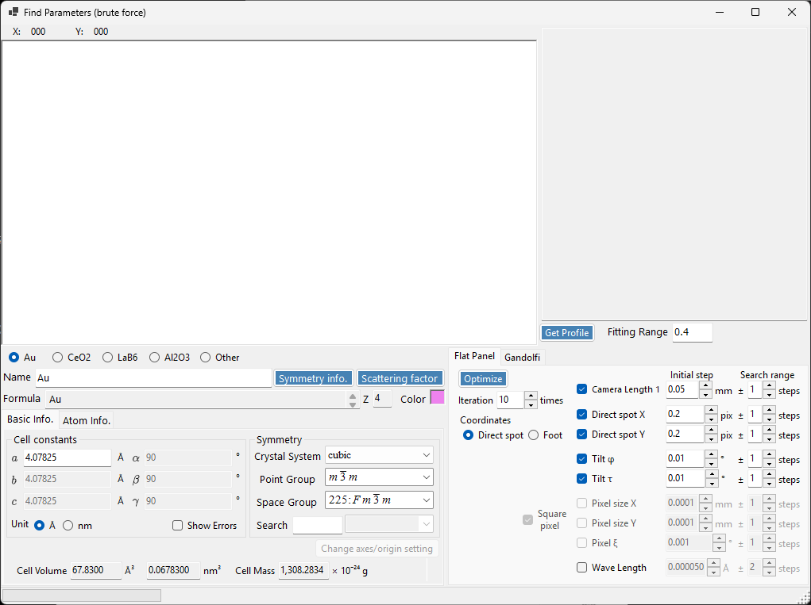

<!-- 261124Cl: Retranslated from en/6-find-parameter.md (UI labels follow the localized GUI). (2nd update: synced with en changes) -->

# Buscar parámetros (fuerza bruta)

El modo de fuerza bruta varía exhaustivamente cada parámetro (una búsqueda en cuadrícula) para encontrar los valores que mejor cumplen:

- desviaciones pequeñas (en 2θ) entre las posiciones de pico calculadas y las obtenidas por ajuste, y
- picos altos (agudos).

Es eficaz con anillos incompletos o datos ruidosos, en los que la optimización geométrica tiene dificultades para converger. Véase [Herramientas](3-tools.md) para una visión general de la herramienta y [Procedimientos](4-procedures.md) para el flujo básico.

## Pasos

1. Carga los datos de imagen y los parámetros y, a continuación, haz clic en **Buscar parámetro (fuerza bruta) (Find parameter (brute force))**.

    
    

2. Selecciona el **material de referencia**. Si no está en la lista, elige **Otro (Other)** e introdúcelo manualmente.
3. Muestra el perfil con **Obtener perfil (Get Profile)**.
4. Haz doble clic en cualquier línea de pico que no quieras usar en la optimización para excluirla.
5. Configura las opciones y pulsa **Optimizar (Optimize)** para iniciar la optimización.

## Opciones

### Fitting Range

Especifica el intervalo angular que se ajusta para cada pico.

### Iteración (Iteration)

Especifica el número de ciclos de optimización.

### Opciones por parámetro

La optimización se realiza sobre los elementos marcados. Cada parámetro se mueve en el intervalo especificado (**Intervalo de búsqueda (Search range)**) con el paso especificado (**Paso inicial (Initial step)**).

Por ejemplo, si la longitud de cámara parte de 100 mm con un Paso inicial de 0,05 mm y un Intervalo de búsqueda de 4, se prueban 9 (= Intervalo de búsqueda × 2 + 1) longitudes de cámara: 99.80, 99.85, 99.90, 99.95, 100.00, 100.05, 100.10, 100.15, 100.20 mm.

Cuando los números de pruebas de los parámetros son N1, N2, N3, …, el número total de pruebas por ciclo es N1 × N2 × N3 × …. En el ejemplo anterior, con cuatro parámetros con Intervalos de búsqueda de 4, 4, 3 y 6, resulta (4×2+1) × (4×2+1) × (3×2+1) × (6×2+1) = 7371 pruebas. Es decir, se prueban 7371 conjuntos de parámetros y se elige la combinación con el menor valor de evaluación R (véase más abajo).

!!! warning
    Aumentar **Intervalo de búsqueda (Search range)** incrementa bruscamente el número de pruebas y alarga cada ciclo. Úsalo con cuidado.

## Pantalla de estado

Durante la calibración se muestra una pantalla de estado como la anterior.

- **Cycle**: el número del ciclo actual. Al terminar un ciclo, el mejor conjunto de parámetros encontrado en él pasa a ser el punto de partida del ciclo siguiente. Si los mejores parámetros son idénticos a los del inicio del ciclo, el paso se reduce al siguiente valor menor de la serie predefinida (1, 1.3, 1.8, 2.4, 3.2, 4.2, 5.6, 7.5 × 10ⁿ) para el ciclo siguiente (p. ej., 0,05 mm → 0,042 mm).
- **Current best values**: los mejores parámetros en ese momento.
- **Current steps**: el paso de cada parámetro en ese momento.
- **No1, No2, …**: los 4 mejores valores de evaluación desde el inicio de la búsqueda (se muestran cuando se han reunido al menos cinco valores distintos). Bajan rápidamente al principio y convergen a medida que se acerca el óptimo.

## Valor de evaluación R

El valor de evaluación R se calcula como sigue.

Aquí \(2\theta_{\mathrm{calc},i}\) es la posición del pico \(i\) calculada a partir de los parámetros actuales, \(2\theta_{\mathrm{fit},i}\) la posición obtenida ajustando el perfil (ambas en grados), *H* la altura del pico tras restar el fondo y *W* el peso (100; este ajuste no se muestra en pantalla en la versión actual). Para un detector plano, la fórmula es:

$$
R = 1000\left[\sum_i \left(2\theta_{\mathrm{calc},i} - 2\theta_{\mathrm{fit},i}\right)^2 + \frac{W}{\sum_i H_i}\right]
$$

R disminuye a medida que las desviaciones de posición se hacen menores y los picos se hacen más altos (más agudos). La propia FWHM no se usa en la evaluación.
