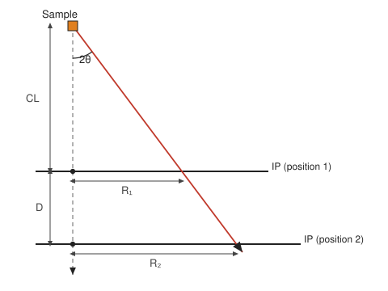

<!-- 261124Cl: Retranslated from en/appendix/a2-calibration.md (UI labels follow the localized GUI). -->

# Apéndice A2. Determinación de parámetros

Como la posición de cada píxel depende de la geometría de [A1. Geometría del detector](a1-geometry.md), usar parámetros incorrectos significa leer las intensidades en posiciones equivocadas. Esta página explica cómo determinar los parámetros verdaderos — longitud de cámara, longitud de onda, tamaño de píxel e inclinación de la IP — a partir de los anillos de difracción de un **material de referencia**. Para las operaciones reales, véanse [4. Procedimientos](../4-procedures.md) y [6. Buscar parámetros (fuerza bruta)](../6-find-parameter.md).

---

## Material de referencia

Para la calibración se mide un material de referencia cuyas constantes de red se conocen. Las condiciones deseables son **muchos anillos de difracción** con una **relación S/N alta**, situados de forma **espaciada** y **sin orientación preferente**. Salvo que tengas una preferencia concreta, se recomienda un cristal cúbico que contenga átomos pesados, como $\mathrm{CeO_2}$ o $\mathrm{Ag}$. Las constantes de red deben conocerse con unas 5 cifras significativas.

---

## Longitud de cámara — método de dos distancias

La longitud de cámara $\mathrm{CL}$ se define como la distancia que une la muestra con el punto directo sobre la IP. Si se toman dos patrones de difracción cambiando la longitud de cámara en $\Delta$, se puede determinar el valor absoluto de $\mathrm{CL}$ a partir del cambio en el radio $r_1,\ r_2$ de un mismo anillo. La diferencia de distancia $\Delta$ se puede controlar con precisión mediante un Magnescale o un dispositivo similar.

{width=440px}

A partir de los triángulos semejantes $\dfrac{r_1}{\mathrm{CL}} = \dfrac{r_2}{\mathrm{CL}+\Delta} = \tan 2\theta$ (con $r_i$ en la misma unidad de longitud que $\mathrm{CL}$), se obtiene

$$
\mathrm{CL} = \frac{r_1\,\Delta}{r_2 - r_1}
$$

Aquí $r_1,\ r_2$ pueden quedarse en unidades de píxel, y la longitud de cámara se puede obtener aunque la corrección de inclinación y la corrección del tamaño de píxel sean algo inexactas, e incluso si las constantes de red del material de referencia son inexactas. Como la longitud de cámara tiene así poca correlación con los demás parámetros, es el **parámetro que debe determinarse en primer lugar**.

---

## Longitud de onda y tamaño de píxel — método de dos líneas

Si se pueden registrar dos líneas de difracción, los ángulos de Bragg $\theta_1,\ \theta_2$ se pueden calcular a partir del cociente de sus posiciones de pico (en píxeles) $p_1,\ p_2$ y de sus espaciados d $d_1,\ d_2$, sin conocer el tamaño de píxel ni la longitud de cámara. Sea el cociente de espaciados d $\rho_d = d_1/d_2$ y el cociente de posiciones de pico $\rho_p = p_1/p_2$.

A partir de la ley de Bragg y de la geometría del detector plano, se cumplen

$$
2 d_i \sin\theta_i = \lambda \quad(i=1,2), \qquad p_i \cdot \mathrm{PixSize} = \mathrm{CL}\,\tan 2\theta_i
$$

Del cociente de la primera ecuación, $\sin\theta_2 = \rho_d \sin\theta_1$, y del cociente de la segunda, $\rho_p = \tan 2\theta_1 / \tan 2\theta_2$. Sustituyendo $\tan 2\theta = \dfrac{2\sin\theta\sqrt{1-\sin^2\theta}}{1-2\sin^2\theta}$ se obtiene una ecuación cuya única incógnita es $\sin\theta_1$:

$$
\rho_p = \frac{\sqrt{1-\sin^2\theta_1}\,\big(1 - 2\rho_d^2\sin^2\theta_1\big)}{\rho_d\,\sqrt{1-\rho_d^2\sin^2\theta_1}\,\big(1 - 2\sin^2\theta_1\big)}
$$

Esta se reduce a una ecuación cúbica en $\sin^2\theta_1$. Como resolverla analíticamente obligaría a manejar números imaginarios, este programa la resuelve **numéricamente** para obtener el valor. Como $\rho_d$ es un cociente de espaciados d, según la simetría del cristal (por ejemplo, en el sistema cúbico) se puede determinar sin error.

Una vez obtenidos los ángulos de difracción, la longitud de cámara se puede determinar de forma independiente con el método de dos distancias descrito antes, por lo que la longitud de onda $\lambda$ y el tamaño de píxel $\mathrm{PixSize}$ también se pueden calcular fácilmente a partir de las dos ecuaciones anteriores.

!!! note "Cuando hay inclinación"
    Si la IP está inclinada, la relación $p_i \cdot \mathrm{PixSize} = \mathrm{CL}\tan 2\theta_i$ deja de cumplirse, por lo que no se pueden obtener directamente los valores exactos. En este caso, **realiza alternativamente la corrección de inclinación y la corrección de la longitud de onda** para hacer converger la solución de forma iterativa hacia el valor verdadero.

---

## Inclinación de la IP — ajuste de elipses

Un anillo con ángulo de cono $2\theta$ debería observarse como un círculo perfecto de radio $R_0 = \mathrm{CL}\tan 2\theta$ sobre un plano $XY$ sin inclinar. Sin embargo, sobre una IP inclinada el anillo se convierte en una **elipse** y, además, su centro no coincide con el centro del haz (el punto directo).

{width=460px}

Sobre un plano de IP inclinado $\varphi,\ \tau$, un punto $(x,y)$ del anillo satisface una cónica general (elipse)

$$
A x^2 + 2 B xy + C y^2 + D x + E y = 1
$$

Los coeficientes $A,B,C,D,E$ se pueden escribir como funciones de $\varphi,\ \tau,\ \mathrm{CL},\ R_0$, y se pueden tratar con álgebra lineal elemental de la manera siguiente.

- El **centro de la elipse** $(x_c, y_c)$ es la solución de la condición de que el gradiente se anule, es decir, del sistema de ecuaciones lineales
  $$
  \begin{pmatrix} A & B \\ B & C \end{pmatrix}\begin{pmatrix} x_c \\ y_c \end{pmatrix} = -\frac{1}{2}\begin{pmatrix} D \\ E \end{pmatrix}
  $$
- Las **direcciones y longitudes de los ejes mayor y menor** se obtienen resolviendo el problema de valores propios de la matriz simétrica $\begin{pmatrix} A & B \\ B & C \end{pmatrix}$.

A partir de ellos, la inclinación se determina como sigue.

1. **Azimut $\varphi$**: El desplazamiento del centro de la elipse se produce a lo largo de la dirección de máxima inclinación (la dirección de máximo gradiente), y el eje de inclinación es ortogonal a ella. Por tanto, la dirección del eje de inclinación viene dada por $(-y_c,\ x_c)$, de donde se determina $\varphi$.
2. **Magnitud de la inclinación $\tau$**: Considerando la figura proyectada a lo largo de la dirección $\varphi$ (la figura anterior), la distancia $R$ del punto directo al centro de la elipse cumple una función de la longitud de cámara, la magnitud de la inclinación y el ángulo de difracción:

    $$
    R = \frac{\mathrm{CL}\,\sin 2\theta}{2}\left( \frac{1}{\cos(2\theta+\tau)} - \frac{1}{\cos(2\theta-\tau)} \right)
    $$

    Resuelve esta ecuación para $\tau$. Cuando se dispone de varios anillos de difracción, toma como valor verdadero la **media ponderada** de los $\tau$ obtenidos con cada anillo.
