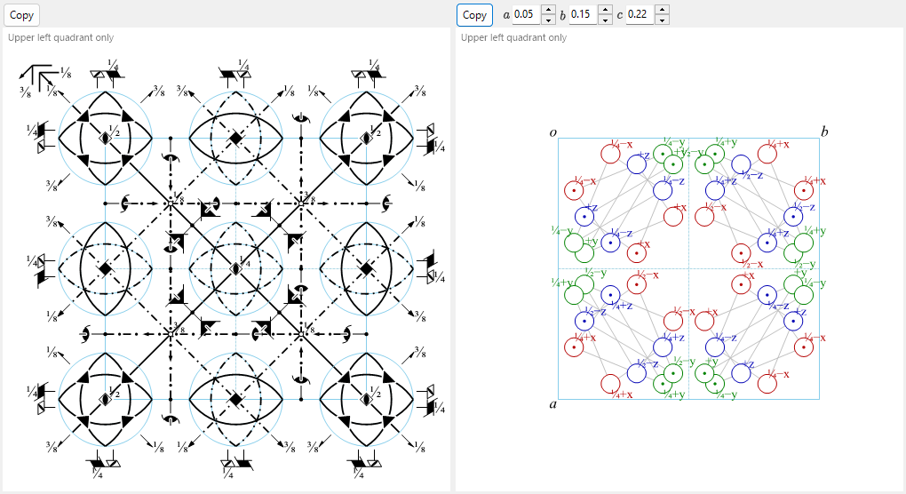

<!-- 261124Cl: Retranslated from en/appendix/a4-symmetry-information.md (UI labels follow the localized GUI). -->

# Apéndice A4. Información de simetría

**Información de simetría (Symmetry Information)** muestra información detallada sobre la simetría del grupo espacial del cristal seleccionado y, además, dibuja diagramas esquemáticos de los elementos de simetría y de las posiciones generales al estilo de las *International Tables for Crystallography* Vol. A.

En IPAnalyzer, esta subventana se abre desde la **ventana de cristal** (Crystal window; el CrystalControl que se usa en [4. Procedimientos](../4-procedures.md) para la calibración geométrica y en [6. Buscar parámetros (fuerza bruta)](../6-find-parameter.md)).

La ventana se divide en un área de identidad del grupo espacial (arriba a la izquierda), un área de cálculos/tablas con pestañas (arriba a la derecha) y dos diagramas esquemáticos (abajo).

---

## Atajos de teclado y ratón

Esta ventana no tiene combinaciones especiales de teclas ni de ratón. <kbd>F1</kbd> abre esta página del manual, y los dos botones **Copy** colocan en el portapapeles el diagrama de elementos de simetría y el diagrama de posiciones generales (como mapa de bits, o como EMF vectorial cuando se marca **EMF**).

---

## Identidad del grupo espacial

El panel superior izquierdo muestra, para el grupo espacial actual:

- **Number** (1–230) y el índice de la configuración (setting)
- **Crystal System** (sistema cristalino)
- **Point Group** (grupo puntual): símbolos de Hermann–Mauguin (HM) y de Schoenflies (SF)
- **Space Group** (grupo espacial): símbolo corto HM, símbolo completo HM, símbolo SF y **Hall symbol** (símbolo de Hall)

---

## Cálculos geométricos (Geometrics Calculation)

Introduce dos planos cristalinos \((h_1, k_1, l_1)\), \((h_2, k_2, l_2)\) o dos índices de dirección \([u_1, v_1, w_1]\), \([u_2, v_2, w_2]\) para obtener:

- el espaciado d de cada plano / la longitud de cada eje,
- el ángulo entre los dos planos (o los dos ejes),
- **el eje de zona común a ambos planos** (la dirección de su intersección) y **el plano que contiene ambas direcciones**.

Estos cálculos respetan la métrica de la celda unidad actual.

---

## Posiciones de Wyckoff (Wyckoff Positions)

Enumera todas las posiciones de Wyckoff con su multiplicidad, letra de Wyckoff, simetría del sitio y si se trata de una posición general o especial. Para las redes centradas, los vectores de traslación de la red se muestran en la fila de cabecera.

---

## Condiciones (Conditions)

Las condiciones de reflexión que surgen del centrado de la red y de los operadores de simetría de deslizamiento/helicoidales.

---

## Diagramas de elementos de simetría y de posiciones generales

Los dos paneles inferiores reproducen los diagramas esquemáticos de simetría del grupo espacial con la notación de las *International Tables for Crystallography* Vol. A.

- **Elementos de simetría (izquierda)**: los ejes de rotación/helicoidales, los planos de reflexión/deslizamiento y los centros de inversión/puntos de rotoinversión se dibujan con los símbolos gráficos convencionales.
  - Para la red \(F\) del sistema cúbico, solo se muestra un octavo de la celda unidad (únicamente el cuadrante superior izquierdo).
- **Posiciones generales (derecha)**: las posiciones equivalentes generales se representan como círculos (una coma indica una imagen especular), anotados con sus coordenadas fraccionarias.
  - Solo para el sistema cúbico, unas líneas auxiliares unen los tres círculos relacionados por un eje de rotación ternario.

Controles situados debajo de los diagramas:

- **Direction** (`a` / `b` / `c`): elige el eje cristalino a lo largo del cual se proyecta.
- **Copy**: copia cada diagrama al portapapeles como imagen vectorial (**EMF**) o imagen ráster (**BMP**); el EMF se puede desagrupar y editar en PowerPoint.

---

## Véase también

- [Página principal del apéndice](index.md)
- [4. Procedimientos](../4-procedures.md) — calibración geométrica de parámetros con un cristal de referencia.
- [6. Buscar parámetros (fuerza bruta)](../6-find-parameter.md)
