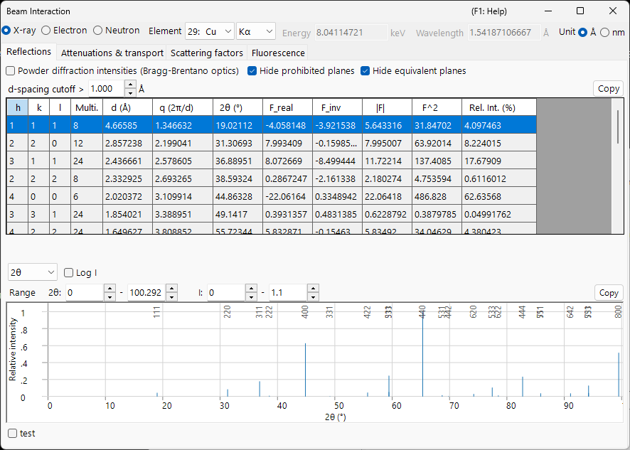

<!-- 261124Cl: Retranslated from en/appendix/a5-scattering-factor.md (UI labels follow the localized GUI). (2nd update: synced with en changes) -->

# Apéndice A5. Factor de dispersión

En la versión actual, las reflexiones y los factores de estructura de un cristal se muestran en la pestaña **Reflexiones (Reflections)** de la ventana **Interacción del haz (Beam Interaction)** (que ha sustituido a la antigua ventana Scattering Factor). La pestaña enumera los planos cristalinos permitidos (reflexiones) del cristal seleccionado y calcula el **factor de estructura** y la intensidad de difracción de cada uno. El tipo de radiación (rayos X, electrones o neutrones) se puede cambiar, de modo que los factores de estructura de un mismo cristal se pueden comparar entre técnicas de difracción.

En IPAnalyzer, se abre desde la ventana de cristal que define el cristal de referencia usado para la calibración de parámetros (la ventana de cristal que se abre con **Definir cristal (Set crystal)** en [Buscar parámetro (geométricamente)](../3-tools.md), o el panel de cristal de [6. Buscar parámetros (fuerza bruta)](../6-find-parameter.md)): pulsa el botón **Interacción del haz (Beam interaction)** o elige **Interacción del haz (Beam Interaction)** en el menú contextual (clic derecho) del panel de cristal.

La franja superior selecciona el haz incidente, y la pestaña **Reflexiones (Reflections)** de debajo muestra la lista de reflexiones (parte superior) y un diagrama de barras de las mismas reflexiones (parte inferior). La lista se recalcula inmediatamente cada vez que cambia una condición. Las demás pestañas (**Atenuación & Transporte (Attenuations & transport)**, **Factores de dispersión (Scattering factors)**, **Fluorescencia (Fluorescence)**) no son necesarias para IPAnalyzer; para ellas, véase [Interacción del haz en el manual de ReciPro](https://seto77.github.io/ReciPro/3-beam-interaction/).

---

## Atajos de teclado y ratón

Esta ventana no tiene combinaciones especiales de teclas ni de ratón. <kbd>F1</kbd> abre esta página del manual, y **Copiar (Copy)** exporta la tabla de reflexiones como texto que se puede pegar en una hoja de cálculo.

---

## Haz y longitud de onda

- **X-ray / Electron / Neutron**: los factores de dispersión atómicos difieren según el tipo de haz incidente, por lo que se cambian aquí.
- Para **X-ray**, al elegir el **Element** (material del ánodo) y la línea característica (Kα, etc.), la longitud de onda de esos rayos X característicos se define automáticamente.
- **Energy** (keV) y **Wavelength** (Å) están vinculados: al definir uno se actualiza el otro, y ambos se usan para calcular el 2θ de cada reflexión.
- **Unit** (**Å** / **nm**) cambia la unidad de longitud que se usa para el espaciado d y magnitudes similares.

---

## Opciones de la pestaña Reflexiones (Reflections)

- **Intensidades de difracción de polvo (óptica Bragg-Brentano) (Powder diffraction intensities (Bragg-Brentano optics))**: calcula la intensidad relativa como intensidad de difracción de polvo (Bragg–Brentano), $I \propto m\,\lvert F\rvert^2 / V^2 \times L$, donde $m$ es la multiplicidad, $V$ el volumen de la celda y $L = (1+\cos^2 2\theta)/(\sin 2\theta\,\sin\theta)$ (factor de Lorentz–polarización) para rayos X o $L = 1/(\sin 2\theta\,\sin\theta)$ (solo el factor de Lorentz) para electrones y neutrones. Las reflexiones que el haz no puede alcanzar (d < λ/2) reciben una intensidad de 0. Si está desactivada, se muestra la intensidad del factor de estructura $\lvert F\rvert^2$. Al activarla también se activan **Ocultar planos equivalentes (Hide equivalent planes)** y **Ocultar planos prohibidos (Hide prohibited planes)**, que quedan atenuados (no editables).
- **Ocultar planos equivalentes (Hide equivalent planes)** (activada por defecto): agrupa en una sola entrada los planos cristalográficamente equivalentes. La columna **Multi.** solo se muestra mientras está activada.
- **Ocultar planos prohibidos (Hide prohibited planes)** (activada por defecto): excluye los planos sistemáticamente ausentes por las reglas de extinción. Mientras está desactivada, una columna **Condition** muestra la(s) condición(es) de reflexión que prohíben cada plano ausente.
- **d-spacing cutoff >** (1 Å por defecto): excluye las reflexiones con un espaciado d menor que este valor (la unidad de longitud sigue a **Unit**).

---

## Lista de reflexiones

Cada fila corresponde a una reflexión (o a un grupo de planos equivalentes por simetría).

| Columna | Significado |
|------|------|
| **h, k, l** | índices de Miller |
| **Multi.** | multiplicidad (número de planos equivalentes por simetría) |
| **d (Å)** | espaciado interplanar |
| **q (2π/d)** | módulo del vector de dispersión |
| **2θ (°)** | ángulo de difracción para la longitud de onda seleccionada |
| **F_real** | parte real del factor de estructura |
| **F_inv** | parte imaginaria del factor de estructura |
| **\|F\|** | amplitud del factor de estructura ($= \sqrt{F_\text{real}^2 + F_\text{inv}^2}$) |
| **F^2** | intensidad del factor de estructura ($\lvert F\rvert^2$) |
| **Rel. Int. (%)** | intensidad relativa, con la reflexión más intensa fijada en 100 |
| **Condition** | condición(es) de extinción que incumple el plano (solo se muestra cuando **Ocultar planos prohibidos (Hide prohibited planes)** está desactivada) |

Debajo de la tabla, las mismas reflexiones se dibujan como un diagrama de barras, con los picos más intensos etiquetados con su *hkl*. El selector elige el eje horizontal entre **2θ**, **d** y **Q** ($= 4\pi\sin\theta/\lambda$), **Log I** cambia el eje de intensidad entre lineal y logarítmico, y las casillas **Range** definen el intervalo representado.

---

## Copiar al portapapeles

**Copiar (Copy)** copia la lista de reflexiones al portapapeles como texto que se puede pegar en una hoja de cálculo como Excel.

---

## Véase también

- [Página principal del apéndice](index.md)
- [4. Procedimientos](../4-procedures.md) — definición del cristal de referencia cuyos factores de estructura se calculan.
- [6. Buscar parámetros (fuerza bruta)](../6-find-parameter.md)
- [Interacción del haz en el manual de ReciPro](https://seto77.github.io/ReciPro/3-beam-interaction/) — las cuatro pestañas de la misma ventana.
