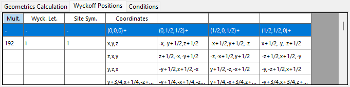

<!-- 261124Cl: Retranslated from en/appendix/a4-symmetry-information.md (UI labels follow the localized GUI). -->

# Annexe A4. Informations de symétrie

**Informations de symétrie (Symmetry Information)** affiche des informations détaillées sur la symétrie du groupe d'espace du cristal sélectionné, et trace en outre des diagrammes schématiques des éléments de symétrie et des positions générales dans le style des *International Tables for Crystallography* Vol. A.

Dans IPAnalyzer, cette sous-fenêtre s'ouvre depuis la **fenêtre Crystal (Crystal window)** (le CrystalControl utilisé dans [4. Procédures](../4-procedures.md) pour la calibration géométrique et dans [6. Recherche de paramètres (force brute)](../6-find-parameter.md)).

La fenêtre est divisée en une zone d'identité du groupe d'espace (en haut à gauche), une zone de calculs/tableaux à onglets (en haut à droite) et deux diagrammes schématiques (en bas).

---

## Raccourcis clavier et souris

Cette fenêtre n'a pas de combinaison de touches ou de souris particulière. <kbd>F1</kbd> ouvre cette page du manuel, et les deux boutons **Copy** placent le diagramme des éléments de symétrie et le diagramme des positions générales dans le presse-papiers (sous forme de bitmap, ou d'EMF vectoriel lorsque **EMF** est coché).

---

## Identité du groupe d'espace

Le panneau en haut à gauche indique, pour le groupe d'espace actuel :

- **Number** (1–230) et l'indice de réglage (setting)
- **Crystal System** (système cristallin)
- **Point Group** (groupe ponctuel) : symboles d'Hermann–Mauguin (HM) et de Schoenflies (SF)
- **Space Group** (groupe d'espace) : symbole HM court, symbole HM complet, symbole SF et **Hall symbol** (symbole de Hall)

---

## Geometrics Calculation

Saisissez deux plans cristallins \((h_1, k_1, l_1)\), \((h_2, k_2, l_2)\) ou deux indices de direction \([u_1, v_1, w_1]\), \([u_2, v_2, w_2]\) pour obtenir :

- la distance interréticulaire de chaque plan / la longueur de chaque axe,
- l'angle entre les deux plans (ou les deux axes),
- **l'axe de zone commun aux deux plans** (la direction de leur intersection) et **le plan contenant les deux directions**.

Ces calculs tiennent compte de la métrique de la maille élémentaire actuelle.

---

## Wyckoff Positions

Liste toutes les positions de Wyckoff avec leur multiplicité, leur lettre de Wyckoff, leur symétrie de site, et indique s'il s'agit d'une position générale ou particulière. Pour les réseaux centrés, les vecteurs de translation du réseau sont indiqués dans la ligne d'en-tête.

---

## Conditions

Les conditions de réflexion dues au centrage du réseau et aux opérations de symétrie de glissement/hélicoïdales.

---

## Diagrammes des éléments de symétrie et des positions générales

Les deux panneaux du bas reproduisent les diagrammes schématiques de symétrie du groupe d'espace selon la notation des *International Tables for Crystallography* Vol. A.

- **Éléments de symétrie (à gauche)** : les axes de rotation/hélicoïdaux, les plans miroirs/de glissement et les centres d'inversion/points de roto-inversion sont tracés avec les symboles graphiques conventionnels.
  - Pour le réseau \(F\) du système cubique, seul un huitième de la maille (le quadrant supérieur gauche seulement) est représenté.
- **Positions générales (à droite)** : les positions équivalentes générales sont représentées par des cercles (une virgule désigne une image miroir), annotés de leurs coordonnées réduites.
  - Pour le système cubique uniquement, des lignes auxiliaires relient les trois cercles liés par un axe de rotation d'ordre trois.

Commandes sous les diagrammes :

- **Direction** (`a` / `b` / `c`) : choisit l'axe cristallin selon lequel projeter.
- **Copy** : copie chaque diagramme dans le presse-papiers sous forme d'image vectorielle (**EMF**) ou matricielle (**BMP**) ; l'EMF peut être dissocié et modifié dans PowerPoint.

---

## Voir aussi

- [Page d'accueil de l'annexe](index.md)
- [4. Procédures](../4-procedures.md) — calibration géométrique des paramètres à l'aide d'un cristal de référence.
- [6. Recherche de paramètres (force brute)](../6-find-parameter.md)
