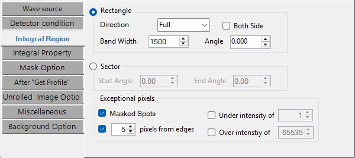

<!-- 261124Cl: Retranslated from en/2-property-windows.md (UI labels follow the localized GUI). -->

# Finestre delle proprietà

La finestra delle proprietà è il luogo in cui si configurano la sorgente, le condizioni del rivelatore e le varie condizioni della riduzione a una dimensione. Ogni scheda si può aprire anche direttamente dal menu **Proprietà (Property)** della finestra principale.

Le etichette riportate qui sotto sono i nomi visualizzati nell'interfaccia italiana, con il nome inglese tra parentesi. I titoli usano i nomi effettivi delle schede e dei controlli.

## Sorgente d'onda (Wave source)

Imposta il tipo di fascio incidente e la lunghezza d'onda. La sorgente può essere a raggi X, elettroni o neutroni. Per i raggi X, selezionando un elemento e una transizione (riga K, riga L, ecc.) la lunghezza d'onda viene compilata automaticamente; per la radiazione di sincrotrone, inserire direttamente la lunghezza d'onda. Per i fasci di elettroni e di neutroni, inserire l'energia o la lunghezza d'onda (la lunghezza d'onda degli elettroni è corretta relativisticamente).

- **Correggi polarizzazione lineare (Correct linear polarization)**: corregge un'intensità polarizzata linearmente nell'equivalente non polarizzato (per i dati di sincrotrone). La formula di correzione riportata sotto dipende dall'azimut χ e dall'angolo di scattering 2θ. Se la direzione di riferimento di χ (impostata nella scheda Varie) è Sinistra/Destra (Left/Right), il fascio è trattato come polarizzato orizzontalmente; se è Alto/Basso (Top/Bottom), come polarizzato verticalmente.

$$
I_\text{corr}(2\theta,\chi) = \frac{I(2\theta,\chi)}{\sin^2\chi + \cos^2\chi\,\cos^2 2\theta} \times \frac{1}{2}\left(1 + \cos^2 2\theta\right)
$$

## Condizione del rivelatore (Detector condition)

Imposta le condizioni geometriche del rivelatore. Corrisponde alla vecchia "IP Condition", con l'aggiunta dei selettori del sistema di coordinate e della forma del rivelatore.

- **Coordinate (Coordinates)**: **Spot diretto (Direct spot)** (riferimento allo spot diretto) / **Coda (Foot)** (riferimento al piede della perpendicolare).
- **Tipo di rivelatore (Detector type)**: **Pannello piatto (Flat panel)** / **Gandolfi**.
- **Posizione spot diretto (Direct spot position)** e **Lunghezza camera 1 (Camera Length 1)**: la posizione dello spot diretto (X, Y pix) e la distanza dal campione allo spot diretto (mm).
- **Posizione coda (Foot position)** e **Lunghezza camera 2 (Camera Length 2)**: in modalità Coda (Foot), la posizione del piede della perpendicolare e la distanza dal campione al piede.
- **Forma del pixel (Pixel Shape)**: dimensione del pixel X, Y (mm) e ξ (Ksi, l'angolo di inclinazione del parallelogramma).
- **Raggio di Gandolfi (Gandolfi Radius)**: il raggio, quando è selezionata la forma Gandolfi.
- **Correzione sferica (Spherical correction)**: per un rivelatore curvo, inserire l'inverso del raggio di curvatura, 1/R (mm⁻¹). Usare 0 per un rivelatore piano.
- **Inclinazione (Tilt)**: l'inclinazione dell'IP φ (Phi) e τ (Tau).

Per le definizioni dell'inclinazione φ, τ e di ξ del pixel vedere [Panoramica](0-overview.md).

## Regione di integrazione (Integral Region)

Specifica la regione dell'immagine da ridurre a una dimensione.

- **Rettangolo (Rectangle)**: scegliere la **Direzione (Direction)** (Completo (Full) / Alto (Top) / Basso (Bottom) / Sinistra (Left) / Destra (Right) / Vertical / Horizontal / Free) e impostare la **Larghezza banda (Band Width)**, l'**Angolo (Angle)** (in modalità Free) ed **Entrambi i lati (Both Side)**.
- **Settore (Sector)**: specificare l'intervallo angolare con **Angolo iniziale (Start Angle)** / **Angolo finale (End Angle)**.
- **Pixel eccezionali (Exceptional pixels)**: esclude gli **Spot mascherati (Masked Spots)**, i pixel **Sotto l'intensità di (Under intensity of)** / **Oltre l'intensità di (Over intensity of)** le soglie indicate, e un certo numero di **pixel dai bordi (pixels from edges)**.

## Proprietà di integrazione (Integral Property)

Imposta il metodo e il passo di integrazione.

- **Integrazione concentrica (dispersiva nell'angolo di scattering) (Concentric integration (scattering-angle dispersive))**: scegliere l'unità dell'asse orizzontale tra **Angolo (Angle)** (2θ, °) / **distanza d (d-spacing)** (Å), e impostare **Inizio / Fine / Passo (Start / End / Step)**. La scelta **Pattern di output (Output pattern)** (Bragg - Brentano / Debye - Scherrer) non ha alcun effetto sul risultato nella versione attuale.
- **Integrazione radiale (pattern a torta) (Radial integration (cake pattern))**: somma l'intensità di una regione anulare per ciascun azimut. Specificare il centro dell'anello (**Raggio ciambella (Donut radius)**) e la semilarghezza (**Larghezza ciambella (Donut width)**) come angolo di scattering 2θ (**Angolo (Angle)**) o distanza d (**distanza d (d-spacing)**), e impostare il **Passo angolo settore (Sector angle step)** (passo azimutale). L'asse orizzontale del profilo risultante è l'azimut χ (°).

## Opzioni maschera (Mask Option)

Imposta le condizioni per la mascheratura e il rilevamento degli spot (un'estensione della vecchia "Find Center & Spots"). Le impostazioni di rilevamento del centro si trovano nella scheda Varie.

- **Mezza maschera (Half mask)**: pulsanti che mascherano rapidamente la metà superiore, inferiore, sinistra o destra dell'immagine.
- **Modalità maschera manuale (Manual mask mode)**: abilita la mascheratura interattiva sull'immagine principale. Le forme sono **Cerchio (Circle)** (trascinare per impostare centro e raggio), **Poligono (Polygon)** (fare clic per aggiungere vertici), **Rettangolo (Rectangle)** (trascinare i vertici diagonali), **Curva spline (Spline curve)** e **Spot** (clic sinistro/destro per aggiungere/rimuovere spot).
- **Takeover**: come viene trattata la maschera quando si carica una nuova immagine (**Nessuno (None)** / **Eredita lo stato corrente della maschera (Take over the current mask state)** / **Eredita il file maschera (Take over the mask file)**).
- **Find Spots** → **Deviation**: la soglia statistica per il rilevamento degli spot.

## Dopo "Ottieni profilo" (After "Get Profile")

Imposta il salvataggio e l'invio dopo la riduzione a una dimensione.

- **Save File**: scegliere la destinazione ("Nella stessa cartella dell'immagine" (At the same directory of the image) oppure "Nella cartella scelta ogni volta" (At the chosen directory each time)) e il formato tra **PDI** / **CSV** / **TSV** / **GSAS**. L'output GSAS è possibile solo per l'integrazione concentrica con asse orizzontale in 2θ. Quando più profili devono essere salvati in un unico file, il formato GSAS non viene scritto; salvarli invece in file separati.
- **Send PDIndexer**: invia il profilo, tramite gli appunti, a un'istanza di PDIndexer in esecuzione.

## Opzioni immagine srotolata (Unrolled Image Option)

Imposta i parametri dell'immagine srotolata (Unroll).

- **Horizontal**: **Inizio / Fine / Passo (Start / End / Step)** nell'angolo di scattering 2θ (°) (le opzioni di unità sono visualizzate, ma la versione attuale tratta sempre i valori come 2θ). Larghezza dell'immagine di output ≈ (End − Start) / Step.
- **Vertical**: il **Numero di divisioni (number of divisions)** N nell'azimut. L'immagine di output è alta N pixel, e ogni riga copre 360°/N (0,5° per il valore predefinito 720).

Lo srotolamento trasforma l'immagine di diffrazione polare centrata sullo spot diretto in un'immagine cartesiana (angolo rispetto a distanza).

## Varie (Miscellaneous)

Una scheda che raccoglie le impostazioni più fini di visualizzazione e di coordinate.

- **Image name display**: solo nome file / cartella superiore + nome file / percorso completo.
- **Mantieni intervallo di visualizzazione (Maintain display range)**: se lo zoom e la posizione di visualizzazione (intervallo di visualizzazione) vengono mantenuti quando si carica una nuova immagine.
- **Azimuth χ (Chi) orientation**: la posizione di riferimento (Alto / Basso / Sinistra / Destra; Top / Bottom / Left / Right) e il senso di rotazione (Orario / Antiorario; Clockwise / Counterclockwise). χ è usato dalla correzione della polarizzazione e dall'integrazione radiale.
- **Linea di scala (Scale line)**: colore, spessore, numero di divisioni e visualizzazione delle etichette.
- **Trova centro (Find Center)**: intervallo di ricerca, intervallo di fitting del picco, fissaggio del centro ed esclusione dei pixel mascherati.

## Opzioni sfondo (Background Option)

Imposta la correzione mediante un'immagine di sfondo.

- **Background image**: imposta come sfondo l'immagine attualmente visualizzata (**Imposta l'immagine corrente come sfondo (Set the current image as background)**), oppure la cancella (**Cancella (Clear)**).
- **Coefficiente (Coefficient)**: il fattore applicato all'immagine di sfondo.

Si usa per sottrarre uno sfondo additivo come lo scattering dell'aria. Per ogni pixel si calcola \(I_\mathrm{out} = I - cB\) (\(B\): immagine di sfondo, \(c\): coefficiente). Per escludere i pixel vicini ai bordi dell'immagine, usare **pixel dai bordi (pixels from edges)** nella scheda Regione di integrazione.

