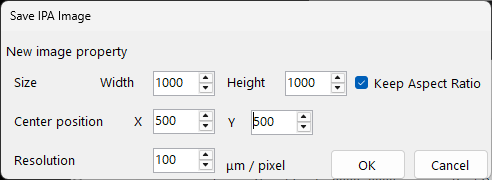
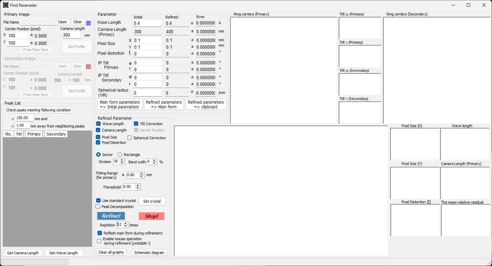

<!-- 261124Cl: Retranslated from en/3-tools.md (UI labels follow the localized GUI). -->

# Strumenti

Questa pagina descrive gli strumenti ausiliari avviati dalla barra degli strumenti verticale a destra della finestra principale, oppure dai menu. Per le procedure concrete che usano la calibrazione dei parametri e le macro, vedere [Procedure](4-procedures.md).

## Calibra immagine R-AXIS (Calibrate Raxis Image)

Si apre con **Strumenti → Calibra immagine R-AXIS** (Tool → Calibrate Raxis Image). Si specificano due immagini R-AXIS IV `.stl` della stessa dimensione; lo strumento ottimizza una tabella di conversione delle intensità in modo che le due intensità coincidano. La tabella è rappresentata da punti di controllo, e la somma dei suoi elementi è mantenuta costante durante l'ottimizzazione. Il risultato è mostrato come grafico. Si usa, ad esempio, per calibrare la risposta in intensità di un rivelatore.

Il pulsante **Tabella intensità (Intensity table)** della barra degli strumenti non ha alcuna funzione assegnata nella versione attuale.

## Procedura automatica (Auto procedure)

Uno strumento che monitora una cartella, carica automaticamente le nuove immagini ed esegue una sequenza di operazioni dopo il caricamento.

- **Monitoraggio e caricamento automatico**: monitora la cartella specificata (sottocartelle comprese) e legge un file una volta completata la sua scrittura. I file si possono filtrare per nome (corrispondenza numerica, parola chiave).
- **Esecuzione automatica**: esegue in ordine i passi selezionati tra Contrasto automatico (Auto Contrast) → Trova centro (Find Center) → Maschera spot (Mask Spots) → Ottieni profilo (Get Profile) → Execute Macro.

Ciò consente, ad esempio, di monitorare una cartella di output durante un esperimento e di integrare automaticamente ogni immagine man mano che arriva. Per i dettagli vedere [Procedure](4-procedures.md).

## Disegna anello (Draw Ring)

Disegna sull'immagine un anello a una distanza, un angolo o un valore d specificati, tenendo conto dell'inclinazione dell'IP e della distorsione del pixel. Fare clic su uno tra **R (mm)** / **2θ (°)** / **d (Å)** per scegliere quale valore modificare; gli altri vengono calcolati automaticamente dalla lunghezza d'onda e dalla lunghezza di camera.

## Srotolamento (Unroll)

Trasforma l'immagine di diffrazione dalle coordinate polari centrate sullo spot diretto in coordinate cartesiane (asse orizzontale = angolo di scattering 2θ; asse verticale = azimut). Ora non si configura con una finestra dedicata, ma con il pulsante **Srotola immagine (Unroll image)** della barra degli strumenti e con la scheda **Opzioni immagine srotolata (Unrolled Image Option)** delle proprietà. Lo srotolamento usa lo stesso algoritmo sub-pixel di distribuzione dell'intensità della riduzione a una dimensione.

## Sfocatura circonferenziale (Circumferential Blur)

Uno strumento che sfoca il pattern ad anelli lungo la direzione circonferenziale (azimutale). Si specifica un unico angolo di sfocatura e lo si applica.

## Immagine sequenziale (Sequential Image)

Uno strumento per gestire le immagini multiframe (NeXus (`.nxs`), TIFF multipagina e simili; serie temporali, serie in temperatura, scansioni in energia al sincrotrone).

- Selezionare un singolo frame dall'elenco dei frame per visualizzarlo, oppure scorrerli con la barra di scorrimento.
- Con **Selezione multipla (multi-selection)**, selezionare più frame e calcolarne la **Media (average)** o la **Sommatoria (sum)**.
- La destinazione della riduzione a una dimensione si può scegliere tra "Tutte le immagini indipendentemente dalle selezioni correnti / L'immagine/le immagini selezionate / Solo l'immagine in cima" (tutti i frame / frame selezionati / solo quello in cima).
- Se un frame contiene informazioni sull'energia, la lunghezza d'onda viene aggiornata quando si seleziona quel singolo frame.

## Salva immagine (formato IPA)

Corregge l'inclinazione dell'IP φ, τ e la distorsione del pixel ξ, e salva l'immagine con pixel quadrati a una risoluzione specificata. Vengono scritti anche metadati come la lunghezza di camera, la lunghezza d'onda e la posizione del centro, quindi l'immagine può essere passata ad altre elaborazioni conservando le informazioni geometriche.

## Trova parametro (geometricamente) (Find Parameter (Geometric))

Uno strumento che ottimizza la lunghezza d'onda, la lunghezza di camera, la dimensione del pixel, la distorsione del pixel e l'inclinazione (φ, τ) a partire dagli anelli di diffrazione di un materiale di riferimento. Usa un'immagine di un campione di riferimento (Primario, Primary), oppure due immagini acquisite a lunghezze di camera diverse (Primario e Secondario, Primary e Secondary); si selezionano i picchi e si ottimizza con **Affina! (Refine!)**. La convergenza (centro dell'ellisse, residui) si può verificare sui grafici. Per i passi concreti vedere [Procedure](4-procedures.md).

## Trova parametro (forza bruta) (Find Parameter (Brute force))

Uno strumento che trova la lunghezza di camera, la posizione del centro, l'inclinazione (φ, τ) e, facoltativamente, la lunghezza d'onda (disattivata per impostazione predefinita) mediante una ricerca esaustiva su griglia invece che con un metodo del gradiente. Usa l'unica immagine di un campione di riferimento caricata nella finestra principale. È efficace quando l'ottimizzazione geometrica fatica a convergere, ad esempio con anelli incompleti o dati rumorosi. Scegliere il materiale di riferimento tra Au / CeO₂ / LaB₆ / Al₂O₃, oppure selezionare **Altro (Other)** e inserire il cristallo. Per i passi dettagliati vedere [Trova parametri (forza bruta)](6-find-parameter.md), e per il flusso di lavoro [Procedure](4-procedures.md).

## Macro

Una funzionalità che automatizza le operazioni con script simili a Python. Aprire l'editor delle macro dal menu **Macro → Editor** della finestra principale.

- Sono disponibili `for` / `if` / `while` / `def` / `class`, l'aritmetica e il modulo `math`.
- API come `IPA.File` / `IPA.Wave` / `IPA.Detector` / `IPA.Profile` / `IPA.Sequential` / `IPA.Image` / `IPA.Mask` / `IPA.PDI` / `IPA.IntegralProperty` permettono di richiamare ciascuna operazione.
- Attivare **Mostra esempi (Show samples)** per visualizzare le macro di esempio in sola lettura (cicli di base, impostazione della geometria, elaborazione batch, divisione azimutale, mascheratura, invio a PDIndexer, ecc.). Con l'esecuzione passo passo si possono ispezionare le variabili.

Per il riferimento completo delle funzioni e gli esempi vedere [Macro](5-macro/index.md), e per i flussi di lavoro basati sulle macro [Procedure](4-procedures.md).

