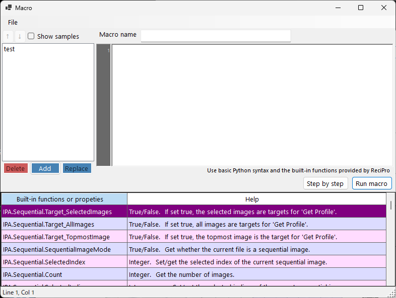

<!-- 261124Cl: Retranslated from en/5-macro/index.md (UI labels follow the localized GUI). (2nd update: synced with en changes) -->

# Macro

IPAnalyzer offre una funzionalità di **macro** che automatizza sequenze di operazioni con script simili a Python. È utile per lavori ripetitivi come l'integrazione in batch di molti file in profili 1D, la conversione di formato e l'analisi a divisione azimutale.

## Aprire l'editor

Aprire l'editor delle macro dal menu **Macro** → **Editor** della finestra principale. Lì si può modificare il codice ed eseguirlo, anche passo passo.

## Linguaggio

- Sono disponibili istruzioni di controllo come `for` / `if` / `while` / `def` / `class`, e l'aritmetica.
- Il modulo `math` è preimportato, quindi si possono usare direttamente `math.pi` o `math.sin(...)` senza un'istruzione `import`.
- `print()` non è disponibile. Per ispezionare i valori, usare l'**esecuzione passo passo** (Step by step) e osservare la variazione delle variabili nel pannello di debug.
- Ogni operazione di IPAnalyzer si richiama da uno spazio dei nomi sotto l'oggetto radice `IPA` (ad es. `IPA.File`).

## Spazi dei nomi IPA

| Spazio dei nomi | Ruolo |
|------|------|
| `IPA.File` | Lettura/scrittura di file di immagine, di parametri e di maschera; finestre di selezione dei file |
| `IPA.Wave` | Impostazione della sorgente incidente e della lunghezza d'onda |
| `IPA.Detector` | Impostazione della geometria del rivelatore: centro, lunghezza di camera, dimensione del pixel, inclinazione |
| `IPA.Image` | Controllo della scala di visualizzazione, del contrasto e dell'area visualizzata |
| `IPA.Mask` | Mascheratura di spot e regioni |
| `IPA.Profile` | Integrazione dell'immagine (Ottieni profilo, Get Profile) e configurazione di salvataggio/invio |
| `IPA.IntegralProperty` | Impostazione di intervallo, passo e unità dell'integrazione concentrica / radiale |
| `IPA.Sequential` | Selezione / media / destinazione dei frame di un'immagine multiframe |
| `IPA.PDI` | Richiamo di macro in PDIndexer (integrazione tramite appunti) |

Per l'elenco dei membri vedere [Funzioni integrate](1-built-in-functions.md), e per script concreti [Esempi](2-examples.md).

!!! tip "La guida nell'editor è il riferimento autorevole"
    La descrizione di ciascuna funzione/proprietà è mostrata nella guida dell'editor delle macro ed è la fonte aggiornata, che segue la versione. Se questa pagina non concorda con la guida nell'editor, fidarsi di quest'ultima.

## Macro di esempio

Attivare **Mostra esempi (Show samples)** nell'editor per elencare le macro di esempio in sola lettura (cicli di base, funzioni matematiche, impostazione della geometria, elaborazione batch, divisione azimutale, mascheratura, invio a PDIndexer, ecc.); disattivarlo per tornare alle proprie macro salvate. Sono un comodo punto di partenza da adattare.

## Uso con la Procedura automatica

Le macro scritte si possono salvare con un nome ed eseguire anche dalla [Procedura automatica (Auto Procedure)](../3-tools.md) (sceglierla in **Macro** e selezionare **Execute macro**), così che una macro venga applicata automaticamente a ogni immagine che arriva durante un esperimento.
