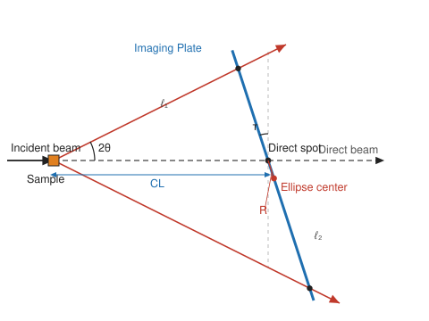

<!-- 261124Cl: Retranslated from en/appendix/a2-calibration.md (UI labels follow the localized GUI). -->

# Appendice A2. Determinazione dei parametri

Poiché la posizione di ciascun pixel è governata dalla geometria di [A1. Geometria del rivelatore](a1-geometry.md), usare parametri errati significa leggere le intensità nei punti sbagliati. Questa pagina spiega come determinare i parametri veri — lunghezza di camera, lunghezza d'onda, dimensione del pixel e inclinazione dell'IP — dagli anelli di diffrazione di un **materiale di riferimento**. Per le operazioni concrete, vedere [4. Procedure](../4-procedures.md) e [6. Trova parametri (forza bruta)](../6-find-parameter.md).

---

## Materiale di riferimento

Per la calibrazione si misura un materiale di riferimento di cui sono note le costanti reticolari. Le condizioni desiderabili sono **molti anelli di diffrazione** con un **alto rapporto S/N**, disposti in modo **rado**, e **senza orientazione preferenziale**. Salvo preferenze particolari, si consiglia un cristallo cubico contenente atomi pesanti come $\mathrm{CeO_2}$ o $\mathrm{Ag}$. Le costanti reticolari devono essere note con circa 5 cifre significative.

---

## Lunghezza di camera — metodo delle due distanze

La lunghezza di camera $\mathrm{CL}$ è definita come la distanza che congiunge il campione e lo spot diretto sull'IP. Se si acquisiscono due pattern di diffrazione variando la lunghezza di camera di $\Delta$, si può determinare il valore assoluto di $\mathrm{CL}$ dalla variazione del raggio $r_1,\ r_2$ dello stesso anello. La differenza di distanza $\Delta$ si può controllare con precisione con un Magnescale o un dispositivo simile.

{width=440px}

Dai triangoli simili $\dfrac{r_1}{\mathrm{CL}} = \dfrac{r_2}{\mathrm{CL}+\Delta} = \tan 2\theta$ (con $r_i$ nella stessa unità di lunghezza di $\mathrm{CL}$) si ottiene

$$
\mathrm{CL} = \frac{r_1\,\Delta}{r_2 - r_1}
$$

Qui $r_1,\ r_2$ possono restare in unità di pixel, e la lunghezza di camera si può ottenere anche se la correzione dell'inclinazione e la correzione della dimensione del pixel sono alquanto imprecise, e anche se le costanti reticolari del materiale di riferimento sono imprecise. Poiché la lunghezza di camera ha quindi poca correlazione con gli altri parametri, è il **parametro da determinare per primo**.

---

## Lunghezza d'onda e dimensione del pixel — metodo delle due linee

Se si possono registrare due linee di diffrazione, gli angoli di Bragg $\theta_1,\ \theta_2$ si possono calcolare dal rapporto tra le loro posizioni dei picchi (in pixel) $p_1,\ p_2$ e le loro distanze interplanari $d_1,\ d_2$, senza conoscere la dimensione del pixel né la lunghezza di camera. Siano $\rho_d = d_1/d_2$ il rapporto tra le distanze interplanari e $\rho_p = p_1/p_2$ il rapporto tra le posizioni dei picchi.

Dalla legge di Bragg e dalla geometria del rivelatore piano valgono

$$
2 d_i \sin\theta_i = \lambda \quad(i=1,2), \qquad p_i \cdot \mathrm{PixSize} = \mathrm{CL}\,\tan 2\theta_i
$$

Dal rapporto della prima equazione si ha $\sin\theta_2 = \rho_d \sin\theta_1$, e dal rapporto della seconda $\rho_p = \tan 2\theta_1 / \tan 2\theta_2$. Sostituendo $\tan 2\theta = \dfrac{2\sin\theta\sqrt{1-\sin^2\theta}}{1-2\sin^2\theta}$ si ottiene un'equazione la cui unica incognita è $\sin\theta_1$:

$$
\rho_p = \frac{\sqrt{1-\sin^2\theta_1}\,\big(1 - 2\rho_d^2\sin^2\theta_1\big)}{\rho_d\,\sqrt{1-\rho_d^2\sin^2\theta_1}\,\big(1 - 2\sin^2\theta_1\big)}
$$

Questa si riduce a un'equazione cubica in $\sin^2\theta_1$. Poiché risolverla analiticamente richiederebbe di gestire numeri immaginari, questo software la risolve **numericamente** per ottenerne il valore. Poiché $\rho_d$ è un rapporto tra distanze interplanari, a seconda della simmetria del cristallo (ad esempio nel sistema cubico) lo si può determinare senza errore.

Una volta ottenuti gli angoli di diffrazione, la lunghezza di camera si può determinare in modo indipendente con il metodo delle due distanze descritto sopra, quindi anche la lunghezza d'onda $\lambda$ e la dimensione del pixel $\mathrm{PixSize}$ si possono calcolare facilmente dalle due equazioni precedenti.

!!! note "Quando c'è un'inclinazione"
    Se l'IP è inclinato, la relazione $p_i \cdot \mathrm{PixSize} = \mathrm{CL}\tan 2\theta_i$ non vale più, quindi non si possono ottenere direttamente i valori esatti. In questo caso, **eseguire alternativamente la correzione dell'inclinazione e la correzione della lunghezza d'onda** per far convergere iterativamente la soluzione verso il valore vero.

---

## Inclinazione dell'IP — fitting di ellissi

Un anello con angolo del cono $2\theta$ dovrebbe essere osservato come un cerchio perfetto di raggio $R_0 = \mathrm{CL}\tan 2\theta$ su un piano $XY$ non inclinato. Su un IP inclinato, invece, l'anello diventa un'**ellisse**, e inoltre il suo centro non coincide con il centro del fascio (lo spot diretto).

{width=460px}

Su un piano dell'IP inclinato di $\varphi,\ \tau$, un punto $(x,y)$ dell'anello soddisfa una conica generale (ellisse)

$$
A x^2 + 2 B xy + C y^2 + D x + E y = 1
$$

I coefficienti $A,B,C,D,E$ si possono scrivere come funzioni di $\varphi,\ \tau,\ \mathrm{CL},\ R_0$, e si possono trattare con l'algebra lineare elementare come segue.

- Il **centro dell'ellisse** $(x_c, y_c)$ è la soluzione della condizione di annullamento del gradiente, cioè del sistema di equazioni lineari
  $$
  \begin{pmatrix} A & B \\ B & C \end{pmatrix}\begin{pmatrix} x_c \\ y_c \end{pmatrix} = -\frac{1}{2}\begin{pmatrix} D \\ E \end{pmatrix}
  $$
- Le **direzioni e le lunghezze degli assi maggiore e minore** si ottengono risolvendo il problema agli autovalori della matrice simmetrica $\begin{pmatrix} A & B \\ B & C \end{pmatrix}$.

Da questi, l'inclinazione si determina come segue.

1. **Azimut $\varphi$**: lo spostamento del centro dell'ellisse avviene lungo la direzione di massima inclinazione (la direzione di massimo gradiente), e l'asse di inclinazione è ortogonale a essa. Pertanto la direzione dell'asse di inclinazione è data da $(-y_c,\ x_c)$, da cui si determina $\varphi$.
2. **Entità dell'inclinazione $\tau$**: considerando la figura proiettata lungo la direzione $\varphi$ (la figura sopra), la distanza $R$ dallo spot diretto al centro dell'ellisse soddisfa una funzione della lunghezza di camera, dell'entità dell'inclinazione e dell'angolo di diffrazione:

    $$
    R = \frac{\mathrm{CL}\,\sin 2\theta}{2}\left( \frac{1}{\cos(2\theta+\tau)} - \frac{1}{\cos(2\theta-\tau)} \right)
    $$

    Risolvere questa equazione rispetto a $\tau$. Quando sono disponibili più anelli di diffrazione, prendere come valore vero la **media pesata** dei $\tau$ ottenuti da ciascun anello.
