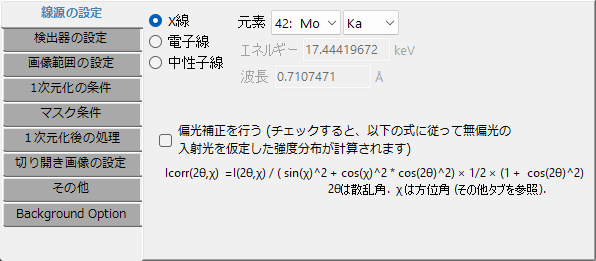
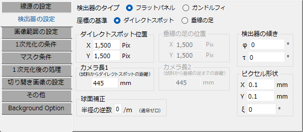
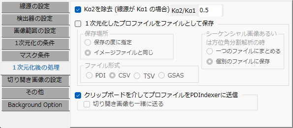
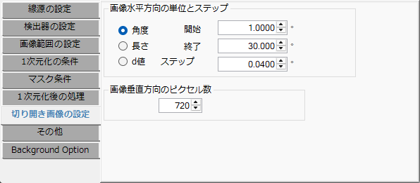
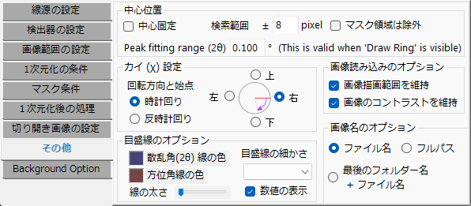
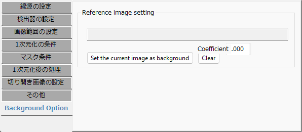

<!-- 260601Cl: 旧 doc と現行コード(FormProperty)の検証結果を基にプロパティウィンドウを再構成。タブUIは英語表示のため英語名を見出しに用い、日本語の補足を併記。260601Cl: 各タブの自動キャプチャ画像を組込。 -->
<!-- 261124Cl: 球面補正の単位、横軸の選択肢、Output pattern、円周方向積分・切り開きの入力値、GSAS の条件、バックグラウンド補正を実装に合わせて訂正。日本語 UI の表示名を主・英語名を括弧にした形 (他章と同じ) に書き換え、見出しも「線源の設定 (Wave source)」の形に変更。ラベルを実表示 (［１次元化したプロファイルをファイルとして保存］・［マスクの引継ぎ］・［画像名のオプション］・［カイ (χ) 設定］・［目盛線のオプション］・［参照画像の設定］など) に合わせ、球面補正の単位を画面どおり m⁻¹ に訂正。しきい値マスクの再計算を追記。 -->

# プロパティウィンドウ

プロパティウィンドウでは、線源・検出器条件・一次元化の各種条件を設定します。各タブはメインウィンドウの **プロパティ (Property)** メニューから直接開くこともできます。

以下では、日本語環境での表示名を示し、括弧内に英語環境での表示名を添えます。見出しは各タブの名前です。

## 線源の設定 (Wave source)

入射線の種類と波長を設定します。線源は X 線・電子線・中性子線から選べます。X 線では元素と遷移（K 線、L 線など）を選ぶと波長が自動入力され、放射光では波長を直接入力します。電子線・中性子線ではエネルギーまたは波長を入力します（電子線は相対論補正済み）。

- **偏光補正を行う (Correct linear polarization)**: 直線偏光の強度を無偏光相当へ補正します（放射光向け）。補正式は次のとおりで、方位角 χ と散乱角 2θ に依存します。χ の基準方向（［その他］タブで設定）が左右なら水平偏光、上下なら垂直偏光として扱います。

$$
I_\text{corr}(2\theta,\chi) = \frac{I(2\theta,\chi)}{\sin^2\chi + \cos^2\chi\,\cos^2 2\theta} \times \frac{1}{2}\left(1 + \cos^2 2\theta\right)
$$

## 検出器の設定 (Detector condition)

検出器の幾何条件を設定します。旧マニュアルの "IP Condition" に相当し、座標系と検出器形状の選択が加わっています。

- **座標の基準 (Coordinates)**: **ダイレクトスポット (Direct spot)**（ダイレクトスポット基準）／ **垂線の足 (Foot)**（垂線の足基準）。
- **検出器のタイプ (Detector type)**: **フラットパネル (Flat panel)**（平面検出器）／ **ガンドルフィ (Gandolfi)**。
- **ダイレクトスポット位置 (Direct spot position)** と **カメラ長1 (Camera Length 1)**: ダイレクトスポット位置 (X, Y pix) と、試料からダイレクトスポットまでの距離 (mm)。
- **垂線の足の位置 (Foot position)** と **カメラ長2 (Camera Length 2)**: ［垂線の足］モードのときの垂線の足の位置と、試料から足までの距離。
- **ピクセル形状 (Pixel Shape)**: 画素サイズ X, Y (mm) と ξ（Ksi、平行四辺形の歪み角）。
- **Gandolfi 半径 (Gandolfi Radius)**: ［ガンドルフィ］選択時の半径。
- **球面補正 (Spherical correction)**: 湾曲した検出器の曲率半径 R の逆数 1/R を m⁻¹ 単位で入力します（画面の単位表示は /m）。平面検出器では 0 にします。
- **検出器の傾き (Tilt)**: IP の傾き φ（Phi）・τ（Tau）。

傾き φ・τ・画素 ξ の定義は[概要](0-overview.md)を参照してください。

## 画像範囲の設定 (Integral Region)

一次元化の対象とする画像領域を指定します。

- **矩形 (Rectangle)**: **方向 (Direction)**（Full / Top / Bottom / Left / Right / Vertical / Horizontal / Free）を選び、**バンド幅 (Band Width)**、**角度 (Angle)**（Free 時の角度）、**中心対称 (Both Side)** を設定します。
- **扇形 (Sector)**: **開始角度 (Start Angle)** / **終了角度 (End Angle)** で角度範囲を指定します。
- **積算除外ピクセル (Exceptional pixels)**: **マスクされたピクセル (Masked Spots)**、**強度が右値以下 (Under intensity of)** / **強度が右値以上 (Over intensity of)**（強度の下限・上限）、端から指定ピクセル数（**ピクセル分の画像端 (pixels from edges)**）を除外します。強度のしきい値によるマスクは、強度が変わるたび（シーケンシャル画像でフレームを替えたとき、反転・回転のあと、バックグラウンド補正や偏光補正を変えたとき）に、補正後の強度で作り直されます。

## 1次元化の条件 (Integral Property)

一次元化の方式と刻みを設定します。

- **散乱角(2θ)積算 (Concentric integration (scattering angle dispersive))**: 横軸の単位を **角度 (Angle)**（2θ, °）／ **d値 (d-spacing)**（Å）から選び、**開始 / 終了 / ステップ (Start / End / Step)** を指定します。**光学系 (Output pattern)**（Bragg - Brentano / Debye - Scherrer）の選択は、現行版では結果に影響しません。
- **偏角 (sector angle) 積算 (Radial integration (cake pattern))**: リング状の領域の強度を方位角ごとにまとめます。積分する環の中心 **リング半径 (Donut radius)** と半幅 **リング幅 (Donut width)** を散乱角 2θ（**角度 (Angle)**）または面間隔 d（**d-spacing**）で指定し、**ステップ (Sector angle step (Sweep step))**（方位角の刻み）を設定します。得られるプロファイルの横軸は方位角 χ（°）です。

## マスク条件 (Mask Option)

マスクとスポット検出の条件を設定します（旧マニュアルの "Find Center & Spots" を拡張）。中心検出の条件は［その他］タブにあります。

- **半分マスク (Half mask)**: 画像の上下左右半分を素早くマスクするボタン（**上 (Top)** / **下 (Bottom)** / **左 (Left)** / **右 (Right)**）。
- **マニュアルモード (Manual mask mode)**: メイン画像上での対話的マスクを有効にします。形状は **円 (Circle)**（ドラッグで中心と半径）／ **多角形 (Polygon)**（クリックで頂点追加）／ **矩形 (Rectangle)**（対角ドラッグ）／ **スプライン (Spline curve)**（曲線）／ **スポット (Spot)**（左右クリックでスポット追加・削除）。
- **マスクの引継ぎ (Take over mask setting)**: 画像読込時のマスクの扱い（**なし (None)** / **マスク状態を引き継ぐ (Take over the current mask state)** / **マスクファイルを引き継ぐ (Take over the mask file)**）。
- **スポット検出 (Mask spots option)** → **標準偏差の何倍ずれた時スポットとみなすか (Criterial deviation for "Mask Spots")**: スポット検出の統計しきい値（平均から標準偏差の何倍上回った画素をスポットとみなすか）。

## １次元化後の処理 (After "Get Profile")

一次元化後の保存と送信を設定します。

- **１次元化したプロファイルをファイルとして保存 (Save Profiles)**: **保存場所 (Directory to be saved)** で保存先（**イメージファイルと同じ (At the same directory of the image)** / **保存の度に指定 (At the chosen directory each time)**）を、**ファイル形式 (File format)** で形式（**PDI** / **CSV** / **TSV** / **GSAS**）を選びます。GSAS 形式で保存できるのは、同心円積分で横軸が 2θ の場合だけです。シーケンシャル画像や方位角分割解析のときの保存方法（**シーケンシャル画像あるいは方位角分割解析の時 (Saving option)**）で **一つのファイルにまとめる (In one file (Excluding GSAS))** を選ぶと GSAS 形式は保存されないので、**個別のファイルに保存 (In separate files)** を選んでください。
- **クリップボードを介してプロファイルをPDIndexerに送信 (Send profile data to PDIndexer through Clipboard)**: クリップボード経由で、起動中の PDIndexer へプロファイルを送信します。

## 切り開き画像の設定 (Unrolled Image Option)

切り開き（Unroll）展開画像のパラメータを設定します。

- **画像水平方向の単位とステップ (Horizontal (distance from direct spot) unit and range)**: **開始 / 終了 / ステップ (Start / End / Step)** を散乱角 2θ（°）で指定します（単位の選択肢は表示されますが、現行版では常に 2θ として扱います）。出力画像の幅 ≈ (End − Start) / Step。
- **画像垂直方向のピクセル数 (Vertical (sector angle) step)**: 方位角の分割数 N を指定します。出力画像の高さは N 画素で、1 行あたりの角度幅は 360°/N です（既定の 720 なら 0.5°）。

切り開きは、ダイレクトスポットを中心とする極座標の回折像を、直交座標（角度・距離）の画像へ展開します。

## その他 (Miscellaneous)

表示や座標の細かな設定をまとめたタブです。

- **画像名のオプション (Image name options)**: **ファイル名 (File name)** / **最後のフォルダー名 + ファイル名 (Last folder + file name)** / **フルパス (Full path)**。
- **画像読み込みのオプション (Image loading options)** → **画像描画範囲を維持 (Maintain display range)**: 画像読込時に、拡大率と表示位置（描画範囲）を引き継ぐかどうか。
- **カイ (χ) 設定 (Chi (χ) axis options)**: 基準位置（**上 / 下 / 左 / 右 (Top / Bottom / Left / Right)**）と回転方向（**時計回り (Clockwise)** / **反時計回り (Counterclockwise)**）。χ は偏光補正や円周方向積分で参照されます。
- **目盛線のオプション (Scale line options)**: 線の色（**散乱角(2θ) 線の色 (2θ scale line)** / **方位角線の色 (Azimuth scale line)**）・**線の太さ (Line Width)**・**目盛線の細かさ (Division)**・**数値の表示 (Show labels)**。
- **中心位置 (Find center options)**: **検索範囲 ± (Search area ±)**、**Peak fitting range (2θ)**（ピークフィッティング範囲）、**中心固定 (Fix Center)**、**マスク領域は除外 (Exclude masked pixels)**。

## バックグラウンドオプション (Background Option)

バックグラウンド画像による補正を設定します。

- **参照画像の設定 (Reference image setting)**: 現在表示している画像をバックグラウンドに設定（**現在の画像をバックグラウンドに設定 (Set the current image as background)**）、または消去（**クリア (Clear)**）します。
- **係数 (Coefficient)**: バックグラウンド画像に掛ける係数。

空気散乱など、加算的に重なった背景の減算に用います。各画素で \(I_\mathrm{out} = I - cB\)（\(B\): バックグラウンド画像、\(c\): 係数）を計算します。画像の端の画素を除外したい場合は、［画像範囲の設定］タブの **ピクセル分の画像端 (pixels from edges)** を使います。

