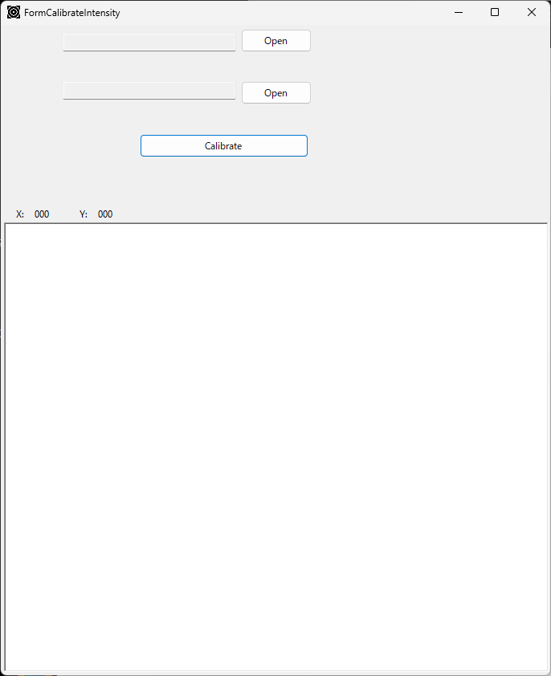
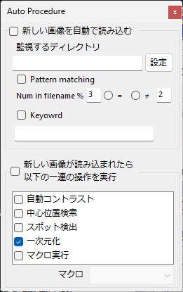
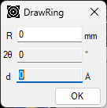
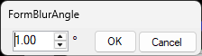
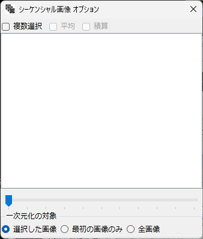
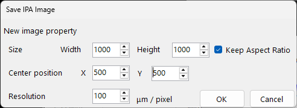
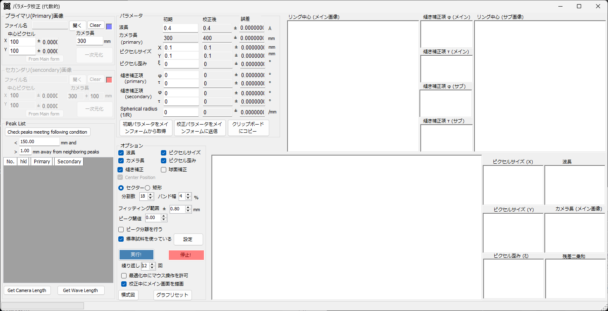
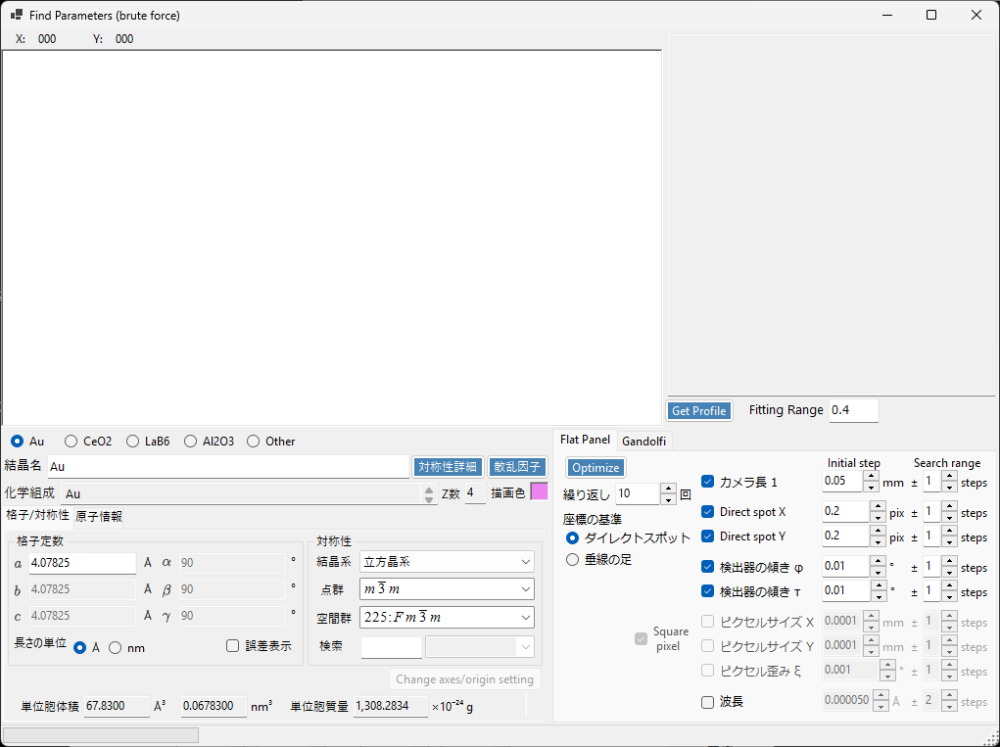
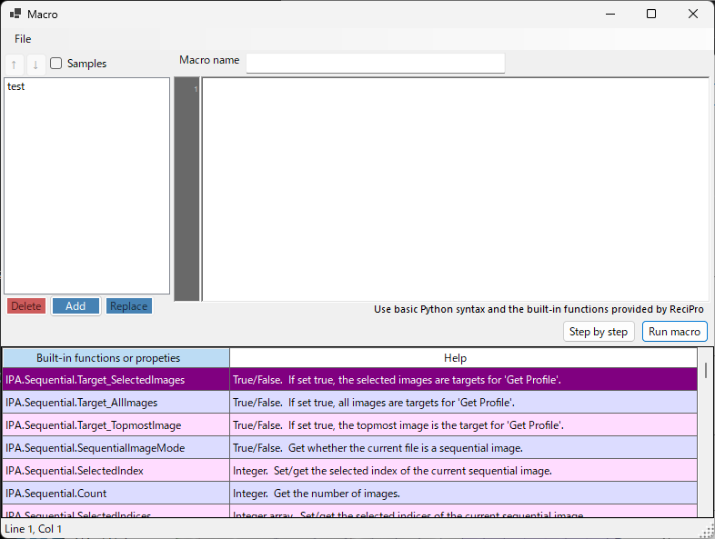

<!-- 260601Cl: 旧 doc と現行コード(各ツールフォーム/Macro)の検証結果を基に各種ツールを再構成。260601Cl: 自動キャプチャ画像を組込。 -->
<!-- 261124Cl: 強度テーブルと R-AXIS 補正の節を実際の入口 (ツール → R-AXIS画像の校正) に統合。表示名・総当たりの探索対象・サンプルマクロの説明を現行版に合わせて訂正。非表示になった強度テーブルのボタンの記述を削除。表示名 (自動実行の手順、パターンマッチング・キーワード、複数選択・平均・積算、一次元化の対象) を実表示に合わせ、自動実行でロック中のファイルを再試行する動作を追記。 -->

# 各種ツール

メインウィンドウ右側の縦型ツールバーやメニューから起動する補助ツールを説明します。パラメータ校正やマクロを使った具体的な作業手順は[実際の手順](4-procedures.md)を参照してください。

## R-AXIS 画像の校正 (Calibrate Raxis Image)

［ツール → R-AXIS画像の校正］で開きます。同じサイズの R-AXIS IV の `.stl` 画像を 2 枚指定し、2 枚の強度が一致するように強度変換表を最適化します。変換表は制御点で表され、最適化の際は変換表の要素の総和を一定に保ちます。結果はグラフで表示されます。検出器の強度応答の校正などに用います。

## 自動実行 (Auto procedure)

フォルダを監視して新しい画像を自動で読み込み、読込後に一連の処理を自動実行するツールです。

- **監視と自動読込**: 指定フォルダ（**監視するディレクトリ (Directory to be monitored)**。サブフォルダ含む）を監視し、ファイルの書き込み完了を待ってから読み込みます。ファイル名による絞り込み（ファイル名の番号による **パターンマッチング (Pattern matching)**・**キーワード (Keyword)**）が可能で、条件に合わないファイルは書き込みを待たずに対象から外します。書き込み待ち（約 50 秒）の後もロックされていたファイルは読み飛ばさず、後の走査で再び試します。最初に見つけてから 10 分たってもロックされたままなら諦めます。
- **自動実行**: **新しい画像が読み込まれたら 以下の一連の操作を実行 (Once the new image is loaded, perform the following sequence)** がオンのとき、**自動コントラスト (Auto contrast)** → **中心位置検索 (Find center)** → **スポット検出 (Mask spots)** → **一次元化 (Get profile)** → **マクロ実行 (Execute macro)** のうち、チェックした手順を順に実行します。

実験中に出力フォルダを監視し、画像が届くたびに自動で一次元化する、といった使い方ができます。詳細は[実際の手順](4-procedures.md)を参照してください。

## リング描画 (Draw Ring)

指定した距離・角度・d 値のリングを、IP の傾きや画素歪みを考慮して画像上に描きます。**R (mm)** / **2θ (°)** / **d (Å)** のいずれかをクリックして編集対象を選ぶと、残りは波長・カメラ長から自動計算されます。

## 切り開き (Unroll)

回折像を、ダイレクトスポットを中心とする極座標から直交座標（横軸＝散乱角 2θ、縦軸＝方位角）へ展開します。現在は専用ウィンドウではなく、ツールバーの **切り開き (Unroll image)** ボタンとプロパティの **切り開き画像の設定 (Unrolled Image Option)** タブで設定します。展開には一次元化と同じサブピクセル強度分配アルゴリズムを使います。

## 回転ぼかし (Circumferential Blur)

リングパターンを円周（方位角）方向にぼかすツールです。ぼかし角を 1 つ指定して適用します。

## シーケンシャル画像 (Sequential image)

マルチフレーム画像（NeXus（`.nxs`）や多ページ TIFF など。時系列・温度系列・放射光エネルギースキャン）を扱うツールです。

- フレーム一覧から 1 枚を選んで表示、またはトラックバーで送ります。
- **複数選択 (Multi selection)** で複数フレームを選び、**平均 (Average)** または **積算 (Summation)** を計算できます。
- **1次元化 (Get Profile)** で積分するフレームを、**一次元化の対象 (Target(s) of "Get Profile")** で **全画像 (All images irrespective of current selections)** / **選択した画像 (The selected image(s))** / **最初の画像のみ (Only the topmost image)** から選べます。
- フレームにエネルギー情報があれば、そのフレームを 1 枚選んだときに波長を更新します。

## 画像保存（IPA 形式）

IP の傾き φ・τ と画素歪み ξ を補正し、正方形画素・指定解像度の画像として保存します。カメラ長・波長・中心位置などのメタデータも書き込まれ、幾何情報を保ったまま他の画像処理に渡せます。

## パラメータ校正（幾何学的）

標準物質の回折リングから、波長・カメラ長・画素サイズ・画素歪み・傾き（φ, τ）を最適化するツールです。標準試料の画像 1 枚（Primary）、またはカメラ長を変えて撮った 2 枚（Primary / Secondary）を使い、ピークを選んで **実行! (Refine!)** で最適化します。収束の様子（楕円中心・残差）はグラフで確認できます。具体的な手順は[実際の手順](4-procedures.md)を参照してください。

## パラメータ校正（力ずく）

カメラ長・中心位置・傾き（φ, τ）と、必要なら波長（既定ではオフ）を、勾配法ではなく総当たり（グリッド探索）で求めるツールです。メイン画面に読み込んだ標準試料の画像 1 枚を使います。不完全なリングやノイズの多いデータなど、幾何学的最適化が収束しにくい場合に有効です。標準物質は Au / CeO₂ / LaB₆ / Al₂O₃ から選ぶか、**その他 (Other)** を選んで結晶を入力します。詳しい手順は[パラメータ校正（力ずく）](6-find-parameter.md)を、全体の流れは[実際の手順](4-procedures.md)を参照してください。

## マクロ

Python ライクなスクリプトで操作を自動化する機能です。メインウィンドウの **マクロ → 編集 (Macro → Editor)** メニューからマクロエディタを開きます。

- `for` / `if` / `while` / `def` / `class` や算術・`math` モジュールが使えます。
- `IPA.File` / `IPA.Wave` / `IPA.Detector` / `IPA.Profile` / `IPA.Sequential` / `IPA.Image` / `IPA.Mask` / `IPA.PDI` / `IPA.IntegralProperty` などの API で各操作を呼べます。
- **サンプルを表示 (Show samples)** をオンにすると、読み取り専用のサンプルマクロ（基本ループ・幾何設定・一括処理・方位角分割・マスク・PDIndexer 送信など）を表示できます。ステップ実行で変数を確認できます。

関数の一覧と使用例は[マクロ](5-macro/index.md)を、マクロを使った手順例は[実際の手順](4-procedures.md)を参照してください。

