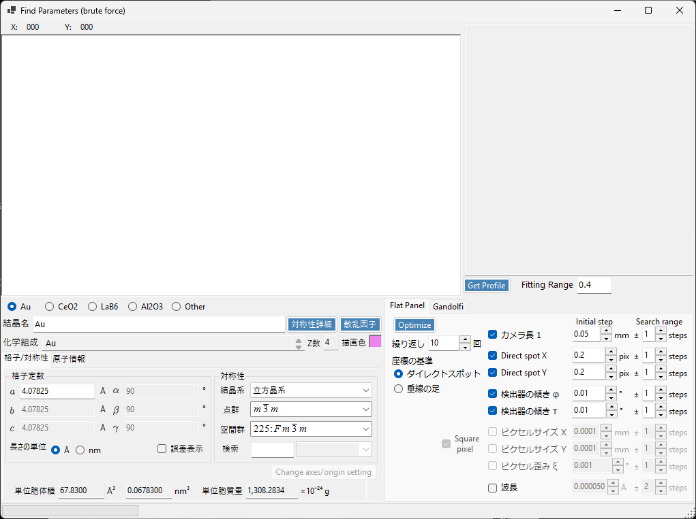

<!-- 260601Cl 追加: Wiki の "Find parameter (brute force)" を移行。スクリーンショットは旧 wiki アップロード (user-images) を流用。 -->
<!-- 261124Cl: 評価の基準・評価値 R の式・刻みの更新規則・上位表示件数・ボタン名を実装 (FormFindParameterBruteForce) に合わせて訂正。 -->

# パラメータ校正（力ずく / brute force）

力ずく（brute force）モードは、各パラメータを総当たり（グリッド探索）的に変動させ、

- 計算したピーク位置とフィッティングで得たピーク位置（2θ）のずれが小さい
- ピークが高い（鋭い）

という条件を最もよく満たす最適値を探します。幾何学的最適化が収束しにくい、不完全なリングやノイズの多いデータに有効です。ツールの概要は[各種ツール](3-tools.md)、基本的な流れは[実際の手順](4-procedures.md)も参照してください。

## 手順

1. 画像データとパラメータを読み込ませて、**パラメータ校正（brute force）** をクリックします。

    
    

2. **標準試料**を選択します。選択肢にない場合は **その他 (Other)** を選び、手動入力してください。
3. **一次元化 (Get Profile)** でプロファイルを表示させます。
4. 最適化に使いたくないピーク線は、ダブルクリックすると除外できます。
5. オプションを設定し、**最適化 (Optimize)** ボタンを押すと最適化が始まります。

## オプション

### Fitting range

各ピークに対してフィッティングする角度範囲を指定します。

### 繰り返し回数

最適化を繰り返すサイクル数を指定します。

### 各パラメータのオプション

チェックした項目に対して最適化が行われます。各パラメータは、指定したステップ（**Initial step**）で、指定した範囲（**Search range**）を動きます。

たとえばカメラ長の初期値が 100 mm、Initial step が 0.05 mm、Search range が 4 の場合、99.80, 99.85, 99.90, 99.95, 100.00, 100.05, 100.10, 100.15, 100.20 mm の 9（＝Search range × 2 + 1）通りのカメラ長を試します。

各パラメータの試行回数が N1, N2, N3, … のとき、1 サイクルの総試行回数は N1 × N2 × N3 × … になります。上の例で 4 個のパラメータをそれぞれ Search range = 4, 4, 3, 6 とすると、(4×2+1) × (4×2+1) × (3×2+1) × (6×2+1) = 7371 回となります。つまり 7371 通りのパラメータ群を試し、評価値 R（後述）が最小になる組み合わせを探します。

!!! warning
    **Search range** を大きくすると試行回数が急増し、1 サイクルの時間が長くなります。ご注意ください。

## ステータス画面

パラメータ校正中は、上のようなステータス画面が表示されます。

- **Cycle**: その時点でのサイクル数です。あるサイクルが終わると、そのサイクル内でベストだったパラメータ群を初期値として次のサイクルが始まります。もしベストなパラメータがサイクル開始時と全く同じであれば、ステップを規定の系列（1, 1.3, 1.8, 2.4, 3.2, 4.2, 5.6, 7.5 × 10ⁿ）で一段小さい値にして次のサイクルに入ります（例: 0.05 mm の次は 0.042 mm）。
- **Current best values**: その時点でのベストのパラメータです。
- **Current steps**: その時点での各パラメータのステップです。
- **No1, No2, …**: 探索を始めてからの評価値の上位 4 件が表示されます（異なる評価値が 5 件以上たまってから表示されます）。最初はどんどん下がっていき、最適値に近づくと収束します。

## 評価値 R

評価値 R の計算式は次の通りです。

ここで \(2\theta_{\mathrm{calc},i}\) は現在のパラメータで計算したピーク \(i\) の位置、\(2\theta_{\mathrm{fit},i}\) はプロファイルへのフィッティングで得た位置（いずれも度）、*H* はバックグラウンド減算後のピークの高さ、*W* は重み（**Weight**、既定 100）です。平面検出器の場合、式は次のとおりです。

$$
R = 1000\left[\sum_i \left(2\theta_{\mathrm{calc},i} - 2\theta_{\mathrm{fit},i}\right)^2 + \frac{W}{\sum_i H_i}\right]
$$

位置のずれが小さく、ピークが高い（鋭い）ほど R は小さくなります。半値幅そのものは評価に使いません。
