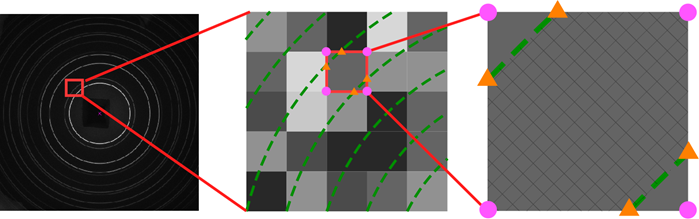

<!-- 260602Cl: 旧 doc/IPAnalyzerAlgorithm.pdf §3 を基に作成（リード言語: 日本語）。 -->
<!-- 261124Cl: 表を「出力の横軸」と「まとめる範囲」に分け、積算後の規格化の違いを追記 (Ring.GetConcenrticProfile / GetProfileThreadWithTiltCorrectionNew / GetUnrolledImageArray / GetRadialProfile で確認)。 -->

# Appendix A3. 画像の積算

2 次元画像を 1 次元プロファイルへ変換するときの最大の問題は、**積算の角度ステップ間隔が画素間隔（画素サイズ）より小さい場合に、複数のステップにまたがる画素の強度を各ステップへどう配分するか** という点です。IPAnalyzer は、この配分を **面積分配法** で行います。

---

## 面積分配法

本ソフトでは、ステップを区切る線（等回折角の境界）と画素との交点を計算し、各ステップに含まれる画素の **面積** を求めて、その面積に比例して強度を配分します。

{width=680px}

この方法には次の特徴があります。

- 各画素の内部ではステップ境界の円弧を **直線として近似** します。これは計算速度のための処置であり、実用上はほとんど問題になりません。
- [A1. 検出器の幾何](a1-geometry.md) の傾き補正・画素形状補正が必要なとき、画素の形状は厳密には正方形になりません。そこで本ソフトでは画素の **四隅の座標を逐次計算** し、四角形（一般には平行四辺形）の形として面積を求めます。

この方式により、原理的には角度ステップをどれだけ細かくしても、画素強度は各ステップへ滑らかに配分されます。

---

## 適用範囲

同一の面積分配アルゴリズムは、次の 3 種類の積算すべてに用いられています。違いは、出力の横軸に残る座標と、出力の 1 点にまとめる画素の範囲です。

| 機能 | 出力の横軸 | 出力の 1 点にまとめる範囲 | 用途 |
|------|------|------|------|
| **散乱角積算 (Concentric integration)** | 回折角 $2\theta$（または d 値） | 積算範囲内の全方位角で、$2\theta$（または d）の 1 ステップに入る画素 | 通常の $2\theta$–強度プロファイルの作成。 |
| **偏角積算 (Radial integration)** | 方位角 $\chi$ | **リング半径 (Donut radius)** ± **リング幅 (Donut width)** の環の中で、方位角の 1 ステップ（**ステップ (Sector angle step (Sweep step))**）に入る画素 | リングの方位角依存性（配向・歪み）の評価。 |
| **切り開き画像 (Unrolled image)** | $2\theta$（横）× 方位角 $\chi$（縦） | $2\theta$ の 1 ステップと方位角の 1 区画（$360^\circ/N$）の両方に入る画素 | リングを切り開いた 2 次元展開像の作成。 |

いずれも有効な画素だけを使います。マスクした画素と、**画像範囲の設定 (Integral Region)** タブで除外した画素は寄与しません。

---

## 積算後の規格化

配分した強度の規格化のしかたは、機能によって異なります。

- **散乱角積算**（フラットパネル検出器で、横軸が $2\theta$ または d 値）と **切り開き画像**: ステップごと（切り開き画像では画素ごと）に配分された強度を合計し、その合計を、そのステップに寄与した量で割ります。画素の各部分の寄与は、散乱線に垂直でカメラ長の距離にある面へ投影した面積、つまりその部分が張る立体角で測り、カメラ長の距離で正面から見た画素 1 個分を単位として数えます。したがって結果は単位立体角あたりの平均強度で、ステップ幅や 1 ステップに入る画素の数には依りません。また、平面検出器で高角ほど画素 1 個あたりの立体角が小さくなる効果も補正されます。画素が 1 つも入らないステップは 0 になります。
- **偏角積算**: 方位角のステップごとに、配分された強度を単純に合計するだけで、割り算はしません。そのため値は、環の幅（**リング幅 (Donut width)**）や方位角のステップに比例して大きくなります。

各機能の操作方法は [3. 各種ツール](../3-tools.md) を参照してください。
