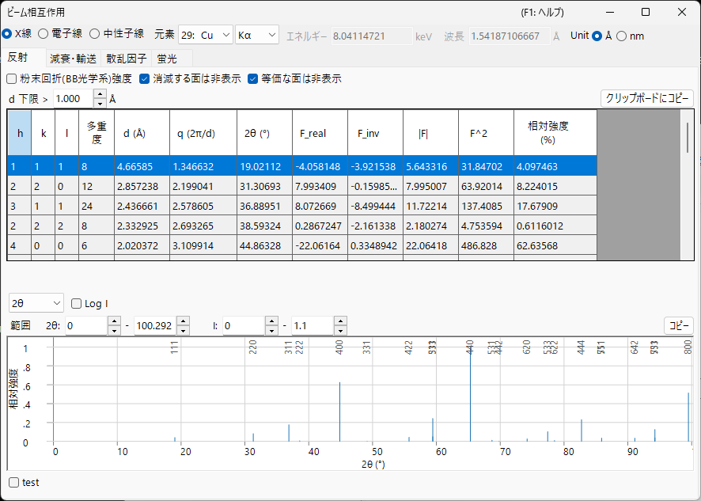

<!-- 260605Cl: ReciPro の docs/src/ja/3-scattering-factor.md を IPAnalyzer 付録へ移植（リード言語: 日本語）。散乱因子ウィンドウは ReciPro と共通の Crystallography.Controls コンポーネント。 -->
<!-- 261124Cl: 現行画面 (結晶ウィンドウ → ビーム相互作用 → 反射タブ) の説明に全面改訂。同じ共有コントロールの ReciPro docs/src/ja/3-beam-interaction.md を基に、IPAnalyzer で使う範囲 (標準結晶の反射一覧・構造因子) に絞った。旧 Scattering Factor ウィンドウの画像を外し、現行画面の画像 (assets/references/beam-interaction-reflections-ja.png、ReciPro から複製) に差し替え。 -->

# Appendix A5. 散乱因子 (Scattering Factor)

現行版では、結晶の反射と構造因子は **ビーム相互作用 (Beam Interaction)** ウィンドウの **反射 (Reflections)** タブに表示されます（旧版の Scattering Factor ウィンドウはこれに置き換わりました）。このタブは、選択中の結晶について許される結晶面（反射）の一覧を作り、それぞれの **構造因子** と回折強度を計算します。放射線の種類（X線・電子線・中性子線）を切り替えられるので、同じ結晶の構造因子を回折手法ごとに比較できます。

IPAnalyzer では、パラメータ校正で用いる標準結晶を定義する結晶ウィンドウ（[パラメータ校正（幾何学的）](../3-tools.md) の **設定 (Set crystal)** で開く結晶ウィンドウ、または [6. パラメータ校正（力ずく）](../6-find-parameter.md) の結晶の欄）で、**ビーム相互作用 (Beam interaction)** ボタンを押すか、結晶の欄の右クリックメニューから **ビーム相互作用 (Beam Interaction)** を選んで開きます。

上部の帯で入射ビームを選び、その下の **反射 (Reflections)** タブに、反射の一覧表（上）と同じ反射のスティック図（下）が表示されます。条件を変えると一覧はすぐに再計算されます。ほかのタブ（**減衰・輸送 (Attenuations & transport)**・**散乱因子 (Scattering factors)**・**蛍光 (Fluorescence)**）は IPAnalyzer では使いません。これらについては [ReciPro のマニュアルの「ビーム相互作用」](https://seto77.github.io/ReciPro/3-beam-interaction/) を参照してください。

---

## キーボード・マウスショートカット

このウィンドウに特別なキー／マウスの組み合わせはありません。<kbd>F1</kbd> でこのマニュアルページが開き、**クリップボードにコピー (Copy)** で反射の一覧表を表計算ソフトに貼り付け可能なテキストとして書き出します。

---

## ビームと波長

- **X線 / 電子線 / 中性子線 (X-ray / Electron / Neutron)** : 原子散乱因子は入射線の種類によって異なるため、ここで切り替えます。
- **X線** の場合は **元素 (Element)**（アノード材）と特性線（Kα など）を選ぶと、その特性X線の波長が自動的に設定されます。
- **エネルギー (Energy)**（keV）と **波長 (Wavelength)**（Å）は相互に連動し、どちらを設定しても他方が更新されます。いずれも各反射の 2θ の計算に使われます。
- **Unit**（**Å** / **nm**）は、面間隔などに使う長さの単位を切り替えます。

---

## 反射タブのオプション

- **粉末回折(BB光学系)強度 (Powder diffraction intensities (Bragg-Brentano optics))** : 粉末回折（Bragg–Brentano 光学系）の強度 $I \propto m\,\lvert F\rvert^2 / V^2 \times L$ として相対強度を計算します（$m$: 多重度、$V$: 単位胞体積）。L は X線ではローレンツ偏光因子 $L = (1+\cos^2 2\theta)/(\sin 2\theta\,\sin\theta)$、電子線・中性子線では偏光項を含まないローレンツ因子 $L = 1/(\sin 2\theta\,\sin\theta)$ です。波長が届かない反射（d < λ/2）の強度は 0 です。オフのときは構造因子の強度 $\lvert F\rvert^2$ を表示します。オンにすると **等価な面は非表示** と **消滅する面は非表示** も自動的にオンになり、変更できなくなります（淡色表示）。
- **等価な面は非表示 (Hide equivalent planes)**（既定オン） : 結晶学的に等価な面を 1 つにまとめて表示します。**多重度 (Multi.)** 列はこれがオンのときだけ表示されます。
- **消滅する面は非表示 (Hide prohibited planes)**（既定オン） : 消滅則で系統的に消滅する面を一覧から除外します。オフのときは **消滅条件 (Condition)** 列に、その面を禁制にする反射条件が表示されます。
- **d 下限 > (d-spacing cutoff >)**（既定 1 Å） : これより小さい d（面間隔）の反射面を一覧から除外します（長さの単位は **Unit** の選択に従います）。

---

## 反射一覧表

各行が 1 つの反射（または対称等価な面のグループ）に対応します。

| 列 | 意味 |
|------|------|
| **h, k, l** | ミラー指数 |
| **多重度 (Multi.)** | 対称等価な面の数 |
| **d (Å)** | 面間隔 |
| **q (2π/d)** | 散乱ベクトルの大きさ |
| **2θ (°)** | 選択した波長に対する回折角 |
| **F_real** | 構造因子の実部 |
| **F_inv** | 構造因子の虚部 |
| **\|F\|** | 構造因子の振幅（$= \sqrt{F_\text{real}^2 + F_\text{inv}^2}$） |
| **F^2** | 構造因子の強度（$\lvert F\rvert^2$） |
| **相対強度 (%) (Rel. Int. (%))** | 最大反射を 100 とした相対強度 |
| **消滅条件 (Condition)** | その面が満たさない消滅条件（**消滅する面は非表示** がオフのときのみ表示） |

表の下には、同じ反射群がスティック状の回折図として描かれ、強いピークには *hkl* のラベルが付きます。セレクタで横軸を **2θ**・**d**・**Q**（$= 4\pi\sin\theta/\lambda$）から選び、**Log I** で強度軸を線形と対数で切り替え、**範囲 (Range)** の各ボックスで描画範囲を設定します。

---

## クリップボードにコピー

**クリップボードにコピー (Copy)** で、反射の一覧表を Excel などの表計算ソフトへ貼り付け可能なテキストとしてクリップボードにコピーします。

---

## 関連項目

- [付録トップ](index.md)
- [4. 実際の手順](../4-procedures.md) — 構造因子の計算対象となる標準結晶の定義。
- [6. パラメータ校正（力ずく）](../6-find-parameter.md)
- [ReciPro のマニュアルの「ビーム相互作用」](https://seto77.github.io/ReciPro/3-beam-interaction/) — 同じウィンドウの 4 つのタブすべての説明。
