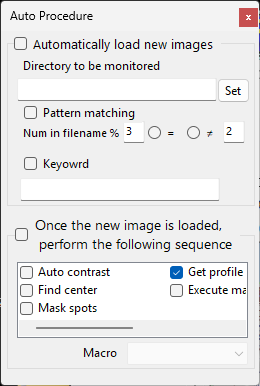

<!-- 261124Cl: Retranslated from en/3-tools.md (UI labels follow the localized GUI). -->

# 도구

이 페이지에서는 메인 창 오른쪽의 세로 도구 모음이나 메뉴에서 실행하는 보조 도구들을 설명합니다. 매개변수 보정과 매크로를 사용한 구체적인 절차는 [작업 절차](4-procedures.md)를 참조하십시오.

## R-AXIS 이미지 보정 (Calibrate Raxis Image)

**도구 (Tool) → R-AXIS 이미지 보정 (Calibrate Raxis Image)** 으로 엽니다. 크기가 같은 R-AXIS IV `.stl` 이미지 두 장을 지정하면, 두 강도가 일치하도록 강도 변환 테이블을 최적화합니다. 테이블은 제어점으로 표현되며, 최적화하는 동안 요소의 합은 일정하게 유지됩니다. 결과는 그래프로 표시됩니다. 예를 들어 검출기의 강도 응답을 보정하는 데 사용합니다.

**강도 테이블 (Intensity table)** 도구 모음 버튼에는 현재 버전에서 기능이 할당되어 있지 않습니다.

## 자동 절차 (Auto procedure)

폴더를 감시하여 새 이미지를 자동으로 불러오고, 불러온 뒤 일련의 조작을 실행하는 도구입니다.

- **감시 및 자동 불러오기**: 지정한 폴더 (하위 폴더 포함) 를 감시하고, 파일 쓰기가 끝난 뒤 그 파일을 읽습니다. 파일 이름으로 걸러낼 수 있습니다 (번호 일치, 키워드).
- **자동 실행**: 자동 대비 (Auto Contrast) → 중심 찾기 (Find Center) → 스폿 마스크 (Mask Spots) → 프로파일 가져오기 (Get Profile) → Execute Macro 중에서 체크한 단계를 차례로 실행합니다.

이를 이용하면 실험 중에 출력 폴더를 감시하여, 이미지가 도착할 때마다 자동으로 적분하는 식으로 사용할 수 있습니다. 자세한 내용은 [작업 절차](4-procedures.md)를 참조하십시오.

## 링 그리기 (Draw Ring)

IP 기울기와 픽셀 왜곡을 고려하여, 지정한 거리, 각도, 또는 d 값에 해당하는 링을 이미지 위에 그립니다. **R (mm)** / **2θ (°)** / **d (Å)** 중 하나를 클릭하여 편집할 값을 고르면, 나머지 값은 파장과 카메라 길이로부터 자동으로 계산됩니다.

## 펼치기 (Unroll)

다이렉트 스폿을 중심으로 하는 극좌표의 회절 이미지를 직교 좌표 (가로축 = 산란각 2θ, 세로축 = 방위각) 로 펼칩니다. 현재는 전용 창이 아니라 **이미지 펼치기 (Unroll image)** 도구 모음 버튼과 속성 창의 **펼친 이미지 옵션 (Unrolled Image Option)** 탭으로 설정합니다. 펼치기에는 1차원화와 같은 서브픽셀 강도 분배 알고리즘이 사용됩니다.

## 원주 블러 (Circumferential Blur)

링 패턴을 원주 (방위각) 방향으로 흐리게 하는 도구입니다. 블러 각도 하나를 지정하여 적용합니다.

## 연속 이미지 (Sequential Image)

다중 프레임 이미지 (NeXus (`.nxs`), 다중 페이지 TIFF 등. 시계열, 온도 시리즈, 방사광 에너지 스캔) 를 다루는 도구입니다.

- 프레임 목록에서 프레임 하나를 선택하여 표시하거나, 트랙바로 차례로 넘겨 볼 수 있습니다.
- **다중 선택 (Multi selection)** 으로 여러 프레임을 선택하고 그 **평균 (Average)** 또는 **합산 (Summation)** 을 계산합니다.
- 1차원화의 대상은 "모든 프레임 / 선택한 프레임 / 최상단 프레임만" 중에서 고를 수 있습니다.
- 프레임에 에너지 정보가 있으면, 그 프레임 하나를 선택했을 때 파장이 갱신됩니다.

## 이미지 저장 (IPA 형식)

IP 기울기 φ, τ 와 픽셀 왜곡 ξ 를 보정하여, 지정한 해상도의 정사각형 픽셀로 이미지를 저장합니다. 카메라 길이, 파장, 중심 위치 같은 메타데이터도 함께 기록되므로, 기하 정보를 유지한 채 다른 이미지 처리에 넘길 수 있습니다.

## 매개변수 찾기 (기하학적)

표준 물질의 회절 고리로부터 파장, 카메라 길이, 픽셀 크기, 픽셀 왜곡, 기울기 (φ, τ) 를 최적화하는 도구입니다. 표준 시료의 이미지 한 장 (주 (Primary)), 또는 카메라 길이를 바꾸어 찍은 두 장 (주 (Primary) 와 보조 (Secondary)) 을 사용하며, 피크를 선택하고 **정밀화! (Refine!)** 로 최적화합니다. 수렴 상태 (타원 중심, 잔차) 는 그래프로 확인할 수 있습니다. 구체적인 절차는 [작업 절차](4-procedures.md)를 참조하십시오.

## 매개변수 찾기 (전수 탐색)

경사법이 아니라 격자 전수 탐색으로 카메라 길이, 중심 위치, 기울기 (φ, τ), 그리고 선택적으로 파장 (기본값은 꺼짐) 을 구하는 도구입니다. 메인 창에 불러온 표준 시료 이미지 한 장을 사용합니다. 고리가 불완전하거나 잡음이 많은 데이터처럼 기하학적 최적화가 잘 수렴하지 않을 때 효과적입니다. 표준 물질은 Au / CeO₂ / LaB₆ / Al₂O₃ 중에서 고르거나, **기타 (Other)** 를 선택하여 결정을 입력합니다. 자세한 절차는 [매개변수 찾기 (전수 탐색)](6-find-parameter.md)를, 작업 흐름은 [작업 절차](4-procedures.md)를 참조하십시오.

## 매크로

Python 과 비슷한 스크립트로 조작을 자동화하는 기능입니다. 메인 창의 **매크로 (Macro) → 편집기 (Editor)** 메뉴에서 매크로 편집기를 엽니다.

- `for` / `if` / `while` / `def` / `class`, 산술 연산, `math` 모듈을 사용할 수 있습니다.
- `IPA.File` / `IPA.Wave` / `IPA.Detector` / `IPA.Profile` / `IPA.Sequential` / `IPA.Image` / `IPA.Mask` / `IPA.PDI` / `IPA.IntegralProperty` 등의 API 로 각 조작을 호출할 수 있습니다.
- **예제 표시 (Show samples)** 를 켜면 읽기 전용 예제 매크로 (기본 루프, 기하 설정, 일괄 처리, 방위각 분할, 마스킹, PDIndexer 로 전송 등) 를 볼 수 있습니다. 단계 실행으로 변수를 확인할 수 있습니다.

전체 함수 레퍼런스와 예제는 [매크로](5-macro/index.md)를, 매크로를 이용한 작업 흐름은 [작업 절차](4-procedures.md)를 참조하십시오.

