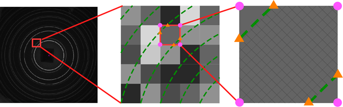

<!-- 261124Cl: Retranslated from en/appendix/a3-image-integration.md (UI labels follow the localized GUI). (2nd update: synced with en changes) -->

# 부록 A3. 이미지 적분

2차원 이미지를 1차원 프로파일로 변환할 때 가장 큰 문제는 **적분의 각도 스텝 크기가 픽셀 간격 (픽셀 크기) 보다 작을 때, 여러 스텝에 걸쳐 있는 픽셀의 강도를 어떻게 분배하느냐**입니다. IPAnalyzer 는 이 분배를 **면적 기반 분배 방법**으로 처리합니다.

---

## 면적 기반 분배 방법

이 소프트웨어에서는 각 스텝을 구분하는 선 (회절각이 같은 경계) 과 픽셀의 교점을 프로그램이 계산하고, 각 픽셀 중 해당 스텝 안에 들어가는 **면적**을 구하여, 그 면적에 비례하여 강도를 분배합니다.

{width=680px}

이 방법에는 다음과 같은 특징이 있습니다.

- 각 픽셀 안에서는 스텝 경계의 호를 **직선으로 근사**합니다. 이는 계산 속도를 위한 것이며, 실제로는 거의 문제가 되지 않습니다.
- [A1. 검출기 기하](a1-geometry.md)의 기울기 보정과 픽셀 모양 보정이 필요한 경우, 픽셀 모양은 엄밀한 정사각형이 아닙니다. 그래서 이 소프트웨어는 **픽셀의 네 꼭짓점 좌표를 차례로 계산**하여, 사각형 (일반적으로 평행사변형) 으로서 면적을 구합니다.

이 방식을 쓰면 원리적으로, 각도 스텝을 아무리 세밀하게 해도 픽셀 강도가 스텝들에 매끄럽게 분배됩니다.

---

## 적용 범위

같은 면적 기반 분배 알고리즘이 다음 세 종류의 적분 모두에 사용됩니다. 세 가지는 출력의 가로축에 어떤 좌표가 남는지, 그리고 어떤 픽셀들이 하나의 출력 점으로 모이는지가 다릅니다.

| 기능 | 출력의 가로축 | 하나의 출력 점으로 모이는 픽셀 | 용도 |
|------|------|------|------|
| **동심 적분 (Concentric integration)** | 회절각 $2\theta$ (또는 d-간격) | 적분 영역 안의 모든 방위각에 걸쳐, $2\theta$ (또는 d) 의 한 스텝 안에 드는 픽셀 | 일반적인 $2\theta$-강도 프로파일 작성. |
| **방사 적분 (Radial integration)** | 방위각 $\chi$ | **도넛 반지름 (Donut radius)** ± **도넛 폭 (Donut width)** 으로 주어지는 고리 안에서, 방위각의 한 스텝 (**섹터 각도 스텝 (스윕 스텝) (Sector angle step (Sweep step))**) 안에 드는 픽셀 | 고리의 방위각 의존성 (배향, 변형) 평가. |
| **Unrolled image** (펼친 이미지) | $2\theta$ (가로) × 방위각 $\chi$ (세로) | $2\theta$ 의 한 스텝과 방위각의 한 섹터 ($360^\circ/N$) 안에 드는 픽셀 | 고리를 잘라 펼친 2차원 펼친 이미지 작성. |

어느 경우든 유효한 픽셀만 사용됩니다. 마스크된 픽셀과 **적분 영역 (Integral Region)** 탭에서 제외한 픽셀은 기여하지 않습니다.

---

## 적분 후의 규격화

분배된 강도는 기능에 따라 다른 방식으로 규격화됩니다.

- **동심 적분 (Concentric integration)** (평판 검출기, $2\theta$ 또는 d-간격 가로축) 과 **Unrolled image** (펼친 이미지): 각 스텝 (펼친 이미지에서는 각 픽셀) 마다 분배된 강도를 합산하고, 그 합을 해당 스텝에 기여한 양으로 나눕니다. 픽셀의 각 부분의 기여는, 카메라 길이 거리에서 산란선에 수직인 평면에 투영한 면적, 즉 그 부분이 차지하는 입체각으로 측정하며, 카메라 길이에서 정면으로 본 픽셀 하나를 단위로 셉니다. 따라서 결과는 단위 입체각당 평균 강도가 됩니다. 스텝 폭이나 한 스텝에 드는 픽셀 수에 의존하지 않으며, 평판 검출기에서 고각으로 갈수록 픽셀당 입체각이 줄어드는 효과도 보정됩니다. 픽셀이 하나도 들어가지 않은 스텝은 0 입니다.
- **방사 적분 (Radial integration)**: 분배된 강도를 방위각 스텝마다 단순히 합산할 뿐 나누지 않습니다. 따라서 값은 고리의 폭 (**도넛 폭 (Donut width)**) 과 방위각 스텝에 따라 커집니다.

각 기능의 조작 방법은 [3. 도구](../3-tools.md)를 참조하십시오.
