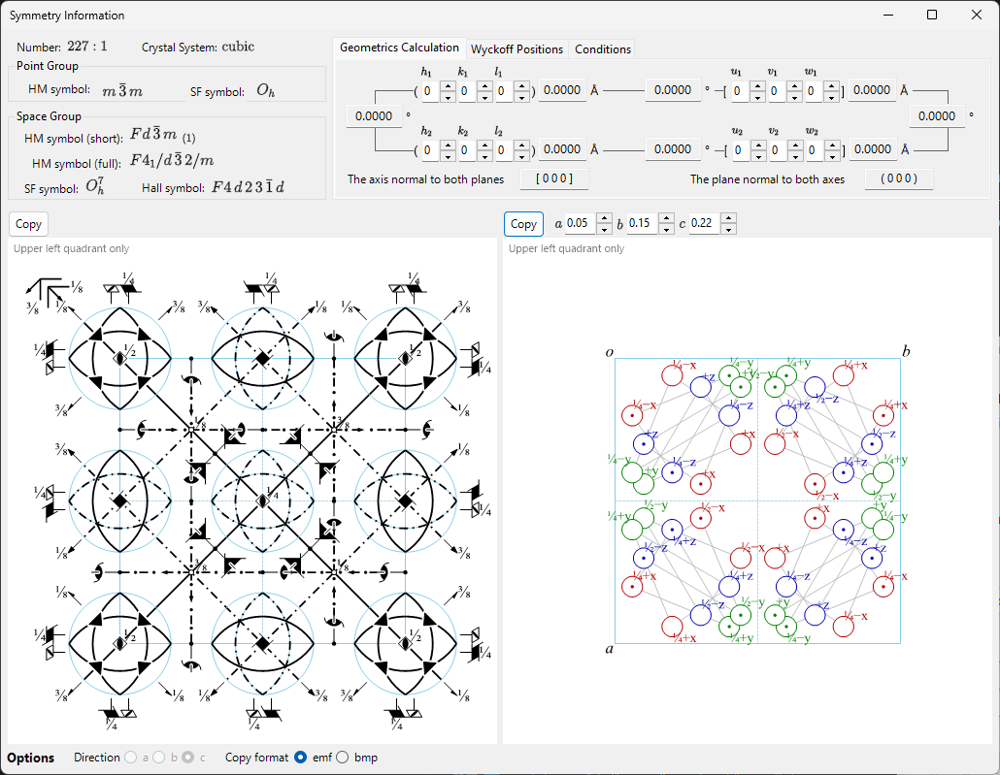

<!-- 261124Cl: Retranslated from en/appendix/a4-symmetry-information.md (UI labels follow the localized GUI). -->

# 부록 A4. 대칭 정보

**대칭 정보 (Symmetry Information)** 는 선택한 결정의 공간군 대칭에 관한 상세한 정보를 표시하며, 아울러 *International Tables for Crystallography* Vol. A 의 양식으로 대칭 요소와 일반 위치의 모식도를 그립니다.

IPAnalyzer 에서는 이 하위 창을 **결정 창** ([4. 작업 절차](../4-procedures.md)의 기하 보정과 [6. 매개변수 찾기 (전수 탐색)](../6-find-parameter.md)에서 사용하는 CrystalControl) 에서 엽니다.

창은 공간군 식별 영역 (왼쪽 위), 탭이 있는 계산/표 영역 (오른쪽 위), 두 개의 모식도 (아래) 로 나뉩니다.

---

## 키보드 및 마우스 단축키

이 창에는 특별한 키나 마우스 조합이 없습니다. <kbd>F1</kbd> 은 이 매뉴얼 페이지를 열고, 두 개의 **Copy** 버튼은 대칭 요소 도와 일반 위치 도를 클립보드에 넣습니다 (비트맵으로, 또는 **EMF** 를 체크하면 벡터 EMF 로).

---

## 공간군 식별 정보

왼쪽 위 패널에는 현재 공간군에 대해 다음이 나열됩니다.

- **Number** (1–230) 와 설정 (setting) 인덱스
- **Crystal System** (결정계)
- **Point Group** (점군) : Hermann–Mauguin (HM) 기호와 Schoenflies (SF) 기호
- **Space Group** (공간군) : HM 짧은 기호, HM 완전 기호, SF 기호, 그리고 **Hall symbol** (Hall 기호)

---

## Geometrics Calculation (기하 계산)

두 결정면 \((h_1, k_1, l_1)\), \((h_2, k_2, l_2)\) 또는 두 방향 지수 \([u_1, v_1, w_1]\), \([u_2, v_2, w_2]\) 를 입력하면 다음을 얻습니다.

- 각 면의 d-간격 / 각 축의 길이,
- 두 면 (또는 두 축) 사이의 각도,
- **두 면에 공통인 정대축** (두 면의 교선 방향) 과 **두 방향을 모두 포함하는 면**.

이 계산은 현재 단위 격자의 계량을 반영합니다.

---

## Wyckoff Positions (Wyckoff 위치)

모든 Wyckoff 위치를 다중도, Wyckoff 문자, 자리 대칭, 그리고 일반 위치인지 특수 위치인지와 함께 나열합니다. 중심이 있는 격자에서는 격자 병진 벡터가 머리글 행에 표시됩니다.

---

## Conditions (반사 조건)

격자 중심화와 미끄럼/나사 대칭 조작으로부터 생기는 반사 조건입니다.

---

## 대칭 요소 도와 일반 위치 도

아래쪽의 두 패널은 공간군의 대칭 모식도를 *International Tables for Crystallography* Vol. A 의 표기법으로 재현합니다.

- **대칭 요소 (왼쪽)**: 회전축/나사축, 거울면/미끄럼면, 반전 중심/회반전점을 관례적인 도형 기호로 그립니다.
  - 입방정계의 \(F\) 격자에서는 단위 격자의 8분의 1 (왼쪽 위 사분면만) 만 표시됩니다.
- **일반 위치 (오른쪽)**: 일반 등가 위치를 원으로 그리고 (쉼표는 거울상을 나타냄), 분율 좌표를 덧붙입니다.
  - 입방정계에 한해, 3회 회전축으로 연결된 세 원을 보조선으로 잇습니다.

모식도 아래의 컨트롤:

- **Direction** (`a` / `b` / `c`) : 투영 방향이 되는 결정축을 고릅니다.
- 각 모식도를 벡터 이미지 (**EMF**) 또는 래스터 이미지 (**BMP**) 로 클립보드에 **Copy** 합니다. EMF 는 PowerPoint 에서 그룹 해제하여 편집할 수 있습니다.

---

## 참고 항목

- [부록 첫 페이지](index.md)
- [4. 작업 절차](../4-procedures.md) — 표준 결정을 이용한 기하 매개변수 보정.
- [6. 매개변수 찾기 (전수 탐색)](../6-find-parameter.md)
