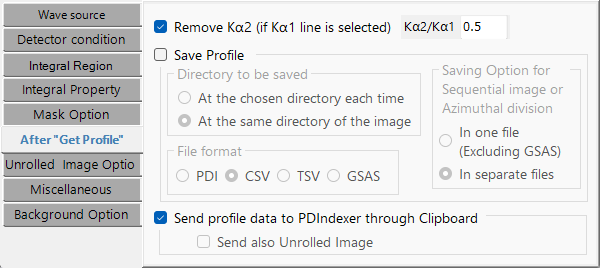
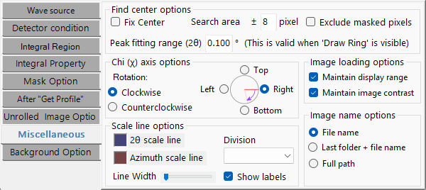

<!-- 261124Cl: Retranslated from en/2-property-windows.md (UI labels follow the localized GUI). (2nd update: synced with en changes) -->

# Janelas de propriedades

A janela de propriedades é onde se configuram a fonte, as condições do detector e as diversas condições para integrar a imagem em um perfil 1D. Cada aba também pode ser aberta diretamente pelo menu **Propriedade (Property)** da janela principal.

Os rótulos abaixo são os exibidos na interface em português, com o nome em inglês entre parênteses. Os títulos usam os nomes reais das abas e dos controles.

## Fonte de ondas (Wave source)

Define o tipo de feixe incidente e o comprimento de onda. A fonte pode ser de raios X, elétrons ou nêutrons. Para raios X, ao selecionar um elemento e uma transição (linha K, linha L etc.), o comprimento de onda é preenchido automaticamente; para radiação síncrotron, digite o comprimento de onda diretamente. Para feixes de elétrons e de nêutrons, digite a energia ou o comprimento de onda (o comprimento de onda dos elétrons tem correção relativística).

- **Corrigir polarização linear (ou seja, polarizado linear → não polarizado) (Correct linear polarization (i.e., linear polarized → unpolarized))**: corrige uma intensidade com polarização linear para o equivalente não polarizado (para dados de síncrotron). A fórmula de correção abaixo depende do azimute χ e do ângulo de espalhamento 2θ. Se a direção de referência de χ (definida na aba **Diversos (Miscellaneous)**) for **Esquerda (Left)** / **Direita (Right)**, o feixe é tratado como polarizado horizontalmente; se for **Topo (Top)** / **Base (Bottom)**, como polarizado verticalmente.

$$
I_\text{corr}(2\theta,\chi) = \frac{I(2\theta,\chi)}{\sin^2\chi + \cos^2\chi\,\cos^2 2\theta} \times \frac{1}{2}\left(1 + \cos^2 2\theta\right)
$$

## Condição do detector (Detector condition)

Define as condições geométricas do detector. Corresponde à antiga "IP Condition", com o acréscimo de seletores do sistema de coordenadas e da forma do detector.

- **Coordenadas (Coordinates)**: **Ponto direto (Direct spot)** (referência no ponto direto) / **Pé (Foot)** (referência no pé da perpendicular).
- **Tipo de detector (Detector type)**: **Painel plano (Flat panel)** / **Gandolfi**.
- **Posição do ponto direto (Direct spot position)** e **Comprimento da câmera 1 (Camera Length 1)**: a posição do ponto direto (X, Y pix) e a distância da amostra ao ponto direto (mm).
- **Posição do pé (Foot position)** e **Comprimento da câmera 2 (Camera Length 2)**: no modo **Pé**, a posição do pé da perpendicular e a distância da amostra ao pé.
- **Forma do pixel (Pixel Shape)**: tamanho do pixel X, Y (mm) e ξ (Ksi, o ângulo de inclinação do paralelogramo).
- **Raio Gandolfi (Gandolfi Radius)**: o raio, quando a forma Gandolfi está selecionada.
- **Correção esférica (Spherical correction)**: para um detector curvo, digite o inverso do raio de curvatura, 1/R, em m⁻¹ (a unidade exibida na tela é /m). Use 0 para um detector plano.
- **Inclinação (Tilt)**: a inclinação do IP, φ (Phi) e τ (Tau).

Veja a [Visão geral](0-overview.md) para as definições da inclinação φ, τ e do ξ do pixel.

## Região de integração (Integral Region)

Especifica a região da imagem a ser integrada.

- **Retângulo (Rectangle)**: escolha a **Direção (Direction)** (**Completo (Full)** / **Topo (Top)** / **Base (Bottom)** / **Esquerda (Left)** / **Direita (Right)** / Vertical / Horizontal / Free) e defina a **Largura da banda (Band Width)**, o **Ângulo (Angle)** (no modo Free) e **Ambos os lados (Both Side)**.
- **Setor (Sector)**: especifique o intervalo angular com **Ângulo inicial (Start Angle)** / **Ângulo final (End Angle)**.
- **Pixels excepcionais (Exceptional pixels)**: exclui os **Pontos mascarados (Masked Spots)**, os pixels **Abaixo da intensidade de (Under intensity of)** / **Acima da intensidade de (Over intensity of)** os limiares indicados e um número de **pixels das bordas (pixels from edges)**. As máscaras por limiar são recalculadas a partir das intensidades corrigidas sempre que as intensidades mudam: quando outro quadro de uma imagem sequencial é selecionado, após inverter/girar e quando a subtração de fundo ou a correção de polarização é alterada.

## Propriedade de integração (Integral Property)

Define o método e o passo de integração.

- **Integração concêntrica (dispersiva em ângulo de espalhamento) (Concentric integration (scattering angle dispersive))**: escolha a unidade do eixo horizontal entre **Ângulo (Angle)** (2θ, °) / **distância d (d-spacing)** (Å) e defina **Início / Fim / Passo (Start / End / Step)**. A escolha de **Padrão de saída (Output pattern)** (Bragg - Brentano / Debye - Scherrer) não tem efeito no resultado na versão atual.
- **Integração radial (padrão em fatias) (Radial integration (cake pattern))**: soma a intensidade de uma região em forma de anel para cada azimute. Especifique o centro do anel (**Raio do anel (Donut radius)**) e a meia largura (**Largura do anel (Donut width)**) como ângulo de espalhamento 2θ (**Ângulo**) ou distância d (**distância d**), e defina o **Passo do ângulo do setor (passo de varredura) (Sector angle step (Sweep step))** (passo azimutal). O eixo horizontal do perfil resultante é o azimute χ (°).

## Opção de máscara (Mask Option)

Define as condições de mascaramento e de detecção de pontos (uma ampliação da antiga "Find Center & Spots"). As configurações de detecção do centro ficam na aba **Diversos (Miscellaneous)**.

- **Meia máscara (Half mask)**: botões que mascaram rapidamente a metade superior, inferior, esquerda ou direita da imagem.
- **Modo de máscara manual (Manual mask mode)**: ativa o mascaramento interativo na imagem principal. As formas são **Círculo (Circle)** (arraste para definir o centro e o raio), **Polígono (Polygon)** (clique para adicionar vértices), **Retângulo (Rectangle)** (arraste os vértices diagonais), **Curva spline (Spline curve)** e **Ponto (Spot)** (clique esquerdo/direito para adicionar/remover pontos).
- **Herdar configuração de máscara (Take over mask setting)**: como a máscara é tratada quando uma nova imagem é carregada (**Nenhum (None)** / **Herdar o estado atual da máscara (Take over the current mask state)** / **Herdar o arquivo de máscara (Take over the mask file)**).
- **Opção de mascarar pontos (Mask spots option)** → **Desvio de critério para "Mascarar pontos" (Criterial deviation for "Mask Spots")**: o limiar estatístico para a detecção de pontos (quantos desvios-padrão acima da média um pixel deve estar para ser considerado um ponto).

## Após "Obter perfil" (After "Get Profile")

Define o salvamento e o envio após a integração.

- **Salvar perfil (Save Profiles)**: escolha o destino em **Diretório a ser salvo (Directory to be saved)** (**No mesmo diretório da imagem (At the same directory of the image)** / **No diretório escolhido a cada vez (At the chosen directory each time)**) e o formato em **Formato de arquivo (File format)** (**PDI** / **CSV** / **TSV** / **GSAS**). A saída em GSAS só é possível para a integração concêntrica com eixo horizontal em 2θ. Em **Opção de salvamento para imagem sequencial ou divisão azimutal (Saving option)**, **Em um arquivo (exceto GSAS) (In one file (Excluding GSAS))** não grava o GSAS; nesse caso, escolha **Em arquivos separados (In separate files)**.
- **Enviar dados do perfil ao PDIndexer pela área de transferência (Send profile data to PDIndexer through Clipboard)**: envia o perfil, pela área de transferência, a uma instância do PDIndexer em execução.

## Opção de imagem desenrolada (Unrolled Image Option)

Define os parâmetros da imagem desenrolada (Unroll).

- **Unidade e intervalo horizontal (distância do ponto direto) (Horizontal (distance from direct spot) unit and range)**: **Início / Fim / Passo (Start / End / Step)** em ângulo de espalhamento 2θ (°) (as opções de unidade são exibidas, mas a versão atual sempre trata os valores como 2θ). A largura da imagem de saída ≈ (Fim − Início) / Passo.
- **Passo vertical (ângulo do setor) (Vertical (sector angle) step)**: o número de divisões N no azimute. A imagem de saída tem N pixels de altura, e cada linha cobre 360°/N (0,5° para o valor padrão 720).

O desenrolamento mapeia a imagem de difração polar centrada no ponto direto em uma imagem cartesiana (ângulo vs. distância).

## Diversos (Miscellaneous)

Uma aba que reúne as configurações mais finas de exibição e de coordenadas.

- **Opções de nome de imagem (Image name options)**: **Nome do arquivo (File name)** / **Última pasta + nome do arquivo (Last folder + file name)** / **Caminho completo (Full path)**.
- **Opções de carregamento de imagem (Image loading options)** → **Manter intervalo de exibição (Maintain display range)**: se o zoom e a posição de exibição (intervalo de exibição) são mantidos quando uma nova imagem é carregada.
- **Opções do eixo Chi (χ) (Chi (χ) axis options)**: a posição de referência (**Topo (Top)** / **Base (Bottom)** / **Esquerda (Left)** / **Direita (Right)**) e o sentido de rotação (**Horário (Clockwise)** / **Anti-horário (Counterclockwise)**). χ é usado como referência pela correção de polarização e pela integração radial.
- **Opções da linha de escala (Scale line options)**: cores (**2θ scale line** / **Azimuth scale line**), **Largura da linha (Line Width)**, **Divisão (Division)** e **Mostrar rótulos (Show labels)**.
- **Opções de localizar centro (Find center options)**: **Search area ±**, **Peak fitting range (2θ)**, **Fixar centro (Fix Center)** e **Excluir pixels mascarados (Exclude masked pixels)**.

## Opção de fundo (Background Option)

Define a correção por uma imagem de fundo.

- **Configuração da imagem de referência (Reference image setting)**: define a imagem exibida no momento como fundo (**Definir a imagem atual como fundo (Set the current image as background)**) ou a apaga (**Limpar (Clear)**).
- **Coeficiente (Coefficient)**: o fator aplicado à imagem de fundo.

Usada para subtrair um fundo aditivo, como o espalhamento pelo ar. Para cada pixel, calcula-se \(I_\mathrm{out} = I - cB\) (\(B\): imagem de fundo, \(c\): coeficiente). Para excluir os pixels próximos às bordas da imagem, use **pixels das bordas (pixels from edges)** na aba **Região de integração (Integral Region)**.

