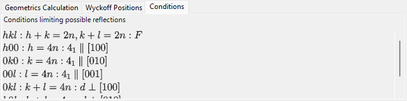

<!-- 261124Cl: Retranslated from en/appendix/a4-symmetry-information.md (UI labels follow the localized GUI). -->

# Apêndice A4. Informação de simetria

**Informação de simetria (Symmetry Information)** exibe informações detalhadas sobre a simetria do grupo espacial do cristal selecionado e, além disso, desenha diagramas esquemáticos dos elementos de simetria e das posições gerais no estilo das *International Tables for Crystallography* Vol. A.

No IPAnalyzer, esta subjanela é aberta a partir da **Crystal window** (o CrystalControl usado na calibração geométrica em [4. Procedimentos](../4-procedures.md) e em [6. Encontrar parâmetros (força bruta)](../6-find-parameter.md)).

A janela é dividida em uma área de identificação do grupo espacial (canto superior esquerdo), uma área de cálculos/tabelas com abas (canto superior direito) e dois diagramas esquemáticos (parte inferior).

---

## Atalhos de teclado e mouse

Esta janela não tem combinações especiais de teclas ou de mouse. <kbd>F1</kbd> abre esta página do manual, e os dois botões **Copy** colocam o diagrama dos elementos de simetria e o diagrama das posições gerais na área de transferência (como bitmap, ou como EMF vetorial quando **EMF** está marcado).

---

## Identificação do grupo espacial

O painel do canto superior esquerdo lista, para o grupo espacial atual:

- **Number** (1–230) e o índice da configuração (setting)
- **Crystal System**
- **Point Group** : símbolos de Hermann–Mauguin (HM) e de Schoenflies (SF)
- **Space Group** : símbolo HM curto, símbolo HM completo, símbolo SF e **Hall symbol**

---

## Geometrics Calculation (cálculo geométrico)

Informe dois planos cristalinos \((h_1, k_1, l_1)\), \((h_2, k_2, l_2)\) ou dois índices de direção \([u_1, v_1, w_1]\), \([u_2, v_2, w_2]\) para obter:

- a distância interplanar de cada plano / o comprimento de cada eixo,
- o ângulo entre os dois planos (ou os dois eixos),
- **o eixo de zona comum aos dois planos** (a direção de sua interseção) e **o plano que contém as duas direções**.

Esses cálculos respeitam a métrica da célula unitária atual.

---

## Wyckoff Positions (posições de Wyckoff)

Lista cada posição de Wyckoff com sua multiplicidade, sua letra de Wyckoff, sua simetria de sítio e se é uma posição geral ou especial. Para redes centradas, os vetores de translação da rede são mostrados na linha de cabeçalho.

---

## Conditions (condições de reflexão)

As condições de reflexão decorrentes da centragem da rede e dos operadores de simetria de deslizamento/helicoidais.

---

## Diagramas dos elementos de simetria e das posições gerais

Os dois painéis da parte inferior reproduzem os diagramas esquemáticos de simetria do grupo espacial na notação das *International Tables for Crystallography* Vol. A.

- **Elementos de simetria (esquerda)**: eixos de rotação/helicoidais, planos de espelho/deslizamento e centros de inversão/pontos de rotoinversão são desenhados com os símbolos gráficos convencionais.
  - Para a rede \(F\) do sistema cúbico, é mostrado apenas um oitavo da célula unitária (somente o quadrante superior esquerdo).
- **Posições gerais (direita)**: as posições equivalentes gerais são marcadas como círculos (uma vírgula indica uma imagem especular), anotadas com suas coordenadas fracionárias.
  - Somente para o sistema cúbico, linhas auxiliares ligam os três círculos relacionados por um eixo de rotação de ordem três.

Controles abaixo dos diagramas:

- **Direction** (`a` / `b` / `c`) : escolhe o eixo cristalino ao longo do qual projetar.
- **Copy** : copia cada diagrama para a área de transferência como imagem vetorial (**EMF**) ou imagem raster (**BMP**); o EMF pode ser desagrupado e editado no PowerPoint.

---

## Veja também

- [Página inicial do apêndice](index.md)
- [4. Procedimentos](../4-procedures.md) — calibração geométrica dos parâmetros usando um cristal padrão.
- [6. Encontrar parâmetros (força bruta)](../6-find-parameter.md)
