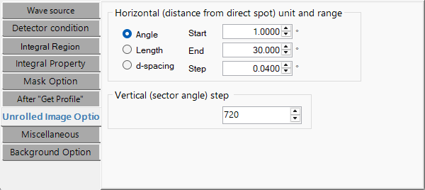

<!-- 261124Cl: Retranslated from en/2-property-windows.md (UI labels follow the localized GUI). -->

# Окна свойств

В окне свойств настраиваются источник излучения, условия детектора и различные условия одномерного преобразования. Каждую вкладку можно также открыть непосредственно из меню **Свойства (Property)** главного окна.

Ниже приведены метки в том виде, в каком они показаны в русском интерфейсе, с английскими названиями в скобках. Заголовки используют фактические названия вкладок и элементов управления.

## Источник волн (Wave source)

Задаёт тип падающего пучка и длину волны. Источником может быть рентгеновское, электронное или нейтронное излучение. Для рентгеновского излучения выбор элемента и перехода (линия K, линия L и т. д.) автоматически заполняет длину волны; для синхротронного излучения введите длину волны напрямую. Для электронных и нейтронных пучков введите энергию или длину волны (длина волны электронов вычисляется с релятивистской поправкой).

- **Коррекция линейной поляризации (Correct linear polarization)**: приводит интенсивность линейно поляризованного излучения к эквиваленту неполяризованного (для синхротронных данных). Приведённая ниже формула коррекции зависит от азимута χ и угла рассеяния 2θ. Если опорное направление χ (задаётся на вкладке **Разное (Miscellaneous)**) — **Слева (Left)**/**Справа (Right)**, пучок считается горизонтально поляризованным; если **Сверху (Top)**/**Снизу (Bottom)** — вертикально поляризованным.

$$
I_\text{corr}(2\theta,\chi) = \frac{I(2\theta,\chi)}{\sin^2\chi + \cos^2\chi\,\cos^2 2\theta} \times \frac{1}{2}\left(1 + \cos^2 2\theta\right)
$$

## Условия детектора (Detector condition)

Задаёт геометрические условия детектора. Соответствует прежнему «IP Condition», к которому добавлен выбор системы координат и формы детектора.

- **Координаты (Coordinates)**: **Прямое пятно (Direct spot)** (отсчёт от прямого пятна) / **Подножие (Foot)** (отсчёт от основания перпендикуляра).
- **Тип детектора (Detector type)**: **Плоская панель (Flat panel)** / **Гандольфи (Gandolfi)**.
- **Положение прямого пятна (Direct spot position)** и **Длина камеры 1 (Camera Length 1)**: положение прямого пятна (X, Y pix) и расстояние от образца до прямого пятна (mm).
- **Положение подножия (Foot position)** и **Длина камеры 2 (Camera Length 2)**: в режиме «Подножие» (Foot) — положение основания перпендикуляра и расстояние от образца до основания.
- **Форма пикселя (Pixel Shape)**: размер пикселя X, Y (mm) и ξ (Ksi, угол скоса параллелограмма).
- **Радиус Гандольфи (Gandolfi Radius)**: радиус, если выбрана форма Гандольфи.
- **Сферическая коррекция (Spherical correction)**: для изогнутого детектора введите величину, обратную радиусу кривизны, 1/R (mm⁻¹). Для плоского детектора используйте 0.
- **Наклон (Tilt)**: наклон IP φ (Phi) и τ (Tau).

Определения наклона φ, τ и параметра пикселя ξ см. в разделе [Обзор](0-overview.md).

## Область интегрирования (Integral Region)

Задаёт область изображения, подлежащую одномерному преобразованию.

- **Прямоугольник (Rectangle)**: выберите **Направление (Direction)** (Полностью (Full) / Сверху (Top) / Снизу (Bottom) / Слева (Left) / Справа (Right) / Vertical / Horizontal / Free) и задайте **Ширина полосы (Band Width)**, **Угол (Angle)** (в режиме Free) и **Обе стороны (Both Side)**.
- **Сектор (Sector)**: задайте угловой диапазон с помощью **Начальный угол (Start Angle)** / **Конечный угол (End Angle)**.
- **Исключительные пиксели (Exceptional pixels)**: исключает **Маскированные рефлексы (Masked Spots)**, пиксели **С интенсивностью ниже (Under intensity of)** / **С интенсивностью выше (Over intensity of)** заданных порогов, а также заданное число **пикселей от краёв (pixels from edges)**.

## Свойства интегрирования (Integral Property)

Задаёт метод и шаг интегрирования.

- **Концентрическое интегрирование (с дисперсией по углу рассеяния) (Concentric integration (scattering-angle dispersive))**: выберите единицу горизонтальной оси — **Угол (Angle)** (2θ, °) / **Межплоскостное расстояние (d-spacing)** (Å) — и задайте **Старт / Конец / Шаг (Start / End / Step)**. Выбор **Выходная картина (Output pattern)** (Брэгга — Брентано (Bragg - Brentano) / Дебая — Шеррера (Debye - Scherrer)) в текущей версии не влияет на результат.
- **Радиальное интегрирование (картина «торта») (Radial integration (cake pattern))**: суммирует интенсивность кольцевой области для каждого азимута. Задайте центр кольца (**Радиус кольца (Donut radius)**) и полуширину (**Ширина кольца (Donut width)**) через угол рассеяния 2θ (**Угол (Angle)**) или межплоскостное расстояние (**Межплоскостное расстояние (d-spacing)**), а также **Шаг угла сектора (Sector angle step)** (азимутальный шаг). Горизонтальная ось полученного профиля — азимут χ (°).

## Параметры маски (Mask Option)

Задаёт условия маскирования и обнаружения рефлексов (расширение прежнего «Find Center & Spots»). Настройки определения центра находятся на вкладке **Разное (Miscellaneous)**.

- **Половинная маска (Half mask)**: кнопки, которые быстро маскируют верхнюю, нижнюю, левую или правую половину изображения.
- **Режим ручной маски (Manual mask mode)**: включает интерактивное маскирование на главном изображении. Формы: **Окружность (Circle)** (перетаскиванием задаются центр и радиус), **Многоугольник (Polygon)** (щелчками добавляются вершины), **Прямоугольник (Rectangle)** (перетаскиванием задаются диагональные вершины), **Сплайн-кривая (Spline curve)** и **Рефлекс (Spot)** (щелчком левой/правой кнопкой рефлексы добавляются/удаляются).
- **Takeover**: как обрабатывается маска при загрузке нового изображения (**Нет (None)** / **Перенести текущее состояние маски (Take over the current mask state)** / **Перенести файл маски (Take over the mask file)**).
- **Find Spots** → **Deviation**: статистический порог для обнаружения рефлексов.

## После «Получить профиль» (After "Get Profile")

Задаёт сохранение и отправку после одномерного преобразования.

- **Save File**: выберите место сохранения («В том же каталоге, что и изображение» (the same directory as the image) или «Каждый раз в выбранном каталоге» (a directory chosen each time)) и формат из **PDI** / **CSV** / **TSV** / **GSAS**. Вывод в GSAS возможен только для концентрического интегрирования с горизонтальной осью 2θ. Если несколько профилей сохраняются в один файл, GSAS не записывается; в этом случае сохраняйте их в отдельные файлы.
- **Send PDIndexer**: отправляет профиль через буфер обмена в запущенный экземпляр PDIndexer.

## Параметры развёрнутого изображения (Unrolled Image Option)

Задаёт параметры развёрнутого (Unroll) изображения.

- **Горизонталь (Horizontal)**: **Старт / Конец / Шаг (Start / End / Step)** по углу рассеяния 2θ (°) (варианты единиц отображаются, но текущая версия всегда трактует значения как 2θ). Ширина выходного изображения ≈ (End − Start) / Step.
- **Шаг по вертикали (Vertical)**: **число делений (number of divisions)** N по азимуту. Высота выходного изображения — N пикселей, и каждая строка охватывает 360°/N (0.5° при значении по умолчанию 720).

Развёртывание отображает полярное дифракционное изображение с центром в прямом пятне в декартово изображение (угол — расстояние).

## Разное (Miscellaneous)

Вкладка, на которой собраны более тонкие настройки отображения и координат.

- **Параметры имени изображения (Image name options)**: только имя файла / родительская папка + имя файла / полный путь.
- **Сохранять диапазон отображения (Maintain display range)**: переносятся ли масштаб и положение отображения (диапазон отображения) при загрузке нового изображения.
- **Параметры оси хи (χ) (Chi (χ) axis options)**: опорное положение (**Сверху (Top)** / **Снизу (Bottom)** / **Слева (Left)** / **Справа (Right)**) и направление вращения (**По часовой стрелке (Clockwise)** / **Против часовой стрелки (Counterclockwise)**). Азимут χ используется коррекцией поляризации и радиальным интегрированием.
- **Параметры масштабной линии (Scale line options)**: цвет, ширина, число делений и отображение меток.
- **Параметры поиска центра (Find center options)**: диапазон поиска, диапазон подгонки пика, фиксация центра и исключение маскированных пикселей.

## Параметры фона (Background Option)

Задаёт коррекцию с помощью фонового изображения.

- **Background image**: задайте текущее отображаемое изображение как фон (**Задать текущее изображение как фон (Set the current image as background)**) или очистите его (**Очистить (Clear)**).
- **Коэффициент (Coefficient)**: множитель, применяемый к фоновому изображению.

Используется для вычитания аддитивного фона, например рассеяния на воздухе. Для каждого пикселя вычисляется \(I_\mathrm{out} = I - cB\) (\(B\): фоновое изображение, \(c\): коэффициент). Чтобы исключить пиксели вблизи краёв изображения, используйте **пикселей от краёв (pixels from edges)** на вкладке **Область интегрирования (Integral Region)**.

