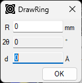

<!-- 261124Cl: Retranslated from en/3-tools.md (UI labels follow the localized GUI). (2nd update: synced with en changes) -->

# Инструменты

На этой странице описаны вспомогательные инструменты, запускаемые с вертикальной панели инструментов справа в главном окне или из меню. Конкретные процедуры с калибровкой параметров и макросами см. в разделе [Процедуры](4-procedures.md).

## Калибровать изображение R-AXIS (Calibrate Raxis Image)

Откройте инструмент командой **Инструменты → Калибровать изображение R-AXIS (Tool → Calibrate Raxis Image)**. Укажите два изображения R-AXIS IV `.stl` одинакового размера; инструмент оптимизирует таблицу преобразования интенсивности так, чтобы интенсивности двух изображений совпали. Таблица представлена контрольными точками, а сумма её элементов при оптимизации остаётся постоянной. Результат показывается в виде графика. Инструмент используется, например, для калибровки отклика детектора по интенсивности.

## Автопроцедура (Auto procedure)

Инструмент, который отслеживает папку, автоматически загружает новые изображения и после загрузки выполняет последовательность операций.

- **Отслеживание и автозагрузка**: отслеживает указанную папку (**Отслеживаемый каталог (Directory to be monitored)**, включая вложенные папки) и считывает файл после завершения его записи. Файлы можно отбирать по имени (**Сопоставление с шаблоном (Pattern matching)** по номеру в имени файла, **Ключевое слово (Keyword)**); не подходящие файлы пропускаются без ожидания. Если файл после ожидания окончания записи (около 50 с) всё ещё заблокирован, он не отбрасывается, а повторно проверяется при последующих сканированиях; от него отказываются, только если он остаётся заблокированным через 10 минут после первого обнаружения.
- **Автоматическое выполнение**: когда включён параметр **После загрузки нового изображения выполнить следующую последовательность (Once the new image is loaded, perform the following sequence)**, выполняет по порядку отмеченные шаги из **Auto contrast** → **Find center** → **Mask spots** → **Get profile** → **Execute macro**.

Это позволяет, например, отслеживать папку вывода во время эксперимента и автоматически интегрировать каждое поступающее изображение. Подробности см. в разделе [Процедуры](4-procedures.md).

## Нарисовать кольцо (Draw Ring)

Рисует на изображении кольцо на заданном расстоянии, угле или значении d с учётом наклона IP и искажения пикселя. Щёлкните одно из полей **R (mm)** / **2θ (°)** / **d (Å)**, чтобы выбрать редактируемую величину; остальные вычисляются автоматически по длине волны и длине камеры.

## Развёртывание (Unroll)

Разворачивает дифракционное изображение из полярных координат с центром в прямом пятне в декартовы координаты (горизонтальная ось — угол рассеяния 2θ; вертикальная ось — азимут). Теперь оно настраивается не в отдельном окне, а с помощью кнопки **Развернуть изображение (Unroll image)** на панели инструментов и вкладки **Параметры развёрнутого изображения (Unrolled Image Option)** в свойствах. При развёртывании используется тот же субпиксельный алгоритм распределения интенсивности, что и при интегрировании в одномерный (1D) профиль.

## Окружное размытие (Circumferential Blur)

Инструмент, размывающий кольцевую картину в окружном (азимутальном) направлении. Задайте один угол размытия и примените его.

## Последовательное изображение (Sequential Image)

Инструмент для работы с многокадровыми изображениями (NeXus (`.nxs`), многостраничные TIFF и т. п.; временные ряды, температурные серии, энергетические сканы на синхротроне).

- Выберите один кадр в списке кадров, чтобы отобразить его, или перебирайте кадры ползунком.
- С помощью **Множественный выбор (Multi selection)** выберите несколько кадров и вычислите их **Среднее (Average)** или **Суммирование (Summation)**.
- Кадры, интегрируемые командой **Получить профиль (Get Profile)**, выбираются в разделе **Цель(и) «Получить профиль» (Target(s) of "Get Profile")**: **Все изображения независимо от текущего выбора (All images irrespective of current selections)** / **Выбранное(ые) изображение(я) (The selected image(s))** / **Только верхнее изображение (Only the topmost image)**.
- Если кадр содержит сведения об энергии, длина волны обновляется при выборе этого единственного кадра.

## Сохранение изображения (формат IPA)

Корректирует наклон IP φ, τ и искажение пикселя ξ и сохраняет изображение с квадратными пикселями в заданном разрешении. Записываются также метаданные — длина камеры, длина волны, положение центра и т. д., — поэтому изображение можно передать в другую обработку с сохранением геометрической информации.

## Поиск параметров (геометрический)

Инструмент, оптимизирующий длину волны, длину камеры, размер пикселя, искажение пикселя и наклон (φ, τ) по дифракционным кольцам эталонного материала. Используется одно изображение эталонного образца (Primary) или два изображения, снятые при разных длинах камеры (Primary и Secondary); вы выбираете пики и выполняете оптимизацию кнопкой **Уточнить! (Refine!)**. Сходимость (центр эллипса, невязки) можно проверить на графиках. Конкретные шаги см. в разделе [Процедуры](4-procedures.md).

## Поиск параметров (полный перебор)

Инструмент, который находит длину камеры, положение центра, наклон (φ, τ) и, при необходимости, длину волны (по умолчанию выключено) не градиентным методом, а исчерпывающим поиском по сетке. Он использует одно изображение эталонного образца, загруженное в главное окно. Он эффективен, когда геометрическая оптимизация плохо сходится, например при неполных кольцах или зашумлённых данных. Выберите эталон из Au / CeO₂ / LaB₆ / Al₂O₃ или выберите **Другой (Other)** и введите кристалл. Подробные шаги см. в разделе [Поиск параметров (полный перебор)](6-find-parameter.md), а общий рабочий процесс — в разделе [Процедуры](4-procedures.md).

## Макрос

Функция автоматизации операций с помощью Python-подобных скриптов. Откройте редактор макросов из меню **Макрос → Редактор (Macro → Editor)** главного окна.

- Доступны `for` / `if` / `while` / `def` / `class`, арифметика и модуль `math`.
- API, такие как `IPA.File` / `IPA.Wave` / `IPA.Detector` / `IPA.Profile` / `IPA.Sequential` / `IPA.Image` / `IPA.Mask` / `IPA.PDI` / `IPA.IntegralProperty`, позволяют вызывать каждую операцию.
- Включите **Показать примеры (Show samples)**, чтобы просмотреть примеры макросов только для чтения (базовые циклы, настройка геометрии, пакетная обработка, азимутальное деление, маскирование, отправка в PDIndexer и т. д.). При пошаговом выполнении можно просматривать переменные.

Полный справочник функций и примеры см. в разделе [Макрос](5-macro/index.md), а рабочие процессы на основе макросов — в разделе [Процедуры](4-procedures.md).

