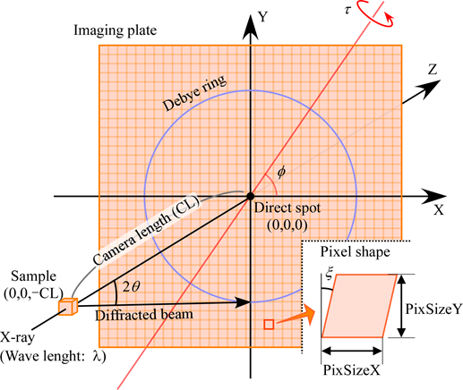

<!-- 261124Cl: Retranslated from en/appendix/a1-geometry.md (UI labels follow the localized GUI). -->

# Приложение A1. Геометрия детектора и преобразования координат

На этой странице с помощью формул определяются **система координат, коррекция наклона IP и коррекция формы пикселя**, которые IPAnalyzer использует для отображения положений пикселей на плоском детекторе (IP, CCD/CMOS) в углы дифракции. Обзор системы координат см. также на [главной странице приложения](index.md) и в разделе [0. Обзор](../0-overview.md).

---

## Система координат и параметры

Внутри IPAnalyzer последовательно используется **правая** система координат.

- Точка, в которой рентгеновский или электронный пучок пересекает IP (**прямое пятно**), принимается за начало координат $(0,0,0)$, а ось $Z$ совпадает с направлением распространения пучка.
- Если считать образец бесконечно малым, расстояние между образцом и началом координат определяется как **длина камеры** $\mathrm{CL}$. Следовательно, положение образца — $(0,\ 0,\ -\mathrm{CL})$.
- Ось $X$ совпадает с направлением сканирования считывающего лазера, когда IP не наклонена (направление вправо на изображении). Поэтому ось $Y$ направлена на экране вниз.
- Дифракционное кольцо с углом конуса $2\theta$ наблюдается на ненаклонённой плоскости $XY$ как идеальная окружность радиуса $\mathrm{CL}\tan 2\theta$.

{width=520px}

Свободный поворот трёхмерного объекта в общем случае требует трёх осей, но поскольку распределение колец Дебая инвариантно относительно поворота вокруг оси $Z$, ось $X$ можно выбрать произвольно. Это убирает одну степень свободы, поэтому наклон IP можно выразить **двумя переменными** $\varphi,\ \tau$.

!!! note "Соответствие с (WIN)PIP"
    Прежняя программа PIP выражает наклон другой парой углов $(\beta,\ \Phi)$. Преобразование из $(\beta,\ \Phi)$ в $(\varphi,\ \tau)$ IPAnalyzer имеет вид $(\beta,\ \Phi)\rightarrow(270^\circ-\beta,\ \Phi)$. Подробности см. в подразделе «Связь с (WIN)PIP» раздела [0. Обзор](../0-overview.md).

---

## Коррекция наклона IP

Наклон IP относительно оптической оси (оси $Z$) представляется поворотом вокруг прямой, проходящей через начало координат и лежащей в плоскости $XY$. Этот поворот можно записать матрицей поворота $R = R_2\,R_1\,R_2^{-1}$ — операцией поворота на $\tau$ ($R_1$) вокруг оси, повёрнутой на $\varphi$ вокруг оси $Z$ ($R_2$).

$$
R_2 = \begin{pmatrix} \cos\varphi & -\sin\varphi & 0 \\ \sin\varphi & \cos\varphi & 0 \\ 0 & 0 & 1 \end{pmatrix},
\qquad
R_1 = \begin{pmatrix} 1 & 0 & 0 \\ 0 & \cos\tau & -\sin\tau \\ 0 & \sin\tau & \cos\tau \end{pmatrix}
$$

Это эквивалентно повороту на угол $\tau$ вокруг единичного вектора $\mathbf{n} = (\cos\varphi,\ \sin\varphi,\ 0)$, составляющего угол $\varphi$ с осью $X$ в плоскости $XY$; раскрывая произведение, получаем

$$
R = R_2\,R_1\,R_2^{-1} =
\begin{pmatrix}
\cos^2\varphi + \cos\tau\,\sin^2\varphi & \cos\varphi\sin\varphi\,(1-\cos\tau) & \sin\varphi\sin\tau \\
\cos\varphi\sin\varphi\,(1-\cos\tau) & \cos^2\varphi\,\cos\tau + \sin^2\varphi & -\cos\varphi\sin\tau \\
-\sin\varphi\sin\tau & \cos\varphi\sin\tau & \cos\tau
\end{pmatrix}
$$

### Прямое преобразование (ненаклонённая плоскость → наклонённая IP)

Точка $P_1 = (X,\ Y,\ 0)$ на ненаклонённой плоскости $XY$ переходит в точку $P_2 = R\,P_1$ на наклонённой IP.

$$
P_2 =
\begin{pmatrix}
X\,(\cos^2\varphi + \cos\tau\sin^2\varphi) + Y\,\cos\varphi\sin\varphi\,(1-\cos\tau) \\
X\,\cos\varphi\sin\varphi\,(1-\cos\tau) + Y\,(\cos^2\varphi\cos\tau + \sin^2\varphi) \\
-X\,\sin\varphi\sin\tau + Y\,\cos\varphi\sin\tau
\end{pmatrix}
$$

### Проекция (наклонённая IP → ненаклонённая плоскость)

На практике нужно обратное направление, а именно координата в плоскости $XY$, которую «пиксель, наблюдаемый на наклонённой IP», занимал бы при отсутствии наклона. Она даётся **центральной (перспективной) проекцией**, которая находит точку $P_3$ пересечения плоскости $XY$ с прямой, соединяющей точку на наклонённой IP и образец $(0,0,-\mathrm{CL})$. Поскольку это проективное преобразование с образцом в качестве центра проекции, получаем

$$
P_3 = \frac{\mathrm{CL}}{\mathrm{CL} + (P_2)_z}\,\big((P_2)_x,\ (P_2)_y,\ 0\big)
$$

Поскольку коррекция наклона, включающая центральную проекцию, является проективным преобразованием, которое можно записать матрицей в однородных координатах, положение каждого пикселя быстро вычисляется на компьютере.

---

## Коррекция формы пикселя

Форма пикселя IP рассматривается как **параллелограмм** с длиной $\mathrm{PixSizeX}$ вдоль оси $X$, длиной $\mathrm{PixSizeY}$ вдоль оси $Y$ и отклонением от прямого угла (углом искажения) $\xi$. Ненулевое $\xi$ означает, что начальная позиция сканирования считывающего лазера смещена; программа предполагает, что это смещение постоянно вдоль оси $Y$.

Фактическая координата $P$ пикселя, отстоящего на $\mathrm{PixNumX}$ в направлении $X$ и на $\mathrm{PixNumY}$ в направлении $Y$ от центрального пикселя, равна

$$
P =
\begin{pmatrix} \mathrm{PixSizeX} & \mathrm{PixSizeY}\,\tan\xi & 0 \\ 0 & \mathrm{PixSizeY} & 0 \\ 0 & 0 & 1 \end{pmatrix}
\begin{pmatrix} \mathrm{PixNumX} \\ \mathrm{PixNumY} \\ 0 \end{pmatrix}
=
\begin{pmatrix} \mathrm{PixNumX}\cdot\mathrm{PixSizeX} + \mathrm{PixNumY}\cdot\mathrm{PixSizeY}\,\tan\xi \\ \mathrm{PixNumY}\cdot\mathrm{PixSizeY} \\ 0 \end{pmatrix}
$$

Сочетая эту коррекцию формы пикселя с описанной выше коррекцией наклона, любой пиксель на наклонённой IP можно отобразить в его правильное положение на ненаклонённой плоскости $XY$. Это отображение лежит в основе определения параметров в следующей главе и раздела [A3. Интегрирование изображения](a3-image-integration.md).
