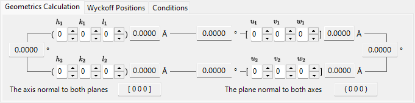

<!-- 261124Cl: Retranslated from en/appendix/a4-symmetry-information.md (UI labels follow the localized GUI). -->

# Приложение A4. Сведения о симметрии

**Сведения о симметрии (Symmetry Information)** показывает подробную информацию о симметрии пространственной группы выбранного кристалла, а также строит схематические диаграммы элементов симметрии и общих позиций в стиле *International Tables for Crystallography* Vol. A.

В IPAnalyzer это вложенное окно открывается из **окна кристалла (Crystal window)** (CrystalControl, используемого в разделе [4. Процедуры](../4-procedures.md) для геометрической калибровки и в разделе [6. Поиск параметров (полный перебор)](../6-find-parameter.md)).

Окно разделено на область идентификации пространственной группы (вверху слева), область расчётов/таблиц с вкладками (вверху справа) и две схематические диаграммы (внизу).

---

## Сочетания клавиш и мыши

В этом окне нет особых сочетаний клавиш или действий мыши. <kbd>F1</kbd> открывает эту страницу руководства, а две кнопки **Copy** помещают в буфер обмена диаграмму элементов симметрии и диаграмму общих позиций (в виде растрового изображения или, если отмечен флажок **EMF**, в виде векторного EMF).

---

## Идентификация пространственной группы

На панели вверху слева для текущей пространственной группы показываются:

- **Number** (1–230) и индекс установки
- **Crystal System** (сингония)
- **Point Group** (точечная группа): символы Германа–Могена (HM) и Шёнфлиса (SF)
- **Space Group** (пространственная группа): краткий символ HM, полный символ HM, символ SF и **Hall symbol** (символ Холла)

---

## Geometrics Calculation

Введите две кристаллографические плоскости \((h_1, k_1, l_1)\), \((h_2, k_2, l_2)\) или два индекса направлений \([u_1, v_1, w_1]\), \([u_2, v_2, w_2]\), чтобы получить:

- межплоскостное расстояние каждой плоскости / длину каждой оси,
- угол между двумя плоскостями (или двумя осями),
- **ось зоны, общую для обеих плоскостей** (направление их пересечения), и **плоскость, содержащую оба направления**.

Эти расчёты учитывают метрику текущей элементарной ячейки.

---

## Wyckoff Positions

Перечисляет все позиции Уайкова с их кратностью, буквой Уайкова, симметрией позиции и указанием, является ли позиция общей или частной. Для центрированных решёток в строке заголовка показываются векторы трансляций решётки.

---

## Conditions

Условия отражения, возникающие из центрировки решётки и из операций симметрии скользящего отражения / винтовых осей.

---

## Диаграммы элементов симметрии и общих позиций

Две панели внизу воспроизводят схематические диаграммы симметрии пространственной группы в обозначениях *International Tables for Crystallography* Vol. A.

- **Элементы симметрии (слева)**: поворотные/винтовые оси, плоскости зеркального/скользящего отражения и центры инверсии / точки инверсионных поворотов изображаются общепринятыми графическими символами.
  - Для решётки \(F\) кубической сингонии показывается только одна восьмая элементарной ячейки (только верхний левый квадрант).
- **Общие позиции (справа)**: общие эквивалентные позиции отмечаются кружками (запятая обозначает зеркальное изображение) с подписями их дробных координат.
  - Только для кубической сингонии вспомогательные линии соединяют три кружка, связанные осью третьего порядка.

Элементы управления под диаграммами:

- **Direction** (`a` / `b` / `c`) : выбор кристаллографической оси, вдоль которой выполняется проекция.
- **Copy** — копирование каждой диаграммы в буфер обмена в виде векторного изображения (**EMF**) или растрового изображения (**BMP**); EMF можно разгруппировать и редактировать в PowerPoint.

---

## См. также

- [Главная страница приложения](index.md)
- [4. Процедуры](../4-procedures.md) — геометрическая калибровка параметров с помощью эталонного кристалла.
- [6. Поиск параметров (полный перебор)](../6-find-parameter.md)
