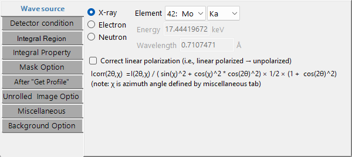

<!-- 261124Cl: Retranslated from en/2-property-windows.md (UI labels follow the localized GUI). -->

# 属性窗口

属性窗口用于设置射线源、探测器条件以及一维化的各种条件。各选项卡也可以从主窗口的 **属性 (Property)** 菜单直接打开。

以下标签为简体中文界面中显示的名称，括号内为英文名称。各标题使用实际的选项卡和控件名称。

## 波源 (Wave source)

设置入射束的种类和波长。射线源可选择 X 射线、电子或中子。对于 X 射线，选择元素和跃迁（K 线、L 线等）后会自动填入波长；对于同步辐射，请直接输入波长。对于电子束和中子束，请输入能量或波长（电子波长已作相对论校正）。

- **校正线偏振 (Correct linear polarization)**：将线偏振的强度校正为等效的非偏振强度（用于同步辐射数据）。下面的校正公式取决于方位角 χ 和散射角 2θ。若 χ 的基准方向（在杂项 (Miscellaneous) 选项卡中设置）为左 (Left) / 右 (Right)，则将束流视为水平偏振；若为上 (Top) / 下 (Bottom)，则视为垂直偏振。

$$
I_\text{corr}(2\theta,\chi) = \frac{I(2\theta,\chi)}{\sin^2\chi + \cos^2\chi\,\cos^2 2\theta} \times \frac{1}{2}\left(1 + \cos^2 2\theta\right)
$$

## 探测器条件 (Detector condition)

设置探测器的几何条件。它对应于旧版的 “IP Condition”，并增加了坐标系和探测器形状的选择项。

- **坐标 (Coordinates)**：**直射斑 (Direct spot)**（以直射斑点为基准）/ **底部 (Foot)**（以垂足为基准）。
- **探测器类型 (Detector type)**：**平板 (Flat panel)** / **Gandolfi**。
- **直射斑位置 (Direct spot position)** 和 **相机长度 1 (Camera Length 1)**：直射斑点的位置 (X, Y pix) 以及样品到直射斑点的距离 (mm)。
- **底部位置 (Foot position)** 和 **相机长度 2 (Camera Length 2)**：在底部 (Foot) 模式下，垂足的位置以及样品到垂足的距离。
- **像素形状 (Pixel Shape)**：像素尺寸 X、Y (mm) 以及 ξ (Ksi，平行四边形的倾斜角)。
- **Gandolfi 半径 (Gandolfi Radius)**：选择 Gandolfi 形状时的半径。
- **球面校正 (Spherical correction)**：对于弯曲的探测器，输入曲率半径的倒数 1/R (mm⁻¹)。平板探测器请输入 0。
- **倾斜 (Tilt)**：IP 的倾斜 φ (Phi) 和 τ (Tau)。

倾斜 φ、τ 和像素 ξ 的定义请参见[概述](0-overview.md)。

## 积分区域 (Integral Region)

指定要一维化的图像区域。

- **矩形 (Rectangle)**：选择 **方向 (Direction)**（完整 (Full) / 上 (Top) / 下 (Bottom) / 左 (Left) / 右 (Right) / Vertical / Horizontal / Free），并设置 **带宽 (Band Width)**、**角度 (Angle)**（Free 模式下）以及 **双侧 (Both Side)**。
- **扇区 (Sector)**：用 **起始角度 (Start Angle)** / **终止角度 (End Angle)** 指定角度范围。
- **异常像素 (Exceptional pixels)**：排除 **已掩蔽斑点 (Masked Spots)**、**强度低于 (Under intensity of)** / **强度高于 (Over intensity of)** 给定阈值的像素，以及 **距边缘像素数 (pixels from edges)** 指定的边缘像素。

## 积分属性 (Integral Property)

设置积分方法和步长。

- **同心积分 (散射角色散) (Concentric integration (scattering-angle dispersive))**：从 **角度 (Angle)** (2θ, °) / **d 间距 (d-spacing)** (Å) 中选择横轴单位，并设置 **开始 / 结束 / 步长 (Start / End / Step)**。在当前版本中，**输出图样 (Output pattern)** 的选择（Bragg - Brentano / Debye - Scherrer）对结果没有影响。
- **径向积分 (饼状图样) (Radial integration (cake pattern))**：对每个方位角求环形区域的强度总和。以散射角 2θ（**角度 (Angle)**）或 d 间距（**d 间距 (d-spacing)**）指定圆环中心（**圆环半径 (Donut radius)**）和半宽（**圆环宽度 (Donut width)**），并设置 **扇区角度步长 (Sector angle step)**（方位角步长）。所得谱线的横轴为方位角 χ (°)。

## 掩模选项 (Mask Option)

设置掩蔽和斑点检测的条件（由旧版的 “Find Center & Spots” 扩展而来）。中心检测的设置位于杂项 (Miscellaneous) 选项卡。

- **半掩模 (Half mask)**：快速掩蔽图像上、下、左、右一半的按钮。
- **手动掩模模式 (Manual mask mode)**：在主图像上启用交互式掩蔽。形状有 **圆 (Circle)**（拖动设置中心和半径）、**多边形 (Polygon)**（单击添加顶点）、**矩形 (Rectangle)**（拖动设置对角顶点）、**样条曲线 (Spline curve)** 以及 **斑点 (Spot)**（左键 / 右键单击添加 / 移除斑点）。
- **Takeover**：载入新图像时掩模的处理方式（**无 (None)** / **沿用当前掩模状态 (Take over the current mask state)** / **沿用掩模文件 (Take over the mask file)**）。
- **Find Spots** → **Deviation**：斑点检测的统计阈值。

## "获取图谱"之后 (After "Get Profile")

设置一维化之后的保存和发送。

- **Save File**：选择保存位置（“在图像所在的同一目录 (At the same directory of the image)” 或 “每次在所选目录 (At the chosen directory each time)”），并从 **PDI** / **CSV** / **TSV** / **GSAS** 中选择格式。只有横轴为 2θ 的同心积分才能输出 GSAS。当多条谱线要保存到一个文件中时，不会写出 GSAS；请改为保存到多个文件。
- **Send PDIndexer**：通过剪贴板将谱线发送到正在运行的 PDIndexer。

## 展开图像选项 (Unrolled Image Option)

设置展开 (Unroll) 图像的参数。

- **Horizontal**：以散射角 2θ (°) 表示的 **开始 / 结束 / 步长 (Start / End / Step)**（界面上显示了单位选项，但当前版本始终将这些值视为 2θ）。输出图像宽度 ≈ (End − Start) / Step。
- **Vertical**：方位角的 **分割数 (number of divisions)** N。输出图像高 N 像素，每一行覆盖 360°/N（默认值 720 时为 0.5°）。

展开是将以直射斑点为中心的极坐标衍射图像映射为直角坐标（角度 vs. 距离）图像。

## 杂项 (Miscellaneous)

汇集了较细的显示和坐标设置的选项卡。

- **Image name display**：仅文件名 / 末级文件夹 + 文件名 / 完整路径。
- **保持显示范围 (Maintain display range)**：载入新图像时是否沿用缩放和显示位置（显示范围）。
- **Azimuth χ (Chi) orientation**：基准位置（上 (Top) / 下 (Bottom) / 左 (Left) / 右 (Right)）和旋转方向（顺时针 (Clockwise) / 逆时针 (Counterclockwise)）。偏振校正和径向积分都会参照 χ。
- **比例尺 (Scale line)**：颜色、线宽、分割数以及标签显示。
- **查找中心 (Find Center)**：搜索范围、峰拟合范围、固定中心以及排除已掩蔽像素。

## 背景选项 (Background Option)

设置用背景图像进行的校正。

- **Background image**：将当前显示的图像设为背景（**将当前图像设为背景 (Set the current image as background)**），或将其清除（**清除 (Clear)**）。
- **系数 (Coefficient)**：施加于背景图像的系数。

用于扣除空气散射等加性背景。对每个像素计算 \(I_\mathrm{out} = I - cB\)（\(B\)：背景图像，\(c\)：系数）。若要排除图像边缘附近的像素，请使用积分区域 (Integral Region) 选项卡中的 **距边缘像素数 (pixels from edges)**。

