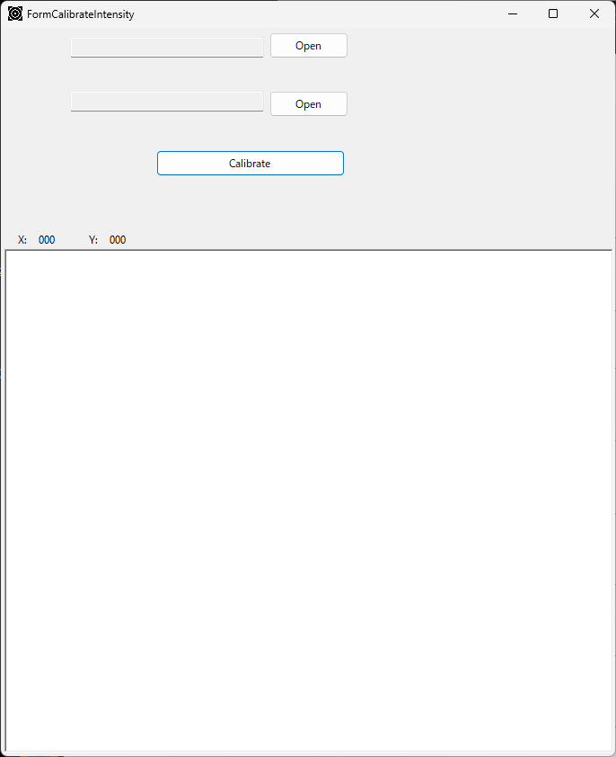

<!-- 261124Cl: Retranslated from en/3-tools.md (UI labels follow the localized GUI). -->

# 工具

本页介绍从主窗口右侧的竖向工具栏或菜单启动的各种辅助工具。使用参数校准和宏的具体步骤请参见[操作步骤](4-procedures.md)。

## 校准 R-AXIS 图像 (Calibrate Raxis Image)

通过 **工具 (Tool) → 校准 R-AXIS 图像 (Calibrate Raxis Image)** 打开。指定两幅尺寸相同的 R-AXIS IV `.stl` 图像，该工具会优化强度换算表，使两者的强度一致。换算表用控制点表示，优化过程中其各元素之和保持不变。结果以图表显示。例如可用于校准探测器的强度响应。

工具栏上的 **强度表 (Intensity table)** 按钮在当前版本中未分配功能。

## 自动流程 (Auto procedure)

监视文件夹、自动载入新图像并在载入后执行一系列操作的工具。

- **监视与自动载入**：监视指定的文件夹（包括子文件夹），并在文件写入完成后读取该文件。可按文件名筛选文件（编号匹配、关键字）。
- **自动执行**：按顺序执行 自动对比度 (Auto Contrast) → 查找中心 (Find Center) → 掩蔽斑点 (Mask Spots) → 获取图谱 (Get Profile) → Execute Macro 中已勾选的步骤。

这样就可以在实验中监视输出文件夹，并在每幅图像到达时自动进行积分。详情请参见[操作步骤](4-procedures.md)。

## 绘制环 (Draw Ring)

在图像上以指定的距离、角度或 d 值绘制圆环，并考虑 IP 倾斜和像素畸变。单击 **R (mm)** / **2θ (°)** / **d (Å)** 之一选择要编辑的值；其他值会根据波长和相机长度自动计算。

## 展开 (Unroll)

将以直射斑点为中心的极坐标衍射图像展开为直角坐标（横轴 = 散射角 2θ；纵轴 = 方位角）。现在不再使用专用窗口，而是通过工具栏的 **展开图像 (Unroll image)** 按钮和属性中的 **展开图像选项 (Unrolled Image Option)** 选项卡进行设置。展开使用与一维化相同的亚像素强度分配算法。

## 周向模糊 (Circumferential Blur)

沿圆周（方位角）方向模糊圆环图样的工具。指定一个模糊角度后应用。

## 序列图像 (Sequential Image)

用于处理多帧图像（NeXus (`.nxs`)、多页 TIFF 等；时间序列、温度序列、同步辐射能量扫描）的工具。

- 从帧列表中选择单帧进行显示，或用滑动条逐帧切换。
- 使用 **多选 (Multi selection)** 可选择多帧并计算其 **平均 (Average)** 或 **求和 (Summation)**。
- 一维化的对象可从“全部图像（忽略当前选择）/ 选中的图像 / 仅最上层图像”中选择。
- 若帧带有能量信息，选择该单帧时会更新波长。

## 保存图像 (Save Image)（IPA 格式）

校正 IP 倾斜 φ、τ 和像素畸变 ξ，并以指定分辨率保存为正方形像素的图像。相机长度、波长、中心位置等元数据也会一并写入，因此可以在保留几何信息的前提下将图像交给其他图像处理软件使用。

## 查找参数 (几何法) (Find Parameter (Geometric))

根据标准物质的衍射环优化波长、相机长度、像素尺寸、像素畸变和倾斜 (φ, τ) 的工具。它使用一幅标准样品图像（**主 (Primary)**），或在不同相机长度下拍摄的两幅图像（**主 (Primary)** 和 **次 (Secondary)**）；选择峰后用 **精修! (Refine!)** 进行优化。收敛情况（椭圆中心、残差）可在图表上确认。具体步骤请参见[操作步骤](4-procedures.md)。

## 查找参数 (穷举法) (Find Parameter (Brute force))

不使用梯度法，而是通过网格暴力搜索求出相机长度、中心位置、倾斜 (φ, τ) 以及可选的波长（默认关闭）的工具。它使用主窗口中载入的一幅标准样品图像。在几何法优化难以收敛时（例如圆环不完整或数据噪声大）十分有效。标准物质可从 Au / CeO₂ / LaB₆ / Al₂O₃ 中选择，或选择 **其他 (Other)** 并输入晶体。详细步骤请参见[查找参数（暴力搜索）](6-find-parameter.md)，工作流程请参见[操作步骤](4-procedures.md)。

## 宏 (Macro)

用类似 Python 的脚本自动执行操作的功能。从主窗口的 **宏 (Macro) → 编辑器 (Editor)** 菜单打开宏编辑器。

- 可以使用 `for` / `if` / `while` / `def` / `class`、算术运算以及 `math` 模块。
- 通过 `IPA.File` / `IPA.Wave` / `IPA.Detector` / `IPA.Profile` / `IPA.Sequential` / `IPA.Image` / `IPA.Mask` / `IPA.PDI` / `IPA.IntegralProperty` 等 API 可以调用各项操作。
- 打开 **显示示例 (Show samples)** 可查看只读的示例宏（基本循环、几何设置、批处理、方位角分割、掩蔽、发送到 PDIndexer 等）。可以通过单步执行检查变量。

完整的函数参考和示例请参见[宏](5-macro/index.md)，基于宏的工作流程请参见[操作步骤](4-procedures.md)。

