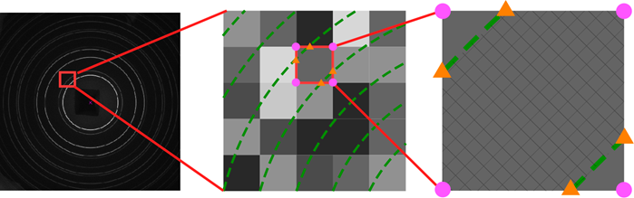

<!-- 261124Cl: Retranslated from en/appendix/a3-image-integration.md (UI labels follow the localized GUI). -->

# 附录 A3. 图像积分

将二维图像转换为一维谱线时，最大的问题是 **当积分的角度步长小于像素间距（像素尺寸）时，如何分配跨越多个步长的像素的强度**。IPAnalyzer 用 **基于面积的分配法** 处理这种分配。

---

## 基于面积的分配法

本软件计算划分各步长的分界线（等衍射角的边界）与像素的交点，求出每个像素落在某一步长内的 **面积**，并按该面积比例分配强度。

{width=680px}

该方法具有以下特点。

- 在每个像素内部，步长边界的圆弧 **近似为直线**。这是为了计算速度，实际上几乎不会造成问题。
- 当需要 [A1. 探测器几何](a1-geometry.md) 中的倾斜校正和像素形状校正时，像素形状并非严格的正方形。因此本软件 **逐一计算像素四个角的坐标**，并按四边形（一般为平行四边形）求出面积。

采用这种方案，原理上无论角度步长取得多细，像素强度都能平滑地分配到各个步长中。

---

## 适用范围

以下三种积分都使用同一种基于面积的分配算法。

| 功能 | 积分方向 | 用途 |
|------|-----------|------|
| **同心积分 (Concentric Integration)** | 衍射角（同心方向） | 生成通常的 $2\theta$-强度谱线。 |
| **径向积分 (Radial Integration)** | 圆周（方位角）方向 | 评价圆环的方位角依赖性（取向、畸变）。 |
| **展开图像 (Unrolled Image)** | 衍射角 × 方位角 | 生成将圆环切开展平的二维展开图像。 |

各功能的操作方法请参见 [3. 工具](../3-tools.md)。
