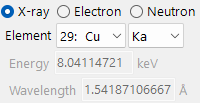

<!-- 261124Cl: Retranslated from en/appendix/a5-scattering-factor.md (UI labels follow the localized GUI). -->

# 附录 A5. 散射因子

**Scattering Factor**（散射因子）列出所选晶体的允许晶面（衍射），并计算每个衍射的 **结构因子** 和衍射强度。射线种类（X 射线、电子或中子）可以切换，因此可以在不同衍射方法之间比较同一晶体的结构因子。

在当前版本中，该列表位于晶体窗口中 **射束相互作用 (Beam interaction)** 的 **衍射 (Reflections)** 选项卡上（原子散射因子本身位于同一窗口的 **散射因子 (Scattering factors)** 选项卡上）。下文所述的界面和项目以以前的 Scattering Factor 窗口为准。

在 IPAnalyzer 中，该子窗口从 **Crystal window**（在 [4. 操作步骤](../4-procedures.md) 的几何校准和 [6. 查找参数（暴力搜索）](../6-find-parameter.md) 中使用的 CrystalControl）打开。

计算条件位于窗口上部，衍射列表位于下部。每当条件改变时，列表都会立即重新计算。

---

## 键盘与鼠标快捷操作

该窗口没有特殊的按键或鼠标组合。<kbd>F1</kbd> 打开本手册页面，**Copy to clipboard** 将整个衍射表导出为可粘贴到电子表格中的文本。

---

## Wave Length Control（波长控制）

- **X-ray / Electron / Neutron**：原子散射因子因入射束的种类而异，因此在此切换。
- 对于 **X-ray**，选择 **Element**（阳极材料）和特征谱线（Kα 等）后，会自动设置该特征 X 射线的波长。

- **Energy (keV)** 与 **Wavelength (Å)** 相互联动。
- 该能量或波长用于计算 2θ（衍射角）。对于 X 射线，也可以通过选择元素和谱线类型来设置。

---

## 显示与计算选项

- **粉末衍射强度（Bragg-Brentano 光路） (Powder Diffraction Intensities (Bragg-Brentano Optics))**：将相对强度计算为包含多重度和 Lorentz–偏振因子的粉末衍射 (Bragg–Brentano) 强度。关闭时显示结构因子强度。
- **隐藏等效晶面 (Hide equivalent planes)**：将晶体学上等效的晶面合并为一项。
- **隐藏禁戒晶面 (Hide prohibited planes)**：排除因消光规则而强度为零的晶面。
- **Unit (Å / nm)**：切换 d 间距等的长度单位。
- **d-Spacing Cutoff**：排除 d 间距小于该值的衍射。

---

## 衍射列表

每一行对应一个衍射（或一组对称等效晶面）。

| 列 | 含义 |
|------|------|
| **h, k, l** | Miller 指数 |
| **Multi.** | 多重度（对称等效晶面的数目） |
| **d (Å)** | 晶面间距 |
| **q (2π/d)** | 散射矢量的大小 |
| **2θ (°)** | 所选波长下的衍射角 |
| **F_real** | 结构因子的实部 |
| **F_inv** | 结构因子的虚部 |
| **\|F\|** | 结构因子振幅（$= \sqrt{F_\text{real}^2 + F_\text{inv}^2}$） |
| **F^2** | 结构因子强度（$\lvert F\rvert^2$） |
| **Rel. Int. (%)** | 相对强度，以最强衍射为 100 |

---

## Copy to Clipboard（复制到剪贴板）

**Copy to Clipboard** 将列表以可粘贴到 Excel 等电子表格中的文本形式复制到剪贴板。

---

## 另请参阅

- [附录首页](index.md)
- [4. 操作步骤](../4-procedures.md) —— 定义要计算结构因子的标准晶体。
- [6. 查找参数（暴力搜索）](../6-find-parameter.md)
