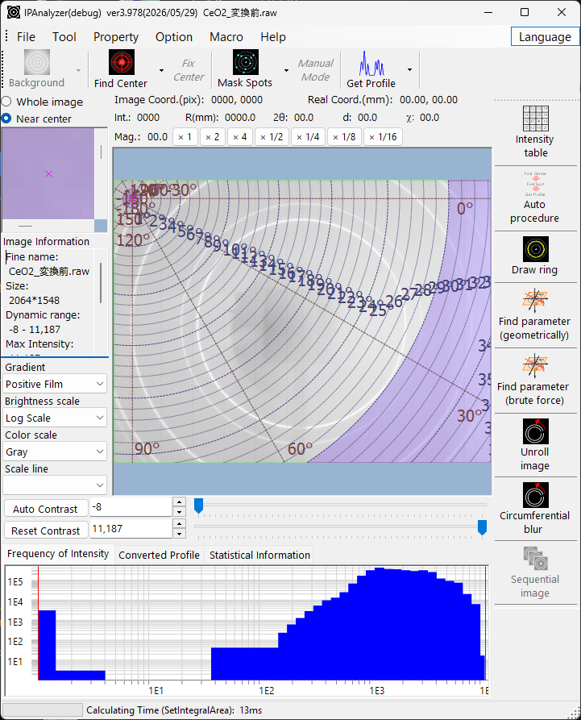

<!-- 261124Cl: Retranslated from en/1-main-window.md (UI labels follow the localized GUI). -->

# 主視窗

主視窗是啟動 IPAnalyzer 時最先顯示的畫面。它集中了已載入繞射影像的顯示、主要操作（尋找中心、遮蔽斑點、一維化），以及偵測器參數設定的入口。

視窗大致由上方的選單與工具列、中央的影像顯示區、右側的垂直工具列，以及下方的圖表區所構成。

## 中央畫面

### 影像顯示

此處顯示已載入的影像。影像上方會依滑鼠指標的位置，顯示實際座標 (mm)、影像座標 (pix)、與中心的距離 R (mm)、散射角 2θ、d 值、方位角 χ 與強度。洋紅色的 × 記號表示直射點（中心）位置。

像素的狀態以不同顏色區分顯示。

| 顏色 | 意義 |
| --- | --- |
| 青色 | 已遮罩的斑點 |
| 綠色 | 排除於積分之外的區域（在積分區域 (Integral Region) 中設定） |
| 洋紅色 | 排除於積分之外的角度區域（在積分性質 (Integral Property) 中設定） |
| 藍色 | 低於強度閾值的像素（在積分區域中設定） |
| 紅色 | 高於強度閾值的像素 |

### 滑鼠操作

一般模式下：

- 左鍵雙擊：將中心位置更新為點選的位置。
- 中鍵點選：以點選的位置為起點搜尋中心。
- 右鍵拖曳：放大拖曳的區域。
- 右鍵點選：縮小顯示。
- Ctrl + 右鍵拖曳：選取用於統計資訊的矩形區域。

左鍵雙擊與中鍵點選僅在 **固定中心 (Fix Center)** 關閉時有效。

在 **手動模式 (Manual Mode)** 下，左鍵點選為遮罩、右鍵點選為取消遮罩。遮罩的形狀與大小在工具列及屬性中設定。

### 輔助畫面與影像資訊

中央畫面旁有輔助顯示。可在 **整張影像 (Whole image)** 與 **中心附近 (Near center)** 之間切換：整張影像會以黃色框標示目前的顯示範圍，中心附近則顯示放大的影像。

**影像資訊 (Image Information)** 會顯示影像解析度、最大強度、總強度、標頭資料等。

### 顯示調整控制項

用來調整影像外觀的控制項：

- **漸層 (Gradient)**：反轉色調。
- **亮度刻度 (Brightness scale)**：對數 / 線性。
- **色階 (Color scale)**：灰階 / 彩色。
- **比例尺線 (Scale line)**：比例尺線的顯示（無 / 粗 / 中 / 細）。
- **自動對比 (Auto Contrast)** / **重設對比 (Reset Contrast)**，以及明確指定最小／最大強度。
- 放大倍率按鈕（×1, ×2, ×4, ×1/2, ×1/4, ×1/8, ×1/16）。

## 下方畫面

下方區域有三個以分頁切換的圖表／檢視。

- **強度頻率 (Frequency of Intensity)**：以雙對數座標顯示所有像素的強度分布。可用滑鼠縮放。
- **轉換後圖譜 (Converted Profile)**：顯示由 **取得圖譜 (Get Profile)** 產生的繞射曲線。可用滑鼠縮放。
- **統計資訊 (Statistical Information)**：顯示在影像上以 Ctrl + 右鍵拖曳所選取之矩形區域 (X1,Y1)–(X2,Y2) 的統計量。載入連續影像時，也可比較其他影格中相同區域的統計。

## 選單

選單列由 **檔案 (File) / 工具 (Tool) / 性質 (Property) / 選項 (Option) / 語言 (Language) / 巨集 (Macro) / 說明 (Help)** 構成。

### 檔案 (File)

- **讀取影像 (Read image)**：開啟繞射影像。支援的格式請參見[概觀](0-overview.md)。
- **儲存影像 (Save image)**：以 TIFF、PNG、CSV 或 IPA 格式儲存。TIFF 會儲存目前處理後的像素強度（套用翻轉／旋轉、背景扣除與偏振校正之後的值），PNG 會保留顯示狀態（亮度、對比、遮罩），IPA 則是經畸變校正的原生格式（含中繼資料）。
- **讀取參數 / 儲存參數 (Read / Save parameter)**：以 `.prm` 檔案匯入／匯出波長、相機長度、像素尺寸、傾斜校正、中心位置等。
- **讀取遮罩 / 儲存遮罩 / 清除遮罩 (Read / Save / Clear mask)**：以 `.mas` 檔案匯入／匯出遮罩，或將其清除（遮罩必須與目前影像的解析度相同）。
- **關閉 (Close)**。

影像、參數與遮罩檔案也可以拖放到視窗上載入。

### 工具 (Tool)

- **重設頻率圖譜 (Reset Frequency Profile)**：以預設範圍重建目前影像的強度頻率圖表（影像保持不變）。
- **校正 R-AXIS 影像 (Calibrate Raxis Image)**：從兩張 R-AXIS 影像求出強度轉換表（參見[工具](3-tools.md)）。

### 性質 (Property)

波源 (Wave Source) / 成像板條件 (Imaging Plate Condition) / 積分區域 (Integral Region) / 積分性質 (Integral Property) / 手動遮罩模式 (Manual Mask Mode) / 「取得圖譜」之後 (After "Get Profile") / 展開影像選項 (Unrolled Image Option) / 其他 (Miscellaneous)。這些項目會直接開啟[屬性視窗](2-property-windows.md)中對應的分頁。

### 選項 (Option)

- **工具提示 (ToolTip)**：切換按鈕與選單的工具提示顯示。
- **翻轉 (Flip)**：水平 (Horizontally) / 垂直 (Vertically)。**旋轉 (Rotate)**：選擇旋轉角度。翻轉與旋轉會套用到作業中的影像資料，因此也會影響之後的積分與影像儲存（磁碟上的原始檔案不會變更）。
- **清除登錄檔 (Clear registry)**：用於疑難排解的項目，會清除已儲存的設定。**Ngen 編譯 (Ngen Compile)** 在目前版本中沒有作用。

### 語言 (Language)

- 選擇顯示語言（11 種語言）。確認後應用程式會重新啟動。此設定會儲存在登錄檔中。

### 巨集 (Macro)

- **編輯器 (Editor)**：開啟巨集編輯器（參見[工具](3-tools.md) / [巨集](5-macro/index.md)）。

### 說明 (Help)

- **程式更新 (Program Updates)**、**提示 (Hint)**、**授權 (License)**、**版本歷程 (Version History)**、**說明 (Help)**（開啟隨附的 PDF 手冊）。
- 在任何視窗中按 **F1**，即可開啟本線上手冊的對應頁面。

## 操作工具列

主要的影像處理操作（下拉選單中有詳細選項）：

- **背景 (Background)**：此按鈕在目前版本中無作用。背景影像的扣除請在屬性視窗的 **背景選項 (Background Option)** 分頁中設定。
- **尋找中心 (Find Center)**：以二維 Pseudo-Voigt 擬合偵測束流中心（搜尋範圍預設為中心周圍 ±8 px，在 **其他項目 (Miscellaneous)** 分頁中設定）。若以 **繪製環 (Draw ring)** 顯示圓環，則改為依據該圓環決定中心。
- **固定中心 (Fix Center)**：固定中心位置。
- **遮罩斑點 (Mask Spots)**：在每個徑向環帶內，將強度超過「平均值 + 標準差 × Deviation」的像素偵測為斑點，並連同其周圍一併遮罩。下拉選單中包含全部遮罩、反轉遮罩、手動等功能。
- **手動模式 (Manual Mode)**：手動遮罩模式。可選擇遮罩形狀（斑點（圓形／矩形）／圓形／矩形／多邊形／雲線 (spline)）與斑點大小（半寬）。
- **取得圖譜 (Get Profile)**：將影像積分為一維曲線。支援 Concentric（以 2θ 為基準）與 Radial（以方位角為基準）。下拉選單可設定積分性質／積分區域 (Integral Property/Region) 的選擇、積分前是否尋找中心與遮罩斑點、傳送至 PDIndexer、方位角分割分析、連續影像處理等。

## 工具列（其他工具）

右側的垂直工具列可啟動各種工具。詳細內容請參見[工具](3-tools.md)。

- **強度表格 (Intensity table)**（目前版本中此按鈕未指派任何功能；R-AXIS 強度校正請使用 **工具 (Tool) → 校正 R-AXIS 影像 (Calibrate Raxis Image)**）
- **自動程序 (Auto procedure)**
- **繪製環 (Draw ring)**
- **尋找參數 (幾何法) (Find parameter (geometrically))** / **尋找參數 (暴力法) (Find parameter (brute force))**
- **展開影像 (Unroll image)**
- **周向模糊 (Circumferential blur)**
- **連續影像 (Sequential image)**
