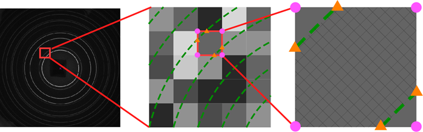

<!-- 261124Cl: Retranslated from en/appendix/a3-image-integration.md (UI labels follow the localized GUI). -->

# 附錄 A3. 影像積分

將二維影像轉換為一維曲線時，最大的問題在於 **當積分的角度步進小於像素間隔（像素尺寸）時，如何分配跨越數個步進之像素的強度**。IPAnalyzer 以 **面積分配法** 處理此分配。

---

## 面積分配法

本軟體會計算劃分各步進的直線（等繞射角的邊界）與像素之間的交點，求出各像素落在某一步進內的 **面積**，並依該面積的比例分配強度。

{width=680px}

此方法具有下列特點。

- 在每個像素內，步進邊界的圓弧 **以直線近似**。這是為了計算速度，在實務上幾乎不會造成問題。
- 需要 [A1. 偵測器幾何](a1-geometry.md) 中的傾斜校正與像素形狀校正時，像素形狀並非嚴格的正方形。因此本軟體會 **依序計算像素四個角的座標**，以四邊形（一般而言為平行四邊形）求出面積。

藉由此方式，原則上不論角度步進設得多細，像素強度都能平滑地分配至各步進。

---

## 適用範圍

下列三種積分都使用相同的面積分配演算法。

| 功能 | 積分方向 | 用途 |
|------|-----------|------|
| **同心積分 (Concentric Integration)** | 繞射角（同心方向） | 製作一般的 $2\theta$-強度曲線。 |
| **徑向積分 (Radial Integration)** | 圓周（方位角）方向 | 評估圓環的方位角相依性（配向、應變）。 |
| **Unrolled Image** | 繞射角 × 方位角 | 製作將圓環切開的二維展開影像。 |

各功能的操作方式請參見 [3. 工具](../3-tools.md)。
